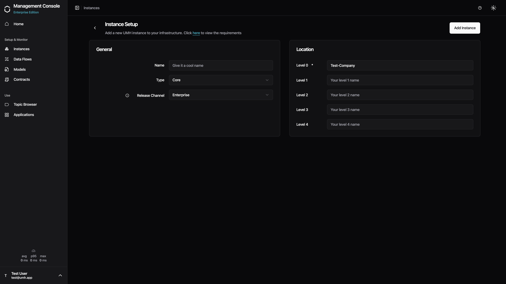

# Step 1: Install UMH Core

**60 seconds — that's all it takes to launch UMH Core.**

No kubectl, no Kubernetes setup, just a single Docker container. Almost anything that runs Docker works — from your MacBook to enterprise edge boxes.

> **Note:** This getting-started guide follows the common PLC/sensor path (raw → device models). For ERP integration and other patterns, see the [Data Modeling documentation](../usage/data-modeling/).

## System requirements

**Minimum:**

* 2 vCPU
* 4 GB RAM
* 40 GB SSD

**Architecture:**

* x86_64 (Intel/AMD 64-bit)
* ARM64 (64-bit ARM, but NOT Raspberry Pi - Redpanda requires 48-bit virtual address space)

**CPU health reporting (early access):**

UMH Core runs on any of the above. Its CPU pressure signal also needs Linux pressure stats (PSI) and cgroup v2. The Red Hat family (RHEL, Rocky, AlmaLinux, Oracle Linux) ships PSI off, and version 8 of each also boots cgroup v1. Without them CPU health still reports from throttling, steal and headroom, and an instance with no CPU limit reports limited visibility. [CPU Health](../usage/instances/cpu-health/README.md) covers how to check, how to switch them on, and which flag enables this reporting.

For detailed sizing recommendations, see the [Sizing Guide](../production/sizing-guide.md).

## Installation using the Management Console

1. **Sign up** at [management.umh.app](https://management.umh.app)
2. Click **"Add a new instance"**



3. **Configure your instance:**
   - **Name** (1): Give it a cool name (e.g., `my-first-umh`)
   - **Type** (2): Select "Core" from the dropdown
   - **Location** (3): Enter your location path:
     - **Level 0**: `your-company` (required - your enterprise name)
     - **Level 1**: `Your level 1 name` (optional - e.g., site or plant)
     - **Level 2-4**: Leave empty for now (optional)
   - Click **"Add Instance"** (4)

4. **Copy the Docker command** that appears
5. **Run it** on any machine with Docker installed

## 🎉 Success!

Your instance will appear as **"Online"** in the Management Console within seconds.

**Next step:** [Connect your first data source →](1-connect-data.md)

---

## Troubleshooting

**Volume permission errors**
Named volumes automatically handle permissions for the container user (UID 1000). If you still see permission errors like `s6-svscan: warning: unable to stat benthos-dataflow-*`, try removing the container and recreating the volume:

```bash
docker rm -f umh-core && docker volume rm umh-core-data && docker volume create umh-core-data
```

Then re-run the `docker run` command.

For advanced users needing bind mounts (custom data locations), see the [Container Layout reference](../reference/container-layout.md#advanced-custom-data-location).

**Instance stays offline behind a corporate firewall**
If your network needs a proxy or inspects TLS traffic, see [Instance Stays Offline Behind a Corporate Firewall](../usage/instances/communicator/instance-offline-behind-corporate-firewall.md).

---

## Coming from UMH Classic?

See the [Migration Guide](../production/migration-from-classic.md) for step-by-step migration instructions, including data contract changes and configuration updates.

---

## Concepts Learned

- **UMH Core** - Single-container Industrial IoT platform
- **Management Console** - Cloud UI for managing instances
- **Instance** - A running UMH Core deployment
- **Location hierarchy** - Organizational structure (enterprise → site → area → line)
- **Docker container** - How UMH Core runs

## Ready to Connect Data?

**You've successfully installed UMH Core!** 🚀

**Next step:** [Connect your first data source →](1-connect-data.md)
