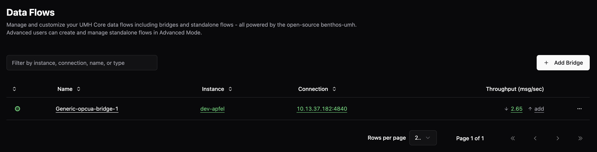
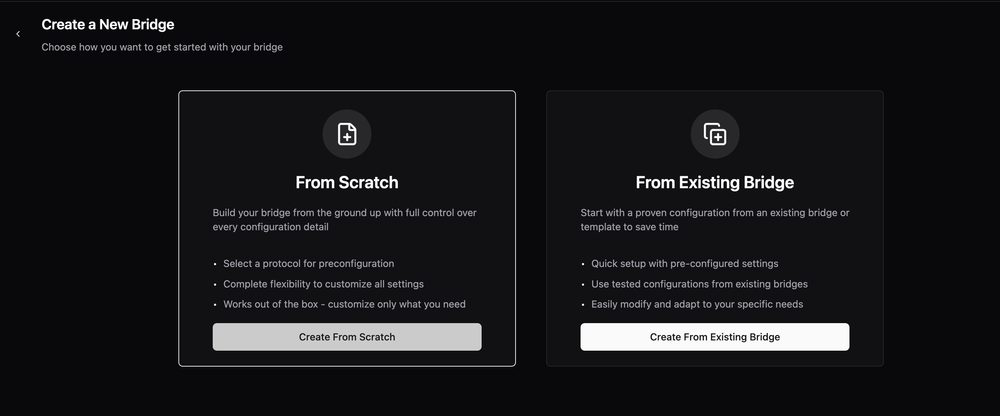
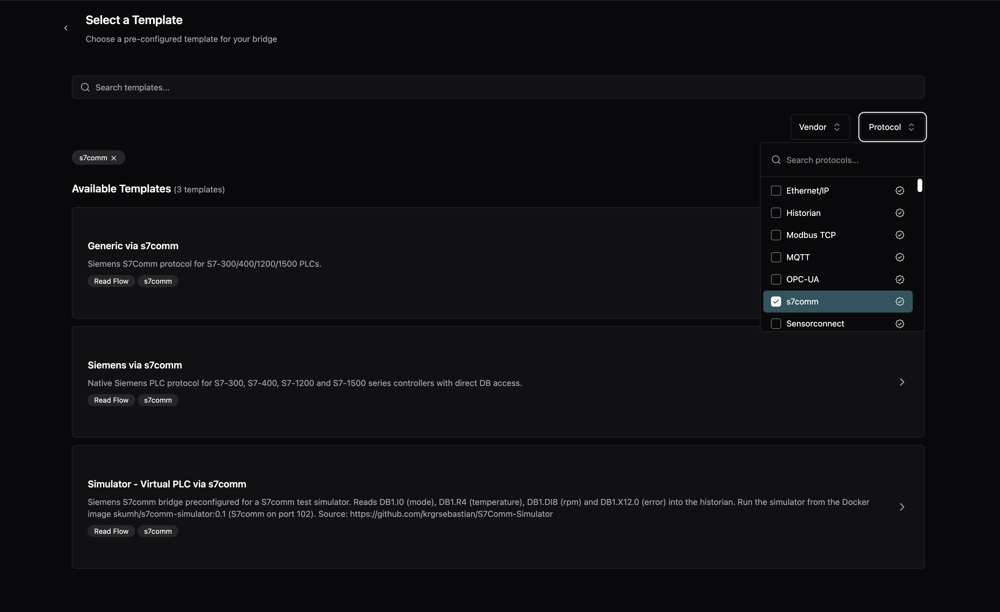
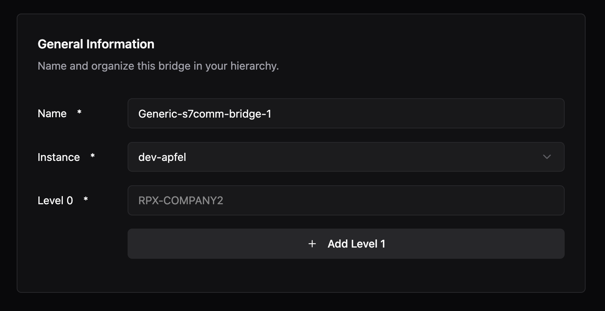
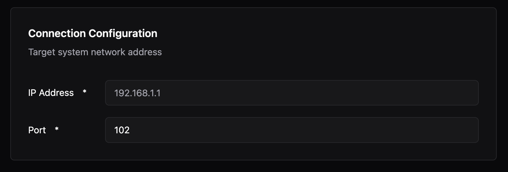
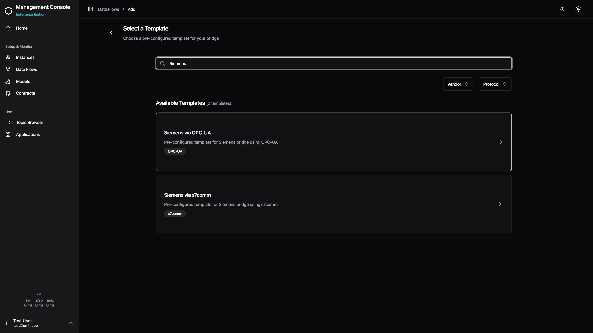
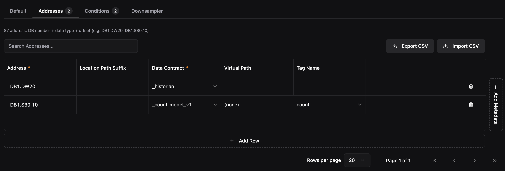
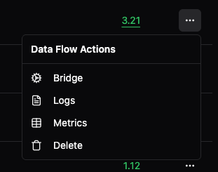
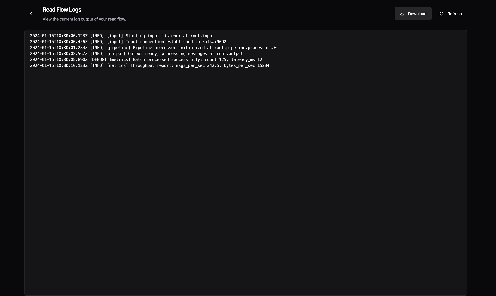
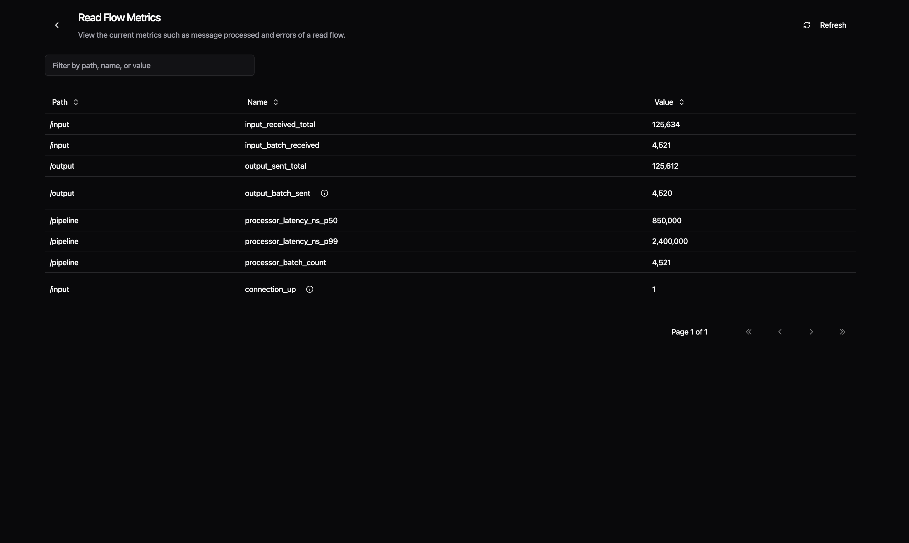

# Bridges

> **Prerequisite:** Understand [Data Flow concepts](README.md) and complete the [Getting Started guide](../../getting-started/).

Bridges move data into and out of the Unified Namespace, providing connection monitoring and automatic data organization. While read flows work with any protocol, write flows are not yet implemented - use [stand-alone flows](stand-alone-flow.md) for writing to external systems.

> **New to UMH?** This page is the reference for setting up real bridges. If you just want to get mock data flowing and learn the basics first, start with [Step 2: Connect Your First Data Source](../../getting-started/1-connect-data.md).

## UI Capabilities

| Action | Available | Notes |
|--------|-----------|-------|
| Create bridges | ✅ | Visual protocol configuration |
| Create from existing bridge | ✅ | Copy a healthy bridge's configuration |
| Start from a template | ✅ | 84 pre-configured templates, filtered by vendor and protocol |
| Select protocols | ✅ | OPC UA, Modbus, S7, MQTT, 50+ more |
| Configure location path | ✅ | ISA-95 levels (0-4) |
| Map addresses to topics | ✅ | Dropdown of data model fields for custom data contracts |
| Monitor connection health | ✅ | Real-time status |
| View logs | ✅ | Live log streaming |
| View metrics | ✅ | Throughput monitoring |
| Edit bridges | ✅ | Modify and redeploy |
| Delete bridges | ✅ | Clean removal |
| Advanced mode | ✅ | Direct YAML editing |

## Creating a Bridge (UI)

### Step 1: Navigate to Data Flows

Go to **Data Flows** and click **Add Bridge**:



### Step 2: Choose How to Start



- **From Scratch**: start from a pre-configured protocol template, which is functional out of the box, or customize the template to fit your needs.
- **From Existing Bridge**: pick a healthy bridge from any instance and start with a copy of its configuration. Adapt the bridges name, connection, and addresses.

The remaining steps describe the from-scratch path. Starting from an existing bridge skips the template list and lands on the same screens with the fields already filled in.

### Step 3: Select a Template



Templates carry a working protocol configuration. Search by name, or narrow the list with the **Vendor** and **Protocol** filters.

Behind the templates we support **50+ industrial protocols** through [Benthos-UMH](https://docs.umh.app/benthos-umh/input) plus everything from [Redpanda Connect](https://docs.redpanda.com/redpanda-connect/components/inputs/about/):

Common industrial protocols:
- **Modbus**: For PLCs and RTUs
- **OPC UA**: For industrial servers
- **S7**: For Siemens PLCs
- **Ethernet/IP**: For Allen-Bradley
- **And many more**: See full list at [Benthos-UMH Inputs](https://docs.umh.app/benthos-umh/input)

### Step 4: Configure General Settings

Fill in the basic information and proceed with Step 5.



**General Information:**
- **Name**: Unique identifier for your bridge
- **Instance**: Select your UMH instance
- **Level**: Location path (e.g., enterprise → site → area → line → machine)



**Connection:**
- **IP Address**: Device IP (becomes `{{ .IP }}` variable)
- **Port**: Connection port (becomes `{{ .PORT }}` variable)

The protocol itself needs no selection here. It comes from the template you picked in Step 3, and the **Read** tab opens on that protocol's settings.

### Step 5: Configure Protocol Settings

Each protocol has specific settings. For example, S7:



### Step 6: Map Addresses

Each row in the address mapping table becomes one UNS topic: the protocol address, followed by the data contract, virtual path, and tag name that build the topic.



With `_historian` or `_raw`, Virtual Path and Tag Name are free-text fields. Selecting a custom data contract merges both columns into a single dropdown listing every field the contract's [data model](../data-modeling/data-models.md) defines, so you pick a valid path instead of typing one. A value the model rejects, for example after switching contracts, stays in the row, is flagged red, and blocks deploy until you correct it. Contracts whose data model references other models keep free-text input.

### Step 7: Deploy

Click **Save & Deploy**. The bridge will start connecting to your device.

## Managing Bridges

### View Status

The main view shows all bridges with connection status and throughput:


- **Green dot**: Connected and running
- **Yellow dot**: Starting or warning state
- **Grey dot**: Intermediate states (starting, stopping, or stuck in starting state)

### Context Menu

Right-click any bridge for quick actions:



### View Logs

Monitor bridge activity in real-time:



### View Metrics

Track performance and throughput:



### Enable Debug Logging

When troubleshooting connection or data issues, enable debug logging in your bridge configuration:

**Via YAML:**
```yaml
protocolConverter:
  - name: my-plc-bridge
    debug_level: true  # Enable detailed logging
    protocolConverterServiceConfig:
      config:
```

Debug logging provides:
- Detailed protocol communication logs
- Connection state transitions
- Data parsing details
- For OPC UA: Sets `OPC_DEBUG` environment variable for protocol-level debugging

**Remember to disable debug logging** after troubleshooting - it generates significantly more log data.

To view debug logs, go to the bridge and select **Logs**.

## Important: Data Types from Different Protocols

**Industrial protocols (OPC UA, Modbus, S7) only provide time-series data** - snapshots of values at points in time. They cannot directly provide relational records.

**IT protocols (MQTT, HTTP, Kafka) can provide relational data** - when you select "relational" as the data type in the UI, the bridge automatically uses [`nodered_js` processor](https://docs.umh.app/benthos-umh/processing/node-red-javascript-processor) to handle complex business records like work orders or batch reports.

For converting time-series to relational data, see [Stream Processors](stream-processor.md#time-series-to-relational-challenges) or use [Stand-alone Flows](stand-alone-flow.md) with state management.

## Configuration (YAML)

Advanced users can edit the YAML directly:

```yaml
protocolConverter:
  - name: my-plc-bridge
    desiredState: active
    debug_level: false
    protocolConverterServiceConfig:
      location:
        2: "production-line"
        3: "plc-01"
      config:
        connection:
          nmap:
            target: "{{ .IP }}"
            port: "{{ .PORT }}"
        dataflowcomponent_read:
          benthos:
            input:
              s7comm:
                addresses:
                  - DB1.DW20
                  - DB3.I270
                tcpDevice: "{{ .IP }}"
                rack: 0
                slot: 1
            pipeline:
              processors:
                - tag_processor:
                    defaults: |
                      msg.meta.location_path = "{{ .location_path }}";
                      msg.meta.data_contract = "_raw";
                      msg.meta.tag_name = msg.meta.s7_address;
                      return msg;
            output:
              uns: {}
      variables:
        IP: "192.168.1.100"
        PORT: "102"
```

### Key Configuration Elements

**Location Path:**
```yaml
location:
  0: enterprise   # Optional: inherits from agent
  1: site        # Optional: inherits from agent
  2: area        # Required: your addition
  3: line        # Required: your addition
  4: cell        # Optional: further subdivision
```

**Template Variables:**
```yaml
variables:
  IP: "192.168.1.100"      # Available as {{ .IP }}
  PORT: "502"              # Available as {{ .PORT }}
  SCAN_RATE: "1s"          # Custom variable {{ .SCAN_RATE }}
```

**Connection Monitoring:**
```yaml
connection:
  nmap:
    target: "{{ .IP }}"    # Uses IP variable
    port: "{{ .PORT }}"    # Uses PORT variable
```

## Metrics

A bridge reports its metrics in two places. [Metrics](../instances/agent/metrics.md) explains how to read them.

The Management Console shows each bridge's message counts. Open the bridge and select **Metrics** (see [View Metrics](#view-metrics)). The view shows messages received and sent, errors, connection status and latency for the bridge's input, processors and output. Port 8080, umh-core's Prometheus endpoint, does not carry per-bridge message counts.

Port 8080 carries the bridge's state and error counts. The bridge runs on FSMv1, the older of umh-core's two frameworks. A framework is the part of umh-core that starts and watches components. [Which framework runs a component](../instances/agent/metrics.md#which-framework-runs-a-component) explains both. The bridge gets the series described in [FSMv1 metrics](../instances/agent/metrics.md#fsmv1-metrics). For a bridge named `mixing-station`, the series carry these labels:

| Part of the bridge | `component` | `instance` |
|---|---|---|
| The bridge | `protocol_converter_instance` | `mixing-station` |
| Its connection | `connection_instance` | `protocolconverter-mixing-station` |
| Its read flow | `dataflow_component_instance` | `read-protocolconverter-mixing-station` |
| Its write flow | `dataflow_component_instance` | `write-protocolconverter-mixing-station` |
| The Benthos process of its read flow | `benthos_instance` | `dataflow-read-protocolconverter-mixing-station` |
| The Benthos process of its write flow | `benthos_instance` | `dataflow-write-protocolconverter-mixing-station` |

Benthos is the engine that moves the data. The connection reports errors and reconcile time, but no state. Prometheus can rename the `instance` label to `exported_instance`. [Read the metrics](../instances/agent/metrics.md#read-the-metrics) explains when.

For the bridge itself, `umh_core_service_current_state` reads 3 when active, 4 when idle and 0 when stopped. -1 means the bridge is in a sub-state: one of the starting, degraded or stopping steps, such as `starting_connection` or `degraded_dfc`. Check the state in the Management Console.

### Connection Check

Before umh-core starts a bridge, it checks that the device's host and port answer. This connection check runs on FSMv2 by default. To run it on FSMv1 instead, set the environment variable `NMAP_BACKEND=fsmv1` on the container, for example with `-e NMAP_BACKEND=fsmv1` on `docker run`. umh-core reads the variable once at startup.

When the device stops answering, the bridge's own state changes. It stays in `starting_connection` if it has not started yet. It moves to `degraded_connection` if it was already running. Both read -1 on `umh_core_service_current_state`.

#### FSMv2 (default)

The connection check's series carry this `hierarchy_path` label, with `<bridge>` replaced by the bridge name:

```
application-fsmv2(application)/connection-protocolconverter-<bridge>-001(nmap)
```

| Name | Type | Reports |
|---|---|---|
| `umh_fsmv2_state_duration_seconds` | gauge | Seconds the check has spent in its current state, in the `state` label. |
| `umh_fsmv2_state_transitions_total` | counter | Changes between states, with `from_state` and `to_state` labels. |

The `state` label reads `running` whether the port answers or not. It reads `degraded` only until the first check completes. To see whether the device answers, read the bridge's state.

The check also gets the standard series every FSMv2 component gets, such as `umh_fsmv2_reconciliation_total`. [FSMv2 metrics](../instances/agent/metrics.md#fsmv2-metrics) lists them. It has no `umh_fsmv2_worker_*` series.

#### FSMv1 (with `NMAP_BACKEND=fsmv1`)

| `component` | `instance` |
|---|---|
| `nmap_instance` | `connection-protocolconverter-<bridge>` |

`umh_core_service_current_state` reads -1 while the port is open. An open port is the healthy case. The gauge also reads -1 when the port is closed or filtered. To see whether the device answers, read the bridge's state.

## Next Steps

- Try the [Getting Started guide](../../getting-started/) to connect your first device
- Learn about [Data Models](../data-modeling/data-models.md) to structure your data
- Explore [Metadata and Tracing](../unified-namespace/metadata-and-tracing.md) for debugging
- Use [Stand-alone Flows](stand-alone-flow.md) for custom processing
- Configure [Stream Processors](stream-processor.md) to transform data
