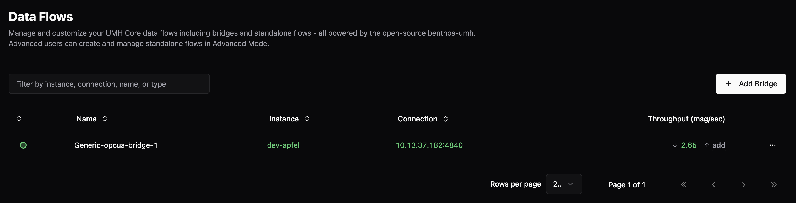
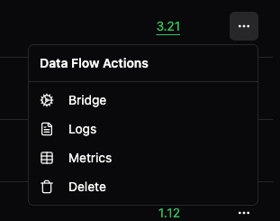
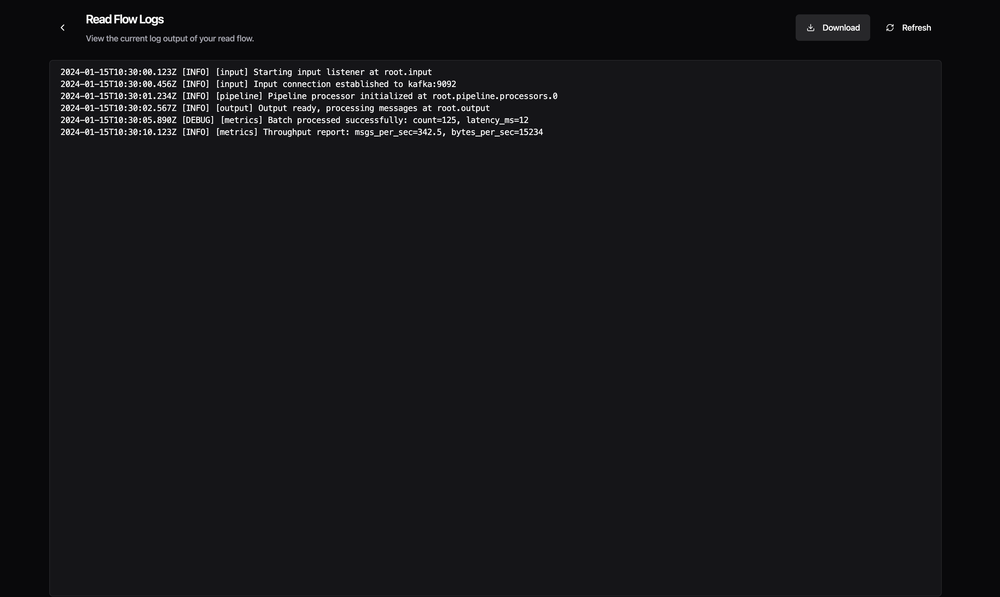
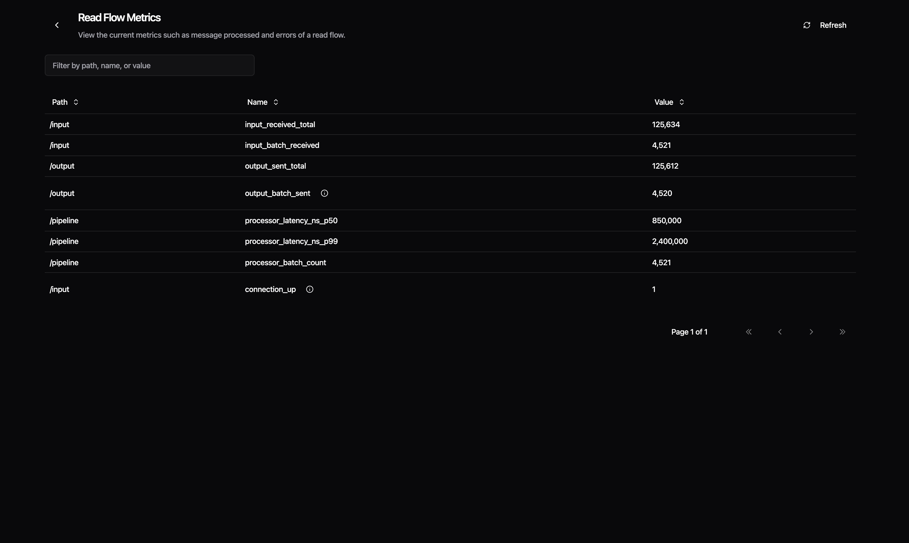

# Bridges

> **Prerequisite:** Understand [Data Flow concepts](README.md) and complete the [Getting Started guide](../../getting-started/).

A bridge (UI: "Bridges", YAML: `protocolConverter:`) connects the Unified Namespace (UNS) to one external system, such as an OPC UA server, a Siemens S7 or a Modbus controller. Its read flow reads from the external system and publishes to the UNS. Its write flow subscribes to UNS topics and writes to the external system.

It combines a **connection probe**, a **read flow** and a **write flow** under a single name and lifecycle. [Connection Probe](connection-probe.md) and [Read Flow](read-flow.md) describe the parts. To create a bridge, see [Create a bridge](create-a-bridge.md).

## UI Capabilities

| Action | Available | Notes |
|--------|-----------|-------|
| Create bridges | ✅ | Visual protocol configuration |
| Create from existing bridge | ✅ | Copy a healthy bridge's configuration |
| Start from a template | ✅ | 84 pre-configured templates, filtered by vendor and protocol |
| Select protocols | ✅ | OPC UA, Modbus, S7, MQTT, 50+ more |
| Configure location path | ✅ | ISA-95 levels (0-4) |
| Map addresses to topics | ✅ | Dropdown of data model fields for custom data contracts |
| Monitor connection health | ✅ | Real-time status |
| View logs | ✅ | Live log streaming |
| View metrics | ✅ | Throughput monitoring |
| Edit bridges | ✅ | Modify and redeploy |
| Delete bridges | ✅ | Clean removal |
| Advanced mode | ✅ | Direct YAML editing |

## Managing Bridges

### View Status

The main view shows all bridges with connection status and throughput:



- **Green dot**: Connected and running
- **Yellow dot**: Starting or warning state
- **Grey dot**: Intermediate states (starting, stopping, or stuck in starting state)

A bridge can be saved without a read flow or a write flow. Once its connection is up and Redpanda is healthy, it waits until you add a flow. Its status shows **Not Configured**, and **Technical Details** shows the state `starting_failed_dfc_missing`. The bridge starts once you add a flow.

### Context Menu

Right-click any bridge for quick actions:



### View Logs

Monitor bridge activity in real-time:



### View Metrics

Track performance and throughput:



### Enable Debug Logging

When troubleshooting connection or data issues, enable debug logging in your bridge configuration:

**Via YAML:**
```yaml
protocolConverter:
  - name: my-plc-bridge
    debug_level: true  # Enable detailed logging
    protocolConverterServiceConfig:
      config:
```

Debug logging provides:
- Detailed protocol communication logs
- Connection state transitions
- Data parsing details
- For OPC UA: Sets `OPC_DEBUG` environment variable for protocol-level debugging

**Remember to disable debug logging** after troubleshooting - it generates significantly more log data.

To view debug logs, go to the bridge and select **Logs**.

## Important: Data Types from Different Protocols

**Industrial protocols (OPC UA, Modbus, S7) only provide time-series data** - snapshots of values at points in time. They cannot directly provide relational records.

**IT protocols (MQTT, HTTP, Kafka) can provide relational data** - when you select "relational" as the data type in the UI, the bridge automatically uses [`nodered_js` processor](https://docs.umh.app/benthos-umh/processing/node-red-javascript-processor) to handle complex business records like work orders or batch reports.

For converting time-series to relational data, see [Stream Processors](stream-processor.md) or use [Stand-alone Flows](stand-alone-flow.md).

## Reference

### Configuration

Advanced users can edit the YAML directly. [Connection Probe](connection-probe.md#configuration) describes the `connection` key, and [Read Flow](read-flow.md#configuration) describes the `dataflowcomponent_read` key.

```yaml
protocolConverter:
  - name: my-plc-bridge
    desiredState: active
    debug_level: false
    protocolConverterServiceConfig:
      location:
        2: "production-line"
        3: "plc-01"
      config:
        connection:
          nmap:
            target: "{{ .IP }}"
            port: "{{ .PORT }}"
        # dataflowcomponent_read: the read flow, see Read Flow
      variables:
        IP: "192.168.1.100"
        PORT: "102"
```

| Field | Description |
|---|---|
| `name` | Unique name of the bridge |
| `desiredState` | `active` to run immediately, or `stopped` to keep it defined but off. |
| `debug_level` | Enable verbose logging for troubleshooting. When `true`, enables DEBUG log level and protocol-specific debugging (e.g., general OPC UA debug logging via the `OPC_DEBUG=debug` environment variable, detailed connection diagnostics). When `false` (default), uses INFO log level. **Use only for troubleshooting** - debug logging generates significantly more log data and may impact performance. Disable after resolving issues. |
| `protocolConverterServiceConfig.location` | The bridge's levels. The instance location (`agent.location`) plus these levels is the bridge location. Optional, but useful to identify per-machine data. |
| `protocolConverterServiceConfig.config.dataflowcomponent_write` | Write flow: subscribes to UNS topics and writes to the external system, set with `source`, `processing` and `destination`. |
| `protocolConverterServiceConfig.variables` | Optional Go-template variables, referenced via `{{ .VARNAME }}` in the template. See [Template Variables Reference](../../reference/variables.md#user-defined-variables) for details. |

**Location Path:**
```yaml
location:
  2: area   # the bridge's levels; assumes agent.location sets levels 0 and 1
  3: line
  4: cell
```

The bridge location is the instance location (`agent.location`) plus the levels set here. The bridge's levels extend the instance location and never overwrite a level that the instance location sets. Any missing level up to the highest one becomes `unknown`.

**Template Variables:**
```yaml
variables:
  IP: "192.168.1.100"      # Available as {{ .IP }}
  PORT: "502"              # Available as {{ .PORT }}
  SCAN_RATE: "1s"          # Custom variable {{ .SCAN_RATE }}
```

### Metrics

The Management Console shows each bridge's message counts. Open the bridge and select **Metrics** (see [View Metrics](#view-metrics)). The view shows messages received and sent, errors, connection status and latency for the bridge's input, processors and output. Port 8080, umh-core's Prometheus endpoint, does not carry per-bridge message counts. It carries the bridge's state and error counts. [Metrics](../instances/agent/metrics.md) explains how to read them, which framework runs bridges and what the labels and the state values mean.

Bridges run on FSMv1 and use the standard [FSMv1 metrics](../instances/agent/metrics.md#fsmv1-metrics). For a bridge named `mixing-station`, the series carry these labels. The labels of the connection are in [Connection Probe](connection-probe.md#metrics), and the labels of the read flow are in [Read Flow](read-flow.md#metrics).

| Part of the bridge | `component` | `instance` |
|---|---|---|
| The bridge | `protocol_converter_instance` | `mixing-station` |
| Its write flow | `dataflow_component_instance` | `write-protocolconverter-mixing-station` |
| The Benthos process of its write flow | `benthos_instance` | `dataflow-write-protocolconverter-mixing-station` |

To alert when a bridge has not been active for 5 minutes, use this rule with `for: 5m`. In Prometheus, write `exported_instance` for `instance`, or keep `instance` if the scrape job sets `honor_labels: true`:

```promql
umh_core_service_current_state{component="protocol_converter_instance"} != 3 != 4 != 0
```

For the bridge itself, `umh_core_service_current_state` reads 3 when active, 4 when idle and 0 when stopped. The rule does not fire for a bridge that is idle or stopped. A stopped bridge is one you stopped on purpose. When you delete a bridge, umh-core keeps its last state series at -1 until the container restarts, so the rule keeps firing for it. Exclude the deleted name by adding `exported_instance!="<deleted bridge>"` to the selector, or restart the container. The definitions are in [`pkg/metrics/metrics.go`](https://github.com/united-manufacturing-hub/united-manufacturing-hub/blob/staging/umh-core/pkg/metrics/metrics.go).

## Next Steps

- Try the [Getting Started guide](../../getting-started/) to create your first bridge
- Learn about [Data Models](../data-modeling/data-models.md) to structure your data
- Explore [Metadata and Tracing](../unified-namespace/metadata-and-tracing.md) for debugging
- Use [Stand-alone Flows](stand-alone-flow.md) for custom processing
- Configure [Stream Processors](stream-processor.md) to transform data
