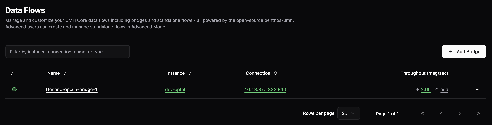
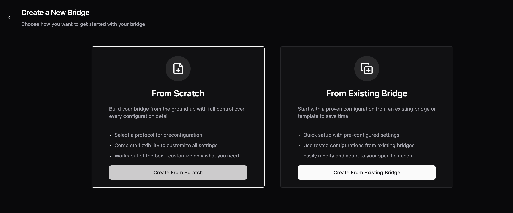
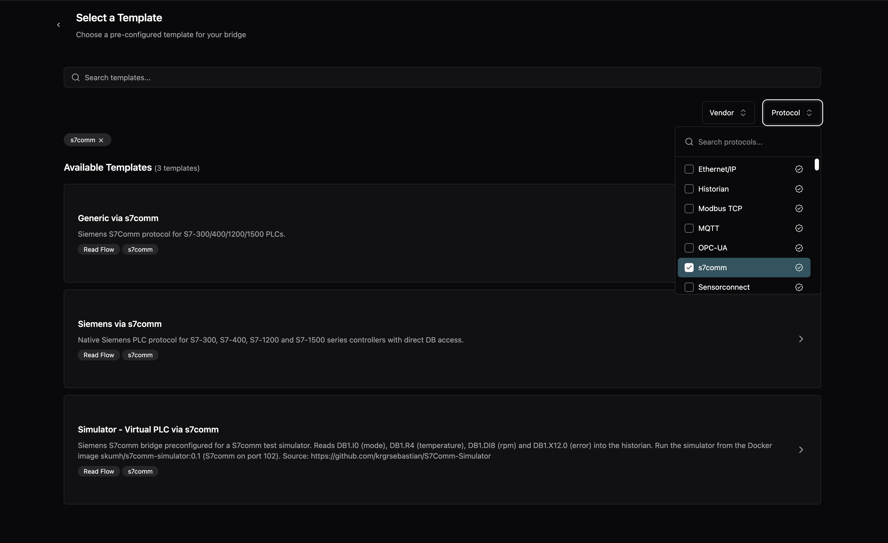
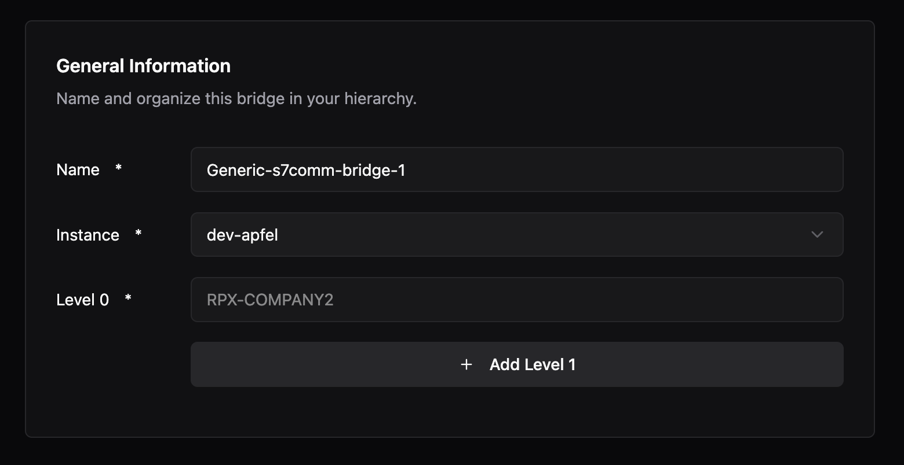
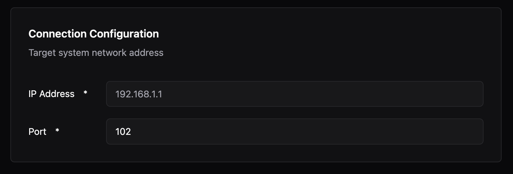

# Create a bridge

This guide creates a [bridge](bridges.md) in the Management Console.

> **New to UMH?** This page is the reference for setting up real bridges. If you just want to get mock data flowing and learn the basics first, start with [Step 2: Connect Data](../../getting-started/1-connect-data.md).

## Step 1: Navigate to Data Flows

Go to **Data Flows** and click **Add Bridge**:

## Step 2: Choose How to Start

- **From Scratch**: start from a pre-configured protocol template, which is functional out of the box, or customize the template to fit your needs.
- **From Existing Bridge**: pick a healthy bridge from any instance and start with a copy of its configuration. Adapt the bridge's name, connection and addresses.

The remaining steps describe the from-scratch path. Starting from an existing bridge skips the template list and lands on the same screens with the fields already filled in.

## Step 3: Select a Template

Templates carry a working protocol configuration. Search by name, or narrow the list with the **Vendor** and **Protocol** filters.

Behind the templates we support **50+ industrial protocols** through [Benthos-UMH](https://docs.umh.app/benthos-umh/input) plus everything from [Redpanda Connect](https://docs.redpanda.com/redpanda-connect/components/inputs/about/):

Common industrial protocols:
- **Modbus**: For PLCs and RTUs
- **OPC UA**: For industrial servers
- **S7**: For Siemens PLCs
- **Ethernet/IP**: For Allen-Bradley
- **And many more**: See full list at [Benthos-UMH Inputs](https://docs.umh.app/benthos-umh/input)

## Step 4: Configure General Settings

Fill in the basic information and proceed with Step 5.

**General Information:**
- **Name**: Unique identifier for your bridge
- **Instance**: Select your UMH instance
- **Level 0, Level 1, …**: pre-filled with the instance location. A level you add, such as area → line → machine, extends it, and the result is the bridge location.

**Connection:**
- **IP Address**: IP address or hostname of the external system (becomes `{{ .IP }}` variable)
- **Port**: Port of the external system (becomes `{{ .PORT }}` variable)

The protocol itself needs no selection here. It comes from the template you picked in Step 3, and the **Read Flow** tab opens on that protocol's settings.

## Step 5: Set Up the Read Flow

Follow [Set up a read flow](set-up-a-read-flow.md), then come back for Step 6.

## Step 6: Deploy

Click **Save & Deploy**. The bridge checks the connection to the external system, and the read flow starts reading from it.
