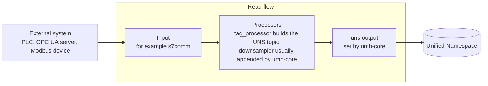

# Read Flow

The read flow is the part of a [bridge](bridges.md) that reads from the external system and publishes what it reads to the Unified Namespace (UNS). It reads values from a PLC, an OPC UA server, a Modbus device or an MQTT broker, for example. It supports many more industrial protocols, such as Siemens S7, EtherNet/IP and Beckhoff ADS, and every input that [Benthos-UMH](https://docs.umh.app/benthos-umh/input) offers. It publishes each value as a message on one UNS topic at the bridge location.

A bridge can have only a read flow, only a write flow, or both. The read flow and the write flow start, stop and report their state separately. To configure a read flow in the Management Console, see [Set up a read flow](set-up-a-read-flow.md).

## What the Management Console shows

The bridge's overview page shows the read flow as its own card, next to the connection and the write flow. The card shows a badge and the throughput of the read flow in messages per second. The icon next to the badge shows the state of the read flow, such as "Flow is idle". A read flow stopped with `readDFCDesiredState: stopped` shows the badge Stopped. **Metrics** opens the message counts of the read flow, and **Logs** opens its log.

| State | Badge | Meaning |
|---|---|---|
| `active` | Active | The read flow reads messages from the external system. |
| `idle` | Active | The read flow runs, but has read no messages recently. |
| `degraded` | Degraded | The read flow has hit errors, its Benthos process is not running, or its input cannot connect. The log shows why. |
| `starting` | Neutral | The read flow is starting. If it stays in this state, the log shows why. |
| `stopping` | Neutral | The read flow is stopping. |
| `stopped` | Neutral | The read flow is stopped with `readDFCDesiredState: stopped`, the bridge is stopped, or the bridge waits for its connection or, during start-up, for Redpanda. |

## How the read flow works

The read flow runs one [Benthos](https://docs.umh.app/benthos-umh) pipeline, a process that reads, changes and writes messages. Its input reads from the external system, its processors build the UNS topic of each message, and its output publishes the message to the UNS.



### The read flow starts only once the connection is up

umh-core starts the read flow once the [connection](connection-probe.md) is `up` and Redpanda is healthy. [How the connection affects the bridge](connection-probe.md#how-the-connection-affects-the-bridge) describes what happens when the connection goes down.

### Every message needs a UNS topic

Each message the read flow publishes goes to one UNS topic. [Topic Convention](../unified-namespace/topic-convention.md) describes the parts of a topic. The read flow sets them as message metadata, usually with a [`tag_processor`](https://docs.umh.app/benthos-umh/processing/tag-processor):

| Metadata | Part of the topic |
|---|---|
| `msg.meta.location_path` | The location path. umh-core replaces `{{ .location_path }}` with the bridge location. |
| `msg.meta.data_contract` | The data contract. |
| `msg.meta.virtual_path` | The virtual path. Optional. |
| `msg.meta.tag_name` | The name. |

In the Management Console, the address table sets these parts, as described in [Set up a read flow](set-up-a-read-flow.md).

The `uns` output checks each message against its data contract. [Data Contracts](../data-modeling/data-contracts.md) explains the check.

### umh-core sets the output

The output of a read flow is always the `uns` output, which publishes to the UNS. umh-core replaces any `output` you set in `dataflowcomponent_read` with it. To write data to a system other than the UNS, use a [write flow](bridges.md) or a [stand-alone flow](stand-alone-flow.md).

### umh-core adds a downsampler

A read flow whose pipeline holds exactly one processor, a `tag_processor`, gets a second one: umh-core appends a [`downsampler`](https://docs.umh.app/benthos-umh/processing/downsampler) after it. umh-core appends it to no other pipeline.

| The pipeline of the read flow | What umh-core appends |
|---|---|
| One `tag_processor` | A `downsampler` |
| One `nodered_js` | Nothing. umh-core reads a `nodered_js` pipeline as relational data |
| One processor of another type | Nothing |
| Two or more processors, whichever they are | Nothing |

A write flow never gets one, and neither does a [stand-alone flow](stand-alone-flow.md) or a [stream processor](stream-processor.md).

A pipeline that umh-core leaves alone can still have a downsampler. Write one into the pipeline yourself, with the options you want, and umh-core keeps it as you wrote it. This also holds for a pipeline of a `tag_processor` and your own `downsampler`: those are two processors, so umh-core appends nothing and your options are the ones that run.

The appended `downsampler` carries no configuration of its own. It publishes the first value of a tag, and after that publishes a value only when it differs from the last value it published, for numbers, booleans and strings alike. A tag that holds its value therefore publishes once and stays quiet until the value changes, however often the read flow reads it, and the age beside it in the Topic Browser grows meanwhile. [Values are not updating at regular intervals](../unified-namespace/values-are-not-updating-at-regular-intervals.md) covers that symptom, and [Downsampler](https://docs.umh.app/benthos-umh/processing/downsampler) describes what the processor does with a message and which options it takes.

## Reference

### Configuration

The read flow is the `dataflowcomponent_read` key of a bridge. Where that key sits depends on whether the bridge uses a template:

- A bridge created in the Management Console keeps its config in a template, in `templates.protocolConverter.<name>`. The read flow is in `templates.protocolConverter.<name>.dataflowcomponent_read`. The bridge references the template with `templateRef: <name>`.
- A bridge without `templateRef` keeps it under the bridge, in `protocolConverterServiceConfig.config.dataflowcomponent_read`.

With `templateRef`, umh-core uses the template and ignores a `config` key under the bridge. Edit the read flow in the template. Keep `readDFCDesiredState`, `location` and `variables` in `protocolConverterServiceConfig`, because umh-core ignores them in a template without an error.

| Key | Default | Description |
|---|---|---|
| `dataflowcomponent_read.benthos.input` | none, required | The Benthos input that reads from the external system, such as `s7comm` or `opcua`. The [Benthos-UMH input documentation](https://docs.umh.app/benthos-umh/input) lists the inputs. Without an input, the read flow does not start. |
| `dataflowcomponent_read.benthos.pipeline` | none | The processors that run on every message, usually one `tag_processor`. umh-core appends a `downsampler` to a pipeline of one `tag_processor`, as [umh-core adds a downsampler](#umh-core-adds-a-downsampler) describes. |
| `dataflowcomponent_read.benthos.buffer`, `cache_resources`, `rate_limit_resources` | none | Benthos settings for buffering, caching and rate limits. See the [Benthos-UMH documentation](https://docs.umh.app/benthos-umh). |
| `dataflowcomponent_read.benthos.output` | the `uns` output | Ignored. umh-core always sets the `uns` output. |
| `readDFCDesiredState` | the bridge's `desiredState` | `active` or `stopped`. It sits in `protocolConverterServiceConfig`, next to `location`. `stopped` stops only the read flow, and the write flow keeps running. A bridge with `desiredState: stopped` always stops its read flow. |

Changes to these keys take effect without a restart of the container.

**Example.** This bridge reads two addresses from a Siemens S7 PLC and publishes them to the `_raw` data contract. The full bridge configuration is in [Bridges](bridges.md#configuration).

```yaml
protocolConverter:
  - name: my-plc-bridge
    desiredState: active
    protocolConverterServiceConfig:
      location:
        2: "production-line"
      config:
        connection:
          nmap:
            target: "{{ .IP }}"
            port: "{{ .PORT }}"
        dataflowcomponent_read:
          benthos:
            input:
              s7comm:
                addresses:
                  - DB1.DW20
                  - DB3.I270
                tcpDevice: "{{ .IP }}"
                rack: 0
                slot: 1
            pipeline:
              processors:
                - tag_processor:
                    defaults: |
                      msg.meta.location_path = "{{ .location_path }}";
                      msg.meta.data_contract = "_raw";
                      msg.meta.tag_name = msg.meta.s7_address;
                      return msg;
      variables:
        IP: "192.168.1.100"
        PORT: "102"
```

### Metrics

The **Metrics** action on the **Read Flow** card shows the message counts of the read flow. They are messages received and sent, errors and latency, for its input, processors and output. These counts are not on umh-core's Prometheus endpoint. [Metrics by component](../instances/agent/metrics.md#metrics-by-component) explains why.

On the Prometheus endpoint, the read flow reports its state and umh-core's reconcile errors for it. For a bridge named `mixing-station`, the series carry these labels. [Read the metrics](../instances/agent/metrics.md#read-the-metrics) explains why Prometheus shows `instance` as `exported_instance`.

| Part | `component` | `instance` |
|---|---|---|
| The read flow | `dataflow_component_instance` | `read-protocolconverter-mixing-station` |
| The Benthos process of the read flow | `benthos_instance` | `dataflow-read-protocolconverter-mixing-station` |

The read flow's state reads 3 when active, 4 when idle and 0 when stopped. [State](../instances/agent/metrics.md#state) lists all values. This rule fires when a read flow is in any other state. Use it with `for: 5m`:

```promql
umh_core_service_current_state{component="dataflow_component_instance", exported_instance=~"read-protocolconverter-.*"} != 3 != 4 != 0
```

A read flow that has not started because its connection is not up reads 0, so this rule does not fire for it. To alert on an unreachable external system, use the bridge rule in the [Bridges metrics section](bridges.md#metrics).

The definitions are in [`pkg/metrics/metrics.go`](https://github.com/united-manufacturing-hub/united-manufacturing-hub/blob/staging/umh-core/pkg/metrics/metrics.go).
