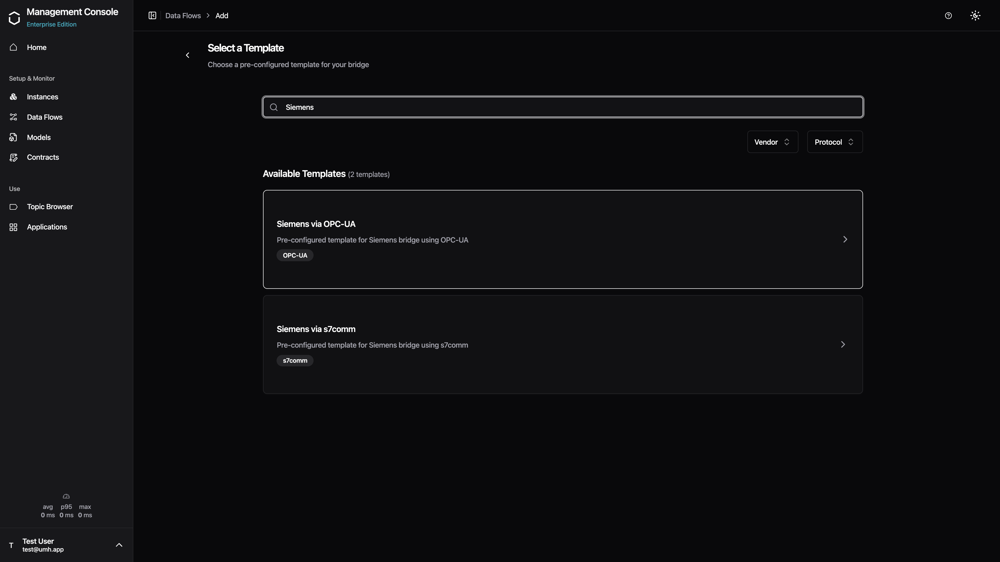
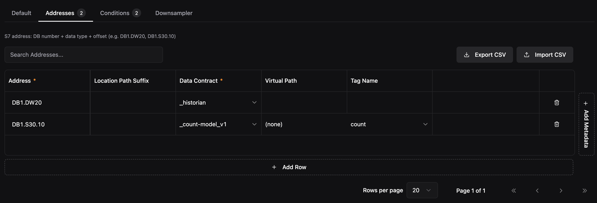

# Set up a read flow

This guide sets up the [read flow](read-flow.md) of a bridge. It is Step 5 of [Create a bridge](create-a-bridge.md), and starts on the **Read Flow** tab.

## Step 1: Configure Protocol Settings

Each protocol has specific settings. For example, S7:

## Step 2: Map Addresses

Each row in the address mapping table becomes one UNS topic: the protocol address, followed by the data contract, virtual path, and tag name that build the topic.

With `_historian` or `_raw`, Virtual Path and Tag Name are free-text fields. Selecting a custom data contract merges both columns into a single dropdown listing every field the contract's [data model](../data-modeling/data-models.md) defines, so you pick a valid path instead of typing one. A value the model rejects, for example after switching contracts, stays in the row, is flagged red, and blocks deploy until you correct it. Contracts whose data model references other models keep free-text input.
