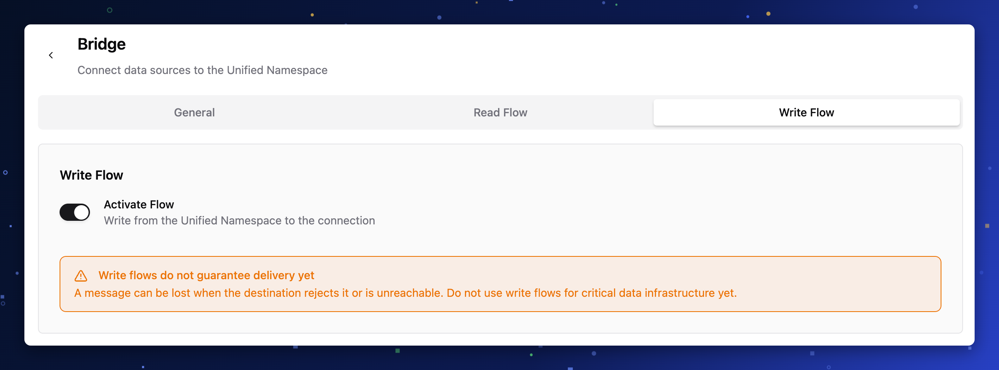
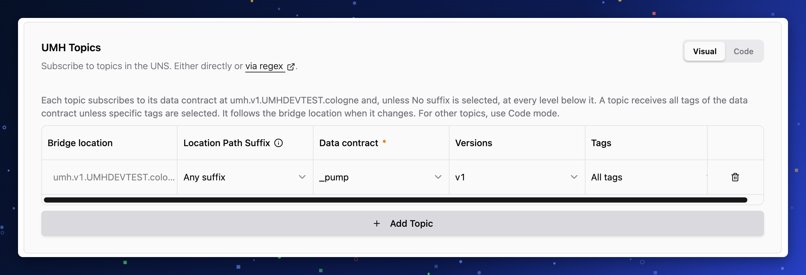
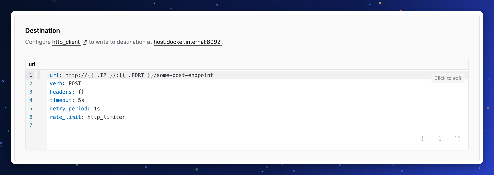
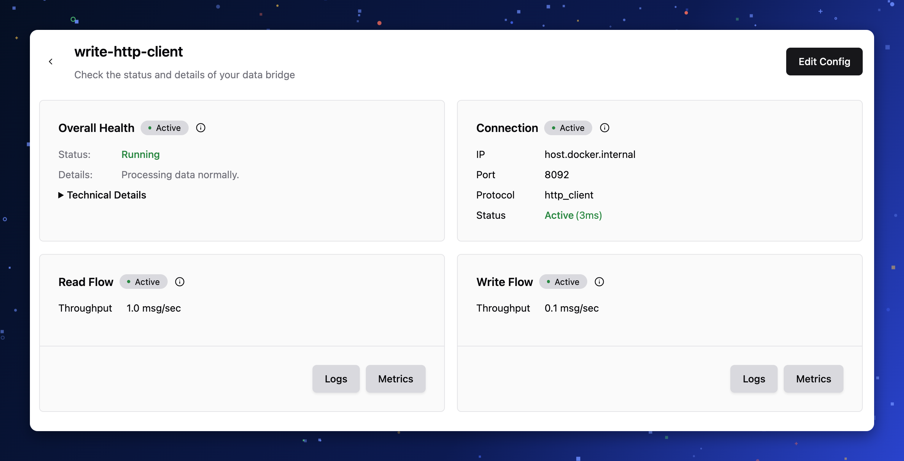

# Set up a write flow

This guide adds a [write flow](write-flow.md) to a bridge in the Management Console. By the end, the write flow subscribes to UNS topics, shapes each message and writes it to the external system.

Before you start you need:

- A data contract on the instance, such as `_pump_v1`. The Management Console creates one when you create a data model. See [Data Contracts](../data-modeling/data-contracts.md).
- Data arriving in the UNS for that contract at the bridge location. Check it in the [Topic Browser](../unified-namespace/topic-browser.md).
- A test system that accepts the data, not your production MES.


**WARNING: Risk of unexpected machine or process operation**

Writing to an external system can affect the operation of connected machinery or processes. Incorrect writes can result in death, serious injury or equipment damage.

**UMH does not provide safety functions.** Data delivery guarantees do not make UMH suitable for use as part of a safety function. Safety functions must be implemented independently of UMH using appropriate safety-rated controllers and devices, correctly programmed and validated for the application.


## Step 1: Open the bridge's overview page

Go to **Data Flows** and select the **Bridges** list. Select the bridge to open its overview page. The overview page shows one card each for the connection, the read flow and the write flow.

For a new bridge, select **Add Bridge** instead and pick a template with the **Write Flow** badge, such as **HTTP Client**. The editor opens directly, so continue with Step 3.

## Step 2: Open the Write Flow tab

On the overview page, select **Edit Config** and then the **Write Flow** tab. A bridge without a write flow shows the button **Configure Write Flow** on its **Write Flow** card. It opens the same tab.



## Step 3: Pick the topics

The **UMH Topics** card builds the topic patterns for you in **Visual** mode. Each row subscribes to one data contract, in one or more versions, at the bridge location.

1. Select **Add Topic**.
2. In **Data contract**, pick the contract, for example `_pump_v1 · user defined`.
3. In **Location Path Suffix**, pick **Any suffix** to include every level below the bridge location, or **No suffix** for the bridge location only.
4. In **Versions**, keep the latest version or add older ones.
5. In **Tags**, keep **All tags**, or type tag names and press Enter to subscribe to only those tags.



To subscribe to only one level below the bridge location, such as one line, try these options in this order:

1. Move the bridge to that level. Change its location on the **General** tab, so the bridge location matches the level you want.
2. Keep **Any suffix** and drop the other levels in **Processing**. The second example in Step 4 shows how.
3. As a last resort, switch **UMH Topics** to **Code** mode and write the topic pattern yourself. [Topic validation](write-flow.md#topic-validation) lists the rules it must follow.

## Step 4: Shape the message in Processing

The **Processing** card holds JavaScript that runs on every message. The write flow runs it in the Benthos `nodered_js` processor. To write the UNS message unchanged, keep `return msg;`. `msg.payload` holds the UNS payload, as described in [Payload Formats](../unified-namespace/payload-formats.md). `msg.meta.umh_topic` holds the topic the message came from. Return `msg` to write it, or return `null` to drop it. The [Node-RED JavaScript processor](https://docs.umh.app/benthos-umh/processing/node-red-javascript-processor) page describes the full API of `nodered_js`.

This example turns a time-series message into the JSON body a test MES expects:

```javascript
msg.payload = {
  topic: msg.meta.umh_topic,
  value: msg.payload.value,
  timestamp_ms: msg.payload.timestamp_ms
};
return msg;
```

This example writes only the data of `line-1` directly below the bridge location, and drops the rest. UMH Core replaces `{{ .location_path }}` with the bridge location, so `prefix` is the start of every topic the write flow subscribes to. The example compares the first level after `prefix`:

```javascript
const prefix = "umh.v1.{{ .location_path }}.";
const firstLevel = msg.meta.umh_topic.slice(prefix.length).split(".")[0];
if (firstLevel !== "line-1") {
  return null;
}
return msg;
```

## Step 5: Set the Destination

The **Destination** card holds the settings of the external system you write to, for example the URL and method of an HTTP request. Its fields depend on the protocol. The protocol name on the card links to its documentation.



## Step 6: Deploy and check

1. Turn on **Activate Flow** on the **Write Flow** card.
2. Select **Save & Deploy**. The dialog shows **Deploy successful** once the bridge runs.
3. Open the bridge's overview page. The **Write Flow** card shows the health and the throughput in msg/sec.
4. Check that the external system gets the messages. Select **Logs** on the **Write Flow** card to see errors from the external system.



If the dialog shows **Bridge deploy failed** and names your topics, see [Write Flow Topics Rejected](write-flow-topics-rejected.md).

To stop only the write flow, turn off **Activate Flow** and deploy again. The read flow keeps running.
