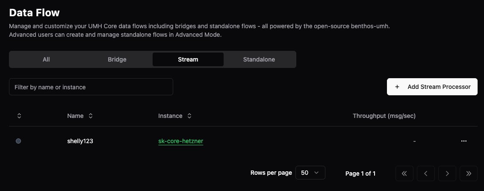
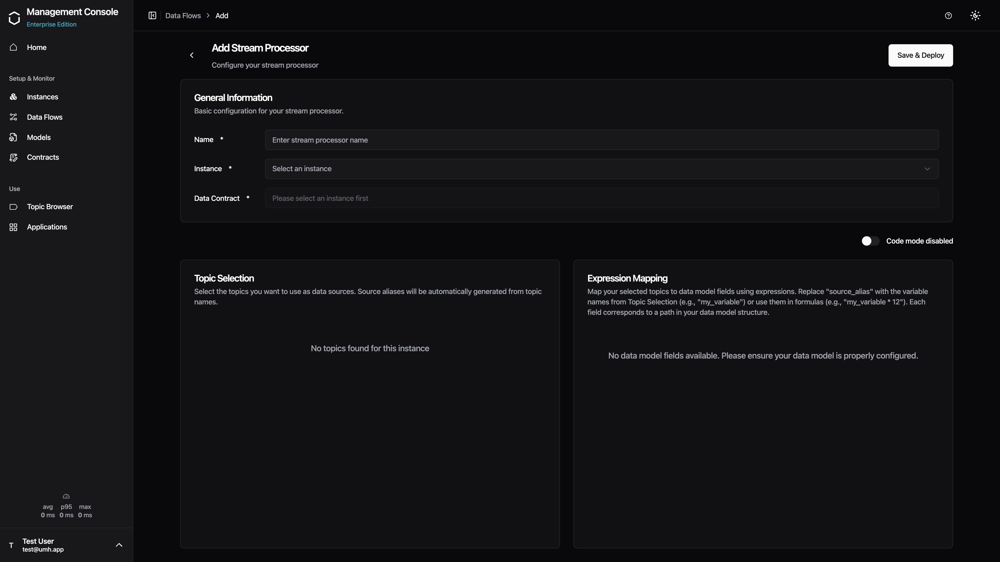
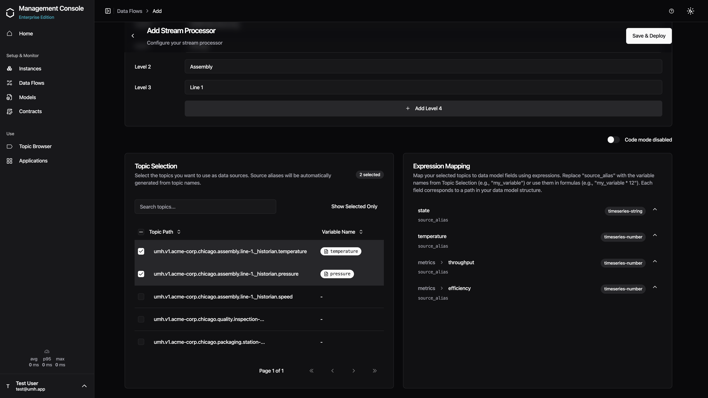
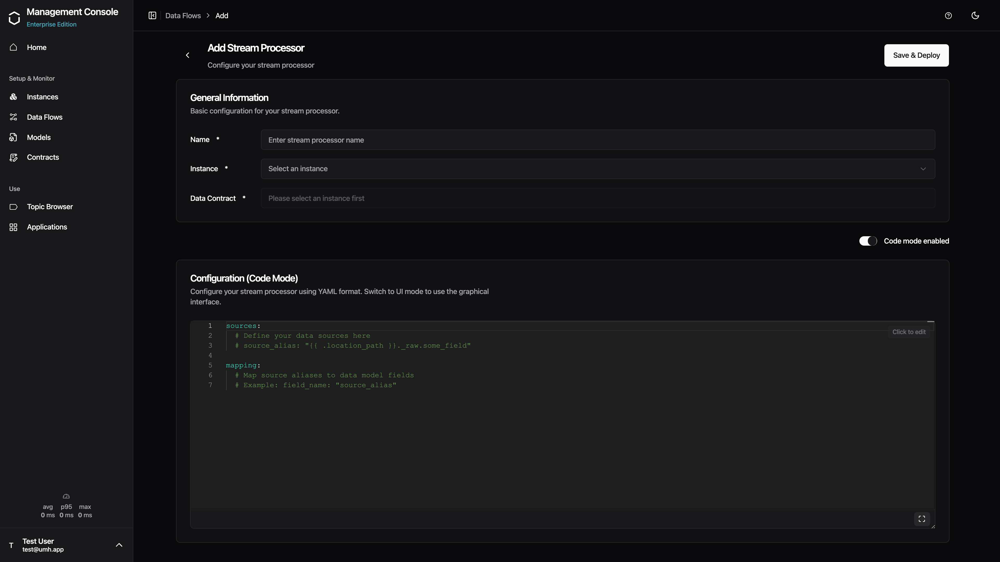
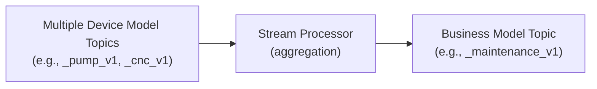

# Stream Processors

> **Prerequisite:** Understand [Data Flow concepts](README.md) and complete the [Getting Started guide](../../getting-started/).

Stream processors transform data already inside the Unified Namespace, aggregating multiple device streams into business KPIs and metrics. They're the third type of data flow, specialized for transforming device models into business models.

## When to Use

Use stream processors for:
- Aggregating data from multiple devices into KPIs
- Creating business metrics from raw sensor data
- Calculating OEE, efficiency, or other derived values
- Reducing data volume for cloud transmission

Use bridges instead for:
- Getting data into the [Unified Namespace](../unified-namespace/README.md) initially
- Single device to model mapping
- Direct protocol connections

## Creating a Stream Processor

Stream processors are created through the **Data Flows → Stream** tab:



### Step 1: General Configuration

Configure basic settings and location hierarchy:



- **Name**: Unique identifier for your processor
- **Instance**: The UMH Core instance to run on
- **Data Contract**: Select the output model (creates validated structure)
- **Location Levels**: Set where in the hierarchy to output data (Level 0-4)

### Step 2: Topic Selection

Select source topics and they'll automatically get variable names:



- Browse available topics in your UNS
- Select multiple sources with checkboxes
- Each variable is named after the last part of its topic, for example `temperature` for a topic ending in `temperature`
- Use "Show Selected Only" to filter view
- Copy variable names for use in expressions

Each variable name stands for one selected topic, and the expressions in the next step refer to a source by that name. In Code Mode you can give the sources your own names instead; the examples in the [Stream Processors guide](../data-modeling/stream-processors.md) use names like `cnc1`.

### Step 3: Expression Mapping

Map source variables to model fields using expressions:


- Each field in your data model appears on the right
- Enter expressions using the source variables
- Simple passthrough: the variable's name, for example `temperature`
- Calculations: `temperature * 1.8 + 32` or more complex formulas
- The expressions support standard mathematical operations

### Step 4: Code Mode (Advanced)

Switch to Code Mode to see or edit the generated YAML configuration:



The UI automatically generates YAML with:
- **sources**: Your selected topics with location_path templates
- **mapping**: Field-to-expression mappings
- Comments explaining the structure

You can switch between UI and Code Mode anytime to fine-tune configurations.

**For detailed configuration instructions**, see the [Stream Processors guide](../data-modeling/stream-processors.md) in Data Modeling.

## How a Stream Processor Works

Stream processors subscribe to multiple UNS topics and output to a single model-based topic:



Example: Combining temperature and pressure from different sensors into a pump model:
- Input: `enterprise.site._raw.temp_sensor_1`, `enterprise.site._raw.pressure_gauge_2`  
- Output: `enterprise.site._pump_v1` with calculated efficiency

## Configuration (YAML)

While the UI is the primary way to create stream processors, they're stored as YAML:

```yaml
streamProcessor:
  - name: pump_efficiency_calc
    desiredState: active
    streamProcessorServiceConfig:
      config:
        model:
          name: pump
          version: v1
        sources:
          inlet_temp: "{{ .location_path }}._raw.inlet_temp"
          outlet_temp: "{{ .location_path }}._raw.outlet_temp"
        mapping:
          efficiency: "(outlet_temp - inlet_temp) / inlet_temp * 100"
```

See the [Stream Processors configuration guide](../data-modeling/stream-processors.md) for detailed YAML structure.

## Key Differences from Other Data Flows

The table below sets stream processors apart from the other two data flow types: what each is for, where it reads from and where it writes.

| Data Flow Type | Purpose | Input Source | Output |
|----------------|---------|--------------|--------|
| **Bridges** | Get data INTO the UNS | External devices (PLCs, sensors) | UNS topics |
| **Stream Processors** | Transform data WITHIN the UNS | UNS topics | UNS model topics |
| **Stand-alone Flows** | Custom processing | Any source | Any destination |

## Metrics

The Management Console shows each stream processor's message counts. Open the stream processor and select **Metrics** on the Monitoring card. The view shows messages received and sent, errors and latency. Port 8080, umh-core's Prometheus endpoint, does not carry message counts. It carries the stream processor's state and error counts. [Metrics](../instances/agent/metrics.md) explains how to read them, which framework runs stream processors and what the labels and the state values mean.

Stream processors run on FSMv1 and use the standard [FSMv1 metrics](../instances/agent/metrics.md#fsmv1-metrics). For a stream processor named `oee-rollup`, the series carry these labels:

| Part | `component` | `instance` |
|---|---|---|
| The stream processor | `stream_processor_instance` | `oee-rollup` |
| The internal flow that runs it | `dataflow_component_instance` | `dfc-streamprocessor-oee-rollup` |
| The Benthos process of that flow | `benthos_instance` | `dataflow-dfc-streamprocessor-oee-rollup` |

To alert on a stream processor that is not active, idle or stopped, use this rule with `for: 5m`. In Prometheus, write `exported_instance` for `instance`, or keep `instance` if the scrape job sets `honor_labels: true`:

```promql
umh_core_service_current_state{component="stream_processor_instance"} != 3 != 4 != 0
```

The rule does not fire for a stream processor that is stopped (0) or idle (4). A stopped one is one you stopped on purpose, and an idle one has no data to process.

When you delete a stream processor, umh-core keeps its last state series at -1 until the instance restarts, so the rule keeps firing for it. Exclude the deleted name, for example by adding `exported_instance!="<deleted stream processor>"` to the selector, or [restart the instance](../../production/deployment/restart-an-instance.md), which interrupts this instance's collection.

The definitions are in [`pkg/metrics/metrics.go`](https://github.com/united-manufacturing-hub/united-manufacturing-hub/blob/staging/umh-core/pkg/metrics/metrics.go).