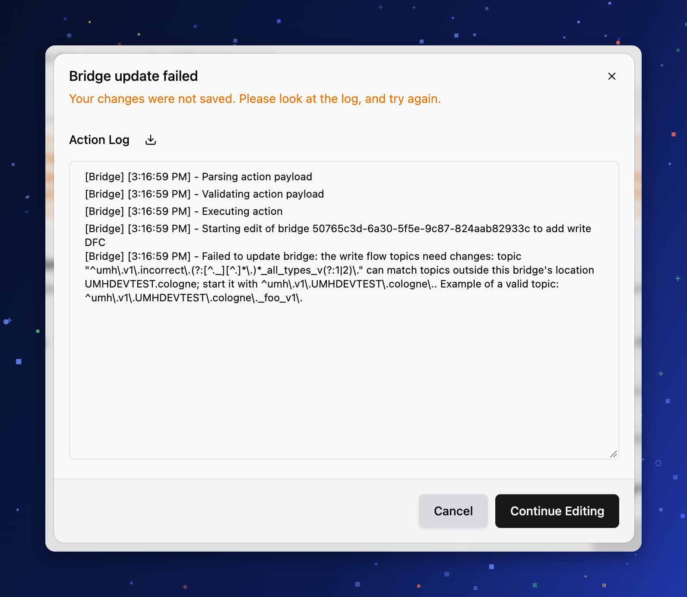

# Write Flow Topics Rejected

This page covers a write flow whose topics break the topic rules: the deploy fails, or the bridge shows as degraded. It explains each message, where it appears, and how to fix the topic. The rules themselves are in [Topic validation](../write-flow.md#topic-validation).

## Where the message appears

The message appears in one of three places:

- **When you deploy or edit a bridge** in the Management Console, the dialog shows **Bridge deploy failed** for a new bridge and **Bridge update failed** for an edit. The message starts with "Failed to deploy Bridge:" or "Failed to update bridge:". Nothing changes on the instance. An edit fails only if it adds a topic that breaks the rules. A bridge whose topics already broke them can still be edited for other reasons.
- **After an upgrade to umh-core 0.45.0**, a write flow that ran before can stop. UMH Core checks the topics of every write flow when it starts. A write flow whose topics break the rules does not start. The bridge shows as degraded, and its status starts with "flow degraded:". The bridge's connection and read flow keep running.
- **When you change the instance location**, a bridge's topics can end up outside the bridge's new location. UMH Core then rejects the change. The message starts with "Failed to update instance location: the new location moves the write flow topics of these bridges outside their location".



Every message has the same shape. It lists one problem per topic and ends with a topic that would work:

```text
the write flow topics need changes: topic "^umh\.v1\.acme\.cologne\.assembly\._pump_v1\." can match topics outside this bridge's location acme.cologne.packaging; start it with ^umh\.v1\.acme\.cologne\.packaging\.. Example of a valid topic: ^umh\.v1\.acme\.cologne\.packaging\._pump_v1\.
```

## What the message says

Each problem quotes the topic as written. Some problems end with `available:` and the data contracts on this instance. This list gives the meaning of each problem and the fix:

- **must start with ^, in front of any alternatives like ^(?:a|b)** — the topic has no `^` at the start. Add it. With alternatives, write `^(?:a|b)`, not `^a|^b`.
- **can match topics outside this bridge's location** — the topic can reach topics at another location. The message names the start the topic needs. Two causes are common:
  - The topic names a different location. Change the bridge's location on the **General** tab, or publish the data at the bridge's location with a [stream processor](../stream-processor.md).
  - The topic has a plain dot, such as `umh.v1.` instead of `umh\.v1\.`. A plain dot matches any character. Write every dot as `\.`.
- **must name a data contract beneath the location, followed by \.** — the topic has no data contract, or the contract is not followed by `\.`. Add a contract from the `available:` list, for example `\._pump_v1\.`.
- **names a data contract that is not declared in dataContracts:** — the contract or its version does not exist on this instance. Create the data model as described in [Data Contracts](../../data-modeling/data-contracts.md), or pick a contract from the `available:` list.
- **can match more than one data contract** — the contract part is a wildcard, such as `_.*` or `_pump_v\d+`, or it lists two contracts. Name one contract and list its versions, like `_pump_v[1-2]\.`. A comma inside brackets counts as a character, so `_pump_v[1,2]` also matches more than one contract.
- **data contract "…" has no version** — the contract exists without a version, such as `_pump`. Create a data model with a version, as described in [Data Contracts](../../data-modeling/data-contracts.md), and use `_pump_v1`.
- **cannot match any topic, so the write flow would receive no messages** — the pattern can never match. Check it for typos.
- **is not a valid regular expression** — the pattern does not parse. The message ends with the syntax error.

For the topic of a Historian bridge, see [Historian bridge](../../historian/bridge.md).

## What to do

Fix the topics in the bridge editor:

1. Read the problem for each topic in the message.
2. Open the bridge, select **Edit Config** and the **Write Flow** tab.
3. Fix the topic in **UMH Topics**. Visual mode builds a valid topic for you. Code mode shows the pattern as text.
4. Select **Save & Deploy**.

If a location change was rejected, fix the topics of each bridge the message names first, then change the location again.

## Emergency setting: Bypass write flow validation

`BYPASS_WRITE_FLOW_VALIDATION` lets a write flow run before its topics follow the rules, for example a Historian bridge that stores data from another location. Set it only when the topics cannot be fixed yet.


**The setting applies to every bridge on the instance.** With it on, any bridge can receive data from any location, and from data contracts that do not exist on the instance or have no version.


Add `-e BYPASS_WRITE_FLOW_VALIDATION=true` to the `docker run` command and recreate the container, as described in [Updating](../../../production/deployment/docker/updating.md). `docker restart` keeps the old value. Receiving data outside the bridge's location needs umh-core 0.45.2 or later.

Each topic must still start with `^umh\.v1\.` and name one data contract, written out in full and followed by `\.`, such as `\._mes_order\.`. A wildcard in place of the contract stays rejected.

A bridge whose topics need the setting shows as degraded, with a status that starts with "flow degraded: BYPASS_WRITE_FLOW_VALIDATION is set". When you edit such a bridge, save it with **Save Anyway**, because a normal **Save & Deploy** waits for a healthy bridge and rolls the edit back.
