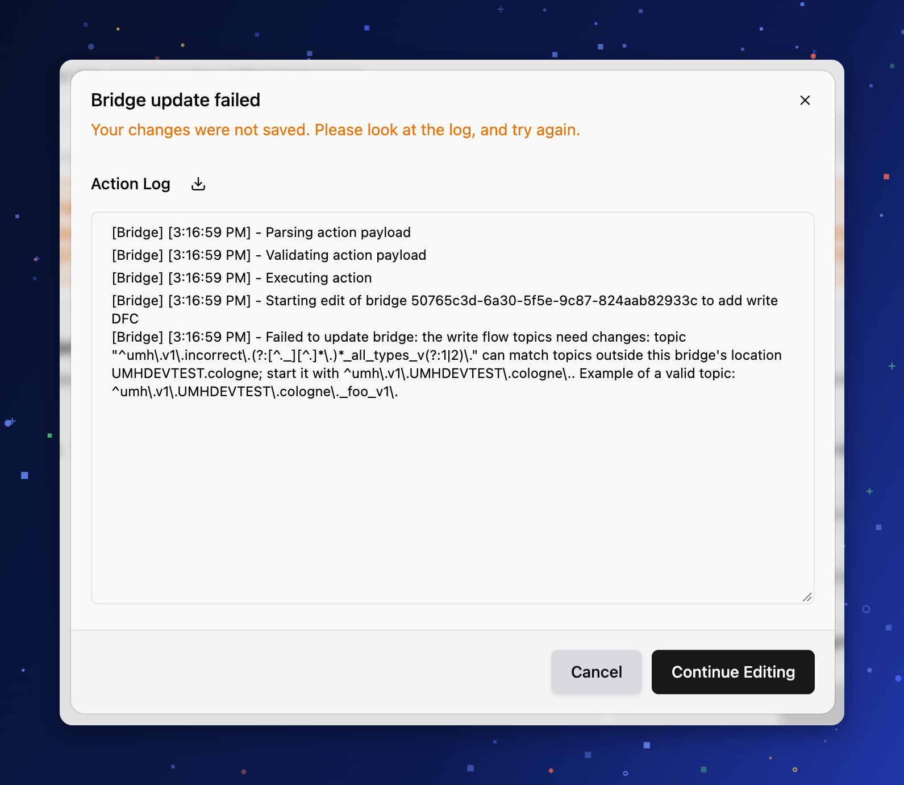

# Write Flow Topics Rejected

This page covers a write flow whose topic patterns break the topic rules: the deploy fails, or the bridge shows as degraded. It explains each message, where it appears, and how to fix the topic pattern. The rules themselves are in [Topic validation](write-flow.md#topic-validation).

## Where write flow topic rejections appear

The message appears in one of three places:

- **When you deploy or edit a bridge** in the Management Console, the dialog shows **Bridge deploy failed** or **Bridge update failed**. The message starts with "Failed to deploy Bridge:" or "Failed to update bridge:". While a bridge's topic patterns break the rules, every edit that includes the write flow fails. The Management Console includes the write flow in every edit, so even an edit that changes only the port fails. To fix the topic patterns, follow the rules in [Topic validation](write-flow.md#topic-validation).
- **After an upgrade to umh-core 0.45.0**, a write flow that ran before can stop. UMH Core checks the topic patterns of every write flow when it starts. A write flow whose topic patterns break the rules does not start. The bridge shows as degraded, and its status starts with "flow degraded:". The bridge's connection and read flow keep running.
- **When you change the instance location**, a bridge's topic patterns can end up outside the bridge's new location. UMH Core then rejects the change. The message starts with "Failed to update instance location: the new location moves the write flow topics of these bridges outside their location". [Move a bridge to another location](#move-a-bridge-to-another-location) shows how to avoid it.



Every message has the same shape. It lists one problem per topic pattern and ends with a topic pattern that would work:

```text
the write flow topics need changes: topic "^umh\.v1\.acme\.cologne\.assembly\._pump_v1\." can match topics outside this bridge's location acme.cologne.packaging; start it with ^umh\.v1\.acme\.cologne\.packaging\.. Example of a valid topic: ^umh\.v1\.acme\.cologne\.packaging\._pump_v1\.
```

## Write flow rejection messages explained

Each problem quotes the topic pattern as written. Some problems end with `available:` and the data contracts on this instance. This list gives the meaning of each problem and the fix. For how a UNS topic is built, see [Topic Convention](../unified-namespace/topic-convention.md).

- **must start with ^, in front of any alternatives like ^(?:a|b)**: the topic pattern has no `^` at the start. Add it. With alternatives, write `^(?:a|b)`, not `^a|^b`.
- **can match topics outside this bridge's location**: the topic pattern can match topics at another location. The message names the start the topic pattern needs. Two causes are common:
  - The topic pattern names a different location. Change the bridge location on the **General** tab, as described in [Move a bridge to another location](#move-a-bridge-to-another-location), or publish the data at the bridge location with a [stream processor](stream-processor.md).
  - The topic pattern has a plain separator dot, such as `umh.v1.` instead of `umh\.v1\.`. A plain dot matches any character. Write every separator dot as `\.`. Leave `.*` as it is, because `\.*` matches repeated dots instead.
- **can match topics outside the UNS**: the bridge has no bridge location, and the topic pattern does not start with `^umh\.v1\.`. Start it with the prefix the message names.
- **must name a data contract beneath the location, followed by \.**: the topic pattern has no data contract. Add a contract from the `available:` list, for example `\._pump_v1\.`.
- **names a data contract that is not declared in dataContracts:**: the contract or its version does not exist on this instance. Create the data model as described in [Data Contracts](../data-modeling/data-contracts.md), or pick a contract from the `available:` list.
- **can match more than one data contract**: the topic pattern can match topics of more than one data contract. The contract part is a wildcard, such as `_.*` or `_pump_v\d+`, or it lists two contracts. A contract that is not followed by `\.`, such as `...\._pump_v1`, gets this message too, because it also matches longer names such as `_pump_v10`. Name one contract and list its versions, like `_pump_v[1-2]\.`. A comma inside brackets counts as a character, so `_pump_v[1,2]` also matches more than one contract. A version range with a version that does not exist on the instance, such as `_pump_v[1-2]` with only `_pump_v1`, gets this message too. Create the missing version or remove it from the range.
- **data contract "…" has no version**: the contract exists without a version, such as `_pump`. Create a data model with a version, as described in [Data Contracts](../data-modeling/data-contracts.md), and use `_pump_v1`.
- **cannot match any topic, so the write flow would receive no messages**: the topic pattern can never match a topic. Check it for typos.
- **is not a valid regular expression**: the topic pattern does not parse. The message ends with the syntax error.

For the topic pattern of a Historian bridge, see [Save data to the Historian](../historian/save-to-historian.md).

## Fix rejected write flow topics

Fix the topic patterns in the bridge editor:

1. Read the problem for each topic pattern in the message.
2. Open the bridge, select **Edit Config** and the **Write Flow** tab.
3. Fix the topic pattern in **UMH Topics**. Visual mode builds a valid topic pattern for you. Code mode shows the topic pattern as text.
4. Select **Save & Deploy**.

## Move a bridge to another location

UMH Core checks the topic patterns of a bridge against its new location. A topic pattern that starts with `^umh\.v1\.{{ .location_path }}\.` moves with the bridge, because UMH Core replaces `{{ .location_path }}` with the bridge's current location. Visual mode writes every topic pattern this way. A topic pattern with the location written out, such as `^umh\.v1\.acme\.cologne\.packaging\.`, stays at the old location and is rejected after the move.


Moving a bridge also moves the topics its read flow publishes to. Anything that subscribes to the old topics, such as a dashboard or another bridge, stops getting data.


To move a bridge, for example from `acme.cologne.packaging` to `acme.cologne.assembly`:

1. Open the bridge, select **Edit Config** and the **Write Flow** tab.
2. In **UMH Topics**, switch to **Code** mode and replace a written-out location with `{{ .location_path }}`. For example, change `^umh\.v1\.acme\.cologne\.packaging\._pump_v1\.` to `^umh\.v1\.{{ .location_path }}\._pump_v1\.`. Skip this step if every topic pattern already starts with `^umh\.v1\.{{ .location_path }}\.`.
3. On the **General** tab, change the bridge location.
4. Select **Save & Deploy**. UMH Core checks the topic patterns against the new location, and the write flow subscribes to the topics at `acme.cologne.assembly`.

The instance location is the first part of every bridge location, so changing it moves every bridge. If UMH Core rejects the change, do step 2 for each bridge the message names and select **Save & Deploy**. Then change the instance location again.

## Emergency setting: Bypass write flow validation

`BYPASS_WRITE_FLOW_VALIDATION` lets a write flow run before its topic patterns follow the rules, for example a Historian bridge that stores data from another location. Set it only when the topic patterns cannot be fixed yet.


**The setting applies to every bridge on the instance.** With it on, any bridge can subscribe to topics at any location, and to data contracts that do not exist on the instance or have no version.


Add `-e BYPASS_WRITE_FLOW_VALIDATION=true` to the `docker run` command and recreate the container, as described in [Updating](../../production/deployment/docker/updating.md). `true`, `1`, `yes`, `y` and `on` turn the setting on, in any case. Unset or any other value leaves it off, which is the default. UMH Core reads the value once at startup, and `docker restart` keeps the old value. Recreating the container stops every bridge on the instance until it is back up. Subscribing to topics outside the bridge location needs umh-core 0.45.2 or later.

Each topic pattern must still start with `^umh\.v1\.` and name one data contract, written out in full and followed by `\.`, such as `\._mes_order\.`. A wildcard in place of the contract stays rejected.

A bridge whose topic patterns need the setting shows as degraded, with a status that starts with "flow degraded: BYPASS_WRITE_FLOW_VALIDATION is set". Save it with **Save Anyway**. For an existing bridge, a normal **Save & Deploy** waits for a healthy bridge and rolls the change back.

To turn the setting off, remove the variable and recreate the container. Bridges whose topic patterns still break the rules then stop their write flow and show as degraded.
