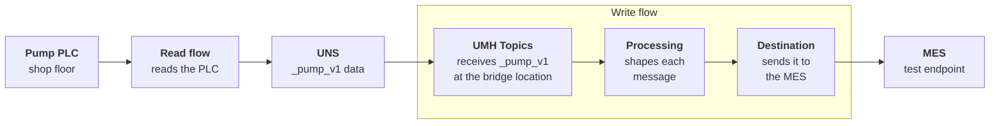
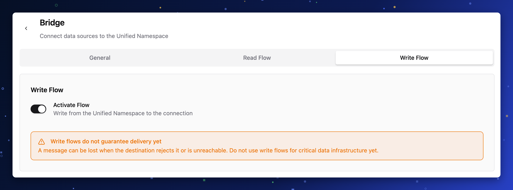
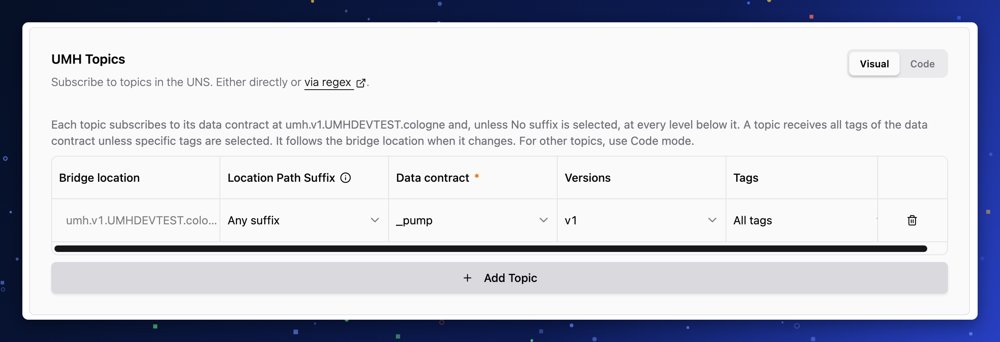
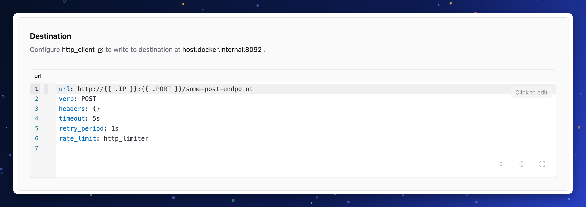
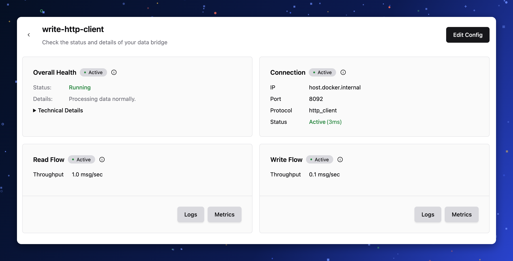
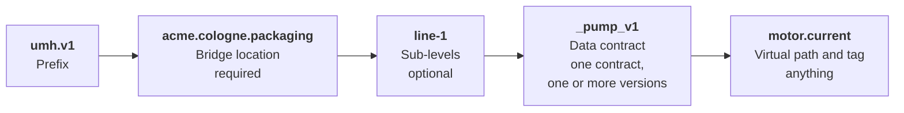
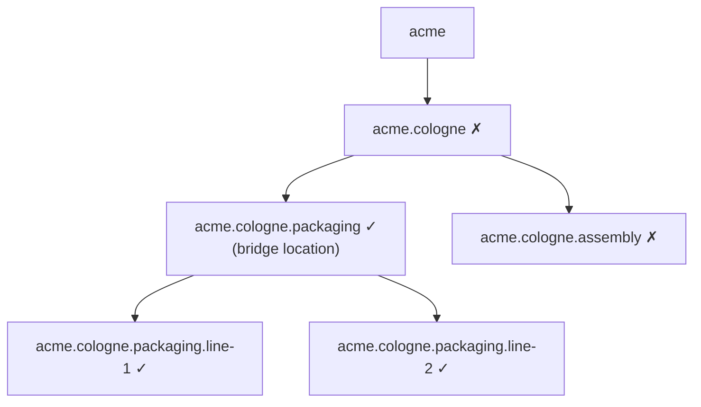

# Write Flow

A write flow sends data from the Unified Namespace (UNS) to a system outside UMH. Typical destinations are:

- MES systems
- HTTP endpoints
- Data lakes such as Snowflake
- PLCs on the shop floor
- The [Historian](../historian/README.md)

The write flow is one part of a [bridge](bridges.md). The bridge's read flow brings data into the UNS, and its write flow takes data out.

This page shows how to set up a write flow in the Management Console. It then lists which UNS topics a write flow may receive, and shows the same write flow in `config.yaml`. When the Management Console rejects your topics, or the bridge shows as degraded, see [Write Flow Topics Rejected](troubleshooting/write-flow-topics-rejected.md).

Write flows need umh-core TODO-WRITE-FLOW-VERSION or later. On an instance with an older version, the **Write Flow** tab is disabled, with the tooltip "This instance does not support write flows yet. Update umh-core."


**Write flows do not guarantee delivery yet.** The Management Console shows this warning on every write flow that does not write to the Historian. A message can be lost when the destination rejects it or is unreachable. Do not use a write flow for data that must arrive, such as production orders or quality records.


## How a write flow works

A write flow has three parts. Each part is a card on the **Write Flow** tab of the bridge editor:

1. **UMH Topics** — the UNS topics the write flow receives. Each topic is [validated](#topic-validation).
2. **Processing** — JavaScript that runs on every message before it is written.
3. **Destination** — the system the message is written to, such as an HTTP endpoint.

In this example, a bridge's read flow publishes pump data into the UNS. Its write flow receives that data and sends it to an MES:



The read flow and the write flow of a bridge start, stop and report health separately. A bridge can also have only a write flow. A [Historian bridge](../historian/bridge.md) is a bridge of that kind.

A write flow has exactly one processing step. To call an MES and publish its answer back into the UNS, use a [stand-alone flow](stand-alone-flow.md).

## Set up a write flow in the Management Console

In this section you add a write flow to a bridge. By the end you will know how to:

1. Pick the topics the write flow receives
2. Shape each message for the destination
3. Deploy the write flow and check that messages arrive

Before you start you need:

- A data contract on the instance, such as `_pump_v1`. The Management Console creates one when you create a data model. See [Data Contracts](../data-modeling/data-contracts.md).
- Data arriving in the UNS for that contract at the bridge's location. Check it in the [Topic Browser](../unified-namespace/topic-browser.md).
- A test endpoint that accepts the data, not your production MES


**A write flow changes the state of the destination.** A destination can be a PLC or a system that machines act on. If it is, a written value can move equipment. Test the write flow against a simulator or a test system first. You own the commissioning, testing and safety approval of the process that the destination controls. UMH does not validate it.


### 1. Open the bridge's overview page

Go to **Data Flows** and select the **Bridges** list. Select the bridge to open its overview page. The overview page shows one card each for the connection, the read flow and the write flow.

For a new bridge, select **Add Bridge** instead and pick a template with the **Write Flow** badge, such as **HTTP Client**. The editor opens directly, so continue with step 3.

### 2. Open the Write Flow tab

On the overview page, select **Edit Config** and then the **Write Flow** tab. A bridge without a write flow shows the button **Configure Write Flow** on its **Write Flow** card. It opens the same tab.



### 3. Pick the topics

The **UMH Topics** card builds the topics for you in **Visual** mode. Each row receives one data contract, in one or more versions, at the bridge's location.

1. Select **Add Topic**.
2. In **Data contract**, pick the contract, for example `_pump_v1 · user defined`.
3. In **Location Path Suffix**, pick **Any suffix** to include every level below the bridge's location, or **No suffix** for the bridge's location only.
4. In **Versions**, keep the latest version or add older ones.
5. In **Tags**, keep **All tags**, or type tag names and press Enter to receive only those tags.



To receive data from only one level below the bridge's location, such as one line, try these options in this order:

1. Move the bridge to that level. Change its location on the **General** tab, so the bridge's location matches the level you want.
2. Keep **Any suffix** and drop the other levels in **Processing**. The example in step 4 shows how.
3. As a last resort, switch **UMH Topics** to **Code** mode and write the topic as a regular expression. [Topic validation](#topic-validation) explains how.

### 4. Shape the message in Processing

The **Processing** card holds JavaScript that runs on every message. To send the UNS message unchanged, keep `return msg;`. `msg.payload` holds the UNS payload, as described in [Payload Formats](../unified-namespace/payload-formats.md). `msg.meta.umh_topic` holds the topic the message came from. Return `msg` to write it, or return `null` to drop it. The [Node-RED JavaScript processor](https://docs.umh.app/benthos-umh/processing/node-red-javascript-processor) page describes the full API.

This example turns a time-series message into the JSON body a test MES expects:

```javascript
msg.payload = {
  topic: msg.meta.umh_topic,
  value: msg.payload.value,
  timestamp_ms: msg.payload.timestamp_ms
};
return msg;
```

This example writes only the data of one line below the bridge's location, and drops the rest:

```javascript
if (!msg.meta.umh_topic.includes(".line-1.")) {
  return null;
}
return msg;
```

### 5. Set the destination

The **Destination** card holds the settings of the system you write to, for example the URL and method of an HTTP request. Its fields depend on the protocol. The protocol name on the card links to its documentation.



### 6. Deploy and check


**Deploying starts writing to the destination.** Point the write flow at a test system first.


1. Turn on **Activate Flow** on the **Write Flow** card.
2. Select **Save & Deploy**. The dialog shows **Update successful** once the bridge runs.
3. Open the bridge's overview page. The **Write Flow** card shows the health and the throughput in msg/sec.
4. Check that the destination receives the messages. Select **Logs** on the **Write Flow** card to see errors from the destination.



If the dialog shows **Bridge update failed** and names your topics, see [Write Flow Topics Rejected](troubleshooting/write-flow-topics-rejected.md). After an upgrade to umh-core 0.45.0, a write flow that ran before can stop for the same reason. The same page covers that case.

To stop only the write flow, turn off **Activate Flow** and deploy again. The read flow keeps running.

## Topic validation

UMH Core validates every topic of a write flow. A write flow receives data only from its bridge's location and the levels below it, and from one data contract per topic, in one or more versions. In **Visual** mode the Management Console builds topics that pass the validation. The rules below matter when you write topics in **Code** mode or in `config.yaml`.

A UNS topic has five parts. The diagram shows them for a topic that a bridge at `acme.cologne.packaging` receives:



Each topic in **UMH Topics** is a regular expression, a text pattern that is matched against UNS topic names. UMH Core accepts a topic only if it follows three rules:

1. **The topic stays at the bridge's location or below it.** The bridge's location is the instance location plus the bridge's own levels. You set those levels on the **General** tab. A bridge at `acme.cologne.packaging` may receive `acme.cologne.packaging` and `acme.cologne.packaging.line-1`. It may not receive `acme.cologne.assembly` or `acme.cologne`.
2. **The topic names one data contract, in one or more versions.** The built-in contracts are `_raw` and `_historian`. Any other contract must exist on the instance with a version, such as `_pump_v1`. List several versions explicitly, such as `_pump_v[1-2]`. Each listed version must exist. A wildcard in place of the contract or the version, such as `_.*` or `_pump_v\d+`, is rejected.
3. **The topic starts with `^`.** `^` ties the pattern to the start of the topic name. Without `^`, the pattern also matches topic names that contain it anywhere.

A bridge receives data only from its own part of the plant. Data from another location reaches it only if a [stream processor](stream-processor.md) or another flow publishes that data at the bridge's location first.

The diagram shows which locations a bridge at `acme.cologne.packaging` may receive:



Anything may follow the data contract. A topic can receive every tag of a contract, or only some of them:

| You want | Topic |
|---|---|
| All `_pump_v1` tags at the bridge location | `^umh\.v1\.{{ .location_path }}\._pump_v1\.` |
| All `_pump_v1` tags at the bridge location and every level below it | `^umh\.v1\.{{ .location_path }}\.(?:[^._][^.]*\.)*_pump_v1\.` |
| Only the `pressure` tag | `^umh\.v1\.{{ .location_path }}\._pump_v1\.pressure$` |
| Versions 1 and 2 of `_pump`, both created | `^umh\.v1\.{{ .location_path }}\._pump_v[1-2]\.` |

These parts of the patterns need a word of explanation:

- `{{ .location_path }}` is replaced by the bridge's location, so the topic moves with the bridge when its location changes.
- `(?:[^._][^.]*\.)*` stands for any number of location levels, including none.
- `\.` is a literal dot. A plain `.` matches any character, so the topic could match another location. UMH Core rejects such a topic. Write every dot as `\.`.

A new version of a data contract does not reach the write flow on its own. Add the version to the topic, for example by changing `_pump_v1` to `_pump_v[1-2]`.

## Configuration

A write flow is stored in `config.yaml` under the bridge, in `protocolConverterServiceConfig.config.dataflowcomponent_write`. The Management Console writes this section for you. Edit it by hand only on the instance's [Config File](../instances/config-file.md) page.


**Deploying starts writing to the destination.** Point the write flow at a test system first.


This bridge has only a write flow. It sends every `_pump_v1` tag at its location and below to a test HTTP endpoint. Every bridge has a connection check, also one with only a write flow:

```yaml
protocolConverter:
  - name: pump-to-mes
    desiredState: active
    protocolConverterServiceConfig:
      location:
        2: packaging
      writeDFCDesiredState: active
      config:
        connection:
          nmap:
            target: "{{ .IP }}"
            port: "{{ .PORT }}"
        dataflowcomponent_write:
          source:
            topics: |-
              ^umh\.v1\.{{ .location_path }}\.(?:[^._][^.]*\.)*_pump_v1\.
          processing:
            type: nodered_js
            code: |-
              msg.payload = {
                topic: msg.meta.umh_topic,
                value: msg.payload.value,
                timestamp_ms: msg.payload.timestamp_ms
              };
              return msg;
          destination:
            protocol: http_client
            code: |-
              url: http://{{ .IP }}:{{ .PORT }}/api/measurements
              verb: POST
      variables:
        IP: "mes-test.example"
        PORT: "8080"
```

The table lists the keys that control the write flow:

| Key | Default | Description |
|---|---|---|
| `source.topics` | none, required | The topics, one per line. A line may start with `- `. Template variables such as `{{ .location_path }}` are inserted as literal text, so a variable cannot add pattern syntax to a topic. |
| `processing.type` | `nodered_js` | The processor that runs `processing.code`. `nodered_js` is the only supported processor. |
| `processing.code` | `return msg;` | The JavaScript that runs on every message. |
| `destination.protocol` | none | The output, such as `http_client` or `historian`. A write flow without a destination does not start. |
| `destination.code` | none | The settings of the output, as YAML. |
| `extra.code` | none | Advanced settings as YAML. Only `cache_resources`, `rate_limit_resources` and `buffer` are used. Other keys are ignored. See the [Benthos-UMH documentation](https://docs.umh.app/benthos-umh). |
| `writeDFCDesiredState` | the bridge's `desiredState` | `active` or `stopped`. Starts or stops the write flow alone. It sits in `protocolConverterServiceConfig`, next to `location`. |

Changes to the `config.yaml` keys take effect without a restart. UMH Core checks the topics each time it loads the configuration. A topic that breaks the rules keeps the write flow from starting, and the bridge shows as degraded. A stopped write flow, or one without a destination, is not checked.

## Metrics

The **Metrics** action on the **Write Flow** card opens the bridge metrics for the write flow. They show messages received and sent, errors, and latency.

On UMH Core's Prometheus endpoint, the write flow of a bridge named `pump-to-mes` reports as `component="dataflow_component_instance"`, `instance="write-protocolconverter-pump-to-mes"`. This rule fires when a write flow is not active (3), idle (4) or stopped (0). Use it with `for: 5m`:

```promql
umh_core_service_current_state{component="dataflow_component_instance", instance=~"write-protocolconverter-.*"} != 3 != 4 != 0
```

[Read the metrics](../instances/agent/metrics.md#read-the-metrics) explains the state values and the label names in Prometheus. The [Bridges metrics section](bridges.md#metrics) lists the labels of every part of a bridge. The definitions are in [`pkg/metrics/metrics.go`](https://github.com/united-manufacturing-hub/united-manufacturing-hub/blob/staging/umh-core/pkg/metrics/metrics.go).
