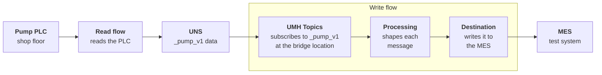
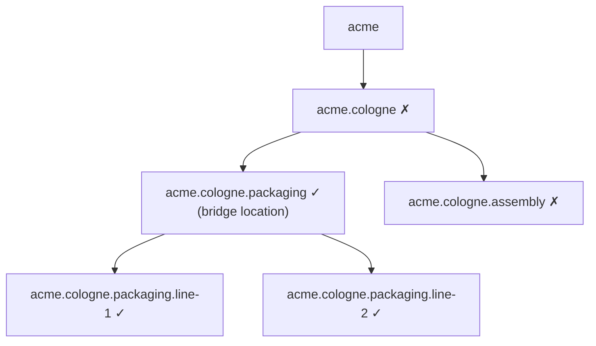

# Write Flow

The write flow is the part of a [bridge](bridges.md) that subscribes to UNS topics and writes to the external system. Typical external systems are:

- MES systems
- HTTP APIs
- Data lakes such as Snowflake
- PLCs on the shop floor
- The [Historian](../historian/README.md)

To configure a write flow in the Management Console, see [Set up a write flow](set-up-a-write-flow.md). When the Management Console rejects your topic patterns, or the bridge shows as degraded, see [Write Flow Topics Rejected](write-flow-topics-rejected.md).

The [topic validation](#topic-validation) rules apply from umh-core 0.45.0. The [emergency setting](write-flow-topics-rejected.md#emergency-setting-bypass-write-flow-validation) lets a write flow subscribe to topics outside its bridge location from umh-core 0.45.2.

Before you use a write flow for data that must arrive, such as production orders or quality records, read [What happens when a write fails](#what-happens-when-a-write-fails).

## How a write flow works

A write flow has three parts. Each part is a card on the **Write Flow** tab of the bridge editor:

1. **UMH Topics**: the topic patterns the write flow subscribes to. A topic pattern is a regular expression that matches one or more UNS topics. Each topic pattern is [validated](#topic-validation).
2. **Processing**: JavaScript that runs on every message before it is written.
3. **Destination**: the settings of the external system the message is written to, such as the URL of an HTTP API.

In this example, a bridge's read flow publishes pump data into the UNS. Its write flow subscribes to that data and writes it to an MES:



The read flow and the write flow of a bridge start, stop and report health separately. A bridge can also have only a write flow. A [Historian bridge](../historian/save-to-historian.md) is a bridge of that kind.

A write flow does not publish anything back into the UNS, and the answer of the external system is not passed on. To call an MES and publish its answer into the UNS, use a [stand-alone flow](stand-alone-flow.md).

Each card has a **Code** mode. **UMH Topics** also has a **Visual** mode, and **Processing** and **Destination** have one for some protocols. In **Code** mode, a card shows the text that is stored in `config.yaml`. UMH Core turns the three cards into one Benthos pipeline: a `uns` input, one processor and one output.

| Card | Code mode shows | `config.yaml` key | Benthos part |
|---|---|---|---|
| **UMH Topics** | The topic patterns, one per line | `source.topics` | The `uns` input, with the topic patterns in `umh_topics` |
| **Processing** | The JavaScript | `processing.code` | One `nodered_js` processor |
| **Destination** | The settings of the output, as YAML | `destination.code` | The output named in `destination.protocol`, such as `http_client` |

The Management Console sets `destination.protocol` for you. [Configuration](#configuration) shows the keys in `config.yaml`.

## What happens when a write fails

UMH Core runs a write flow as a `uns` input, one processor and the output. It adds no retry, fallback or dead-letter queue of its own. What happens when the external system rejects a message or cannot be reached depends on the output. The documentation of the output describes whether and how it retries a failed write.

An acknowledgement tells the `uns` input that a message is handled. When the output gives up on a message, it does not acknowledge it. The `uns` input does not deliver an unacknowledged message again. It continues with the next messages, and the failed message is not written.

A dead-letter queue is where messages go that could not be written, so you can inspect or replay them instead of losing them. A write flow has no dead-letter queue.

A `buffer` in `extra.code` acknowledges a message as soon as it stores the message, before the output writes it. A `memory` buffer can lose the messages it holds when the write flow restarts.

## Topic validation

UMH Core validates every topic pattern of a write flow. A write flow subscribes only to topics at its bridge location and the levels below it, and to one data contract per topic pattern, in one or more versions. In **Visual** mode the Management Console builds topic patterns that pass the validation. The rules below matter when you write topic patterns in **Code** mode or in `config.yaml`. [Topic Convention](../unified-namespace/topic-convention.md) explains the parts of a UNS topic, and [Topic patterns](../unified-namespace/topic-convention.md#topic-patterns) explains the regular expression syntax.

UMH Core accepts a topic pattern only if it follows three rules:

1. **The topic pattern stays at the bridge location or below it.** The bridge location is the instance location plus the bridge's own levels. You set those levels on the **General** tab. A bridge at `acme.cologne.packaging` may subscribe to topics at `acme.cologne.packaging` and `acme.cologne.packaging.line-1`. It may not subscribe to topics at `acme.cologne.assembly` or `acme.cologne`.
2. **The topic pattern names one data contract, in one or more versions.** The built-in contracts are `_raw` and `_historian`. Any other contract must exist on the instance with a version, such as `_pump_v1`. List several versions explicitly, such as `_pump_v[1-2]`. Each listed version must exist. A wildcard in place of the contract or the version, such as `_.*` or `_pump_v\d+`, is rejected.
3. **The topic pattern starts with `^`.** `^` ties the pattern to the start of the topic. Without `^`, the pattern also matches topics that contain it anywhere.

A bridge subscribes only to topics in its own part of the plant. Data from another location reaches it only if a [stream processor](stream-processor.md) or another flow publishes that data at the bridge location first.

The diagram shows at which locations a bridge at `acme.cologne.packaging` may subscribe to topics:



Anything may follow the data contract. A topic pattern can match every tag of a contract, or only some of them:

| You want | Topic pattern |
|---|---|
| All `_pump_v1` tags at the bridge location | `^umh\.v1\.{{ .location_path }}\._pump_v1\.` |
| All `_pump_v1` tags at the bridge location and every level below it | `^umh\.v1\.{{ .location_path }}\.(?:[^._][^.]*\.)*_pump_v1\.` |
| Only the `pressure` tag | `^umh\.v1\.{{ .location_path }}\._pump_v1\.pressure$` |
| Versions 1 and 2 of `_pump`, both created | `^umh\.v1\.{{ .location_path }}\._pump_v[1-2]\.` |

A new version of a data contract does not reach the write flow on its own. Add the version to the topic pattern, for example by changing `_pump_v1` to `_pump_v[1-2]`.

## Reference

### Configuration

A write flow is stored in `config.yaml` in the section `dataflowcomponent_write`. Where that section sits depends on whether the bridge uses a template:

- A bridge created in the Management Console keeps its whole config in a template, in `templates.protocolConverter.<name>`, where `<name>` is the bridge's name. The write flow is in `templates.protocolConverter.<name>.dataflowcomponent_write`. The bridge references the template with `templateRef: <name>`.
- A bridge without `templateRef` keeps it under the bridge, in `protocolConverterServiceConfig.config.dataflowcomponent_write`.

The Management Console writes these sections for you. Edit them by hand only on the instance's [Config File](../instances/config-file.md) page.

This bridge has only a write flow. It writes every `_pump_v1` tag at its bridge location and below to a test MES over HTTP. Every bridge has a connection probe, also one with only a write flow:

```yaml
protocolConverter:
  - name: pump-to-mes
    desiredState: active
    protocolConverterServiceConfig:
      location:
        2: packaging
      writeDFCDesiredState: active
      config:
        connection:
          nmap:
            target: "{{ .IP }}"
            port: "{{ .PORT }}"
        dataflowcomponent_write:
          source:
            topics: |-
              ^umh\.v1\.{{ .location_path }}\.(?:[^._][^.]*\.)*_pump_v1\.
          processing:
            type: nodered_js
            code: |-
              msg.payload = {
                topic: msg.meta.umh_topic,
                value: msg.payload.value,
                timestamp_ms: msg.payload.timestamp_ms
              };
              return msg;
          destination:
            protocol: http_client
            code: |-
              url: http://{{ .IP }}:{{ .PORT }}/api/measurements
              verb: POST
      variables:
        IP: "mes-test.example"
        PORT: "8080"
```

Created in the Management Console, the same bridge looks like this. `config` moves to the template, and the bridge keeps `location`, `writeDFCDesiredState` and `variables`:

```yaml
templates:
  protocolConverter:
    pump-to-mes:
      connection:
        nmap:
          target: "{{ .IP }}"
          port: "{{ .PORT }}"
      dataflowcomponent_write:
        source:
          topics: |-
            ^umh\.v1\.{{ .location_path }}\.(?:[^._][^.]*\.)*_pump_v1\.
        # processing and destination as in the example above
protocolConverter:
  - name: pump-to-mes
    desiredState: active
    protocolConverterServiceConfig:
      templateRef: pump-to-mes
      location:
        2: packaging
      writeDFCDesiredState: active
      variables:
        IP: "mes-test.example"
        PORT: "8080"
```

The table lists the keys that control the write flow:

| Key | Default | Description |
|---|---|---|
| `source.topics` | none, required | The topic patterns, one per line. A line may start with `- `. Template variables such as `{{ .location_path }}` are inserted as literal text, so a variable cannot add pattern syntax to a topic pattern. |
| `processing.type` | `nodered_js` | The processor that runs `processing.code`. `nodered_js` is the only supported processor. |
| `processing.code` | `return msg;` | The JavaScript that runs on every message. |
| `destination.protocol` | none | The output, such as `http_client` or `historian`. A write flow without it does not start. |
| `destination.code` | none | The settings of the output, as YAML. |
| `extra.code` | none | Advanced settings as YAML. Only `cache_resources`, `rate_limit_resources` and `buffer` are used. Other keys are ignored. See the [Benthos-UMH documentation](https://docs.umh.app/benthos-umh). |
| `writeDFCDesiredState` | the bridge's `desiredState` | `active` or `stopped`. It sits in `protocolConverterServiceConfig`, next to `location`. `stopped` stops only the write flow. `active` is a request: the write flow starts only when it has a `destination.protocol` and the connection probe is up. A bridge with `desiredState: stopped` always stops its write flow. |

Changes to the `config.yaml` keys take effect without a restart. UMH Core checks the topic patterns each time it loads the configuration. A topic pattern that breaks the rules keeps the write flow from starting, and the bridge shows as degraded. A stopped write flow, or one without `destination.protocol`, is not checked.

### Metrics

The **Metrics** action on the **Write Flow** card opens the bridge metrics for the write flow. They show messages received and sent, errors, and latency.

For a bridge named `mixing-station`, the write flow's series carry these labels. [Bridges: Metrics](bridges.md#metrics) explains the labels of the other parts of the bridge.

| Part of the bridge | `component` | `instance` |
|---|---|---|
| Its write flow | `dataflow_component_instance` | `write-protocolconverter-mixing-station` |
| The Benthos process of its write flow | `benthos_instance` | `dataflow-write-protocolconverter-mixing-station` |

To alert when a write flow is not active (3), idle (4) or stopped (0) for 5 minutes, use this rule with `for: 5m`:

```promql
umh_core_service_current_state{component="dataflow_component_instance", exported_instance=~"write-protocolconverter-.*"} != 3 != 4 != 0
```

[Read the metrics](../instances/agent/metrics.md#read-the-metrics) explains the state values and why Prometheus shows `instance` as `exported_instance`. The definitions are in [`pkg/metrics/metrics.go`](https://github.com/united-manufacturing-hub/united-manufacturing-hub/blob/staging/umh-core/pkg/metrics/metrics.go).
