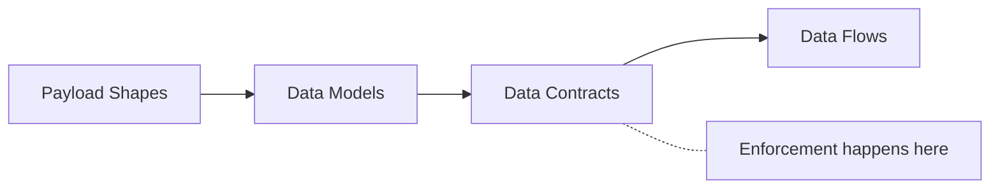
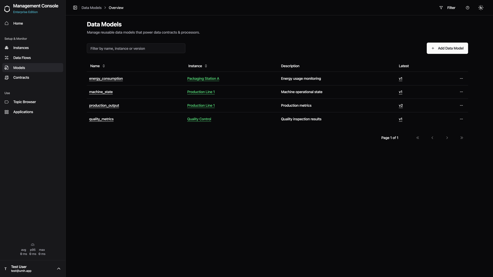
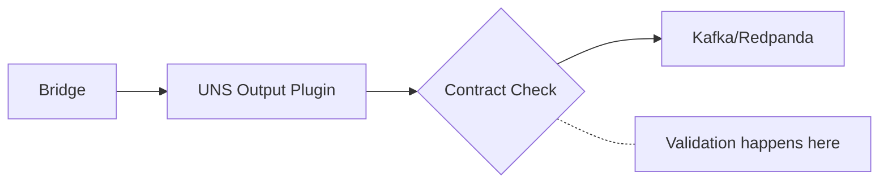

# Data Contracts

> This article assumes you've completed the [Getting Started guide](../../getting-started/) and understand the [data modeling concepts](README.md).

Data contracts are the enforcement mechanism that makes data models mandatory. Without a contract, models are just documentation - contracts make validation happen.

## Overview

In the [component chain](README.md#the-component-chain), contracts sit between models and execution:



When you specify a data contract in a bridge, the UNS output plugin validates every message against the associated model.

## UI Capabilities

The Management Console provides read-only access to contracts:

| Feature | Available | Notes |
|---------|-----------|-------|
| View contract list | ✅ | Shows all contracts with their models |
| Filter/search | ✅ | Filter by name, instance, or model |
| View associations | ✅ | See which model version each contract enforces |
| View usage | ✅ | Shows count of stream processors using contract |
| Create contracts | ❌ | Auto-created when creating models in UI |
| Edit contracts | ❌ | Immutable once created |
| Delete contracts | ❌ | Must be done via config.yaml |



**What you see in the UI:**
- **Name**: Contract identifier (e.g., `_cnc_v1`, `_pump_v2`)
- **Instance**: Which UMH Core instance owns the contract
- **Model**: The model and version being enforced (e.g., `cnc (v1)`)
- **Stream Processors**: Count of processors using this contract

### Auto-Creation via UI

When you create a model in the UI, it automatically generates a matching contract:

1. Create model `pump` version `v1` in UI
2. System auto-creates contract `_pump_v1`
3. Contract immediately available for use in bridges

## Configuration

Access configuration via: Instances → Select instance → `...` → Config File

### Basic Structure

```yaml
dataContracts:
  - name: _pump_v1          # Contract name (used in bridges)
    model:
      name: pump            # References a data model
      version: v1           # Specific version to enforce
```

### Naming Convention

A contract is named `_<model>_v<version>`, such as `_pump_v1`, `_temperature_sensor_v2` or `_workorder_v1`. Only the built-in contracts `_raw` and `_historian` have no version. [Topic Convention](../unified-namespace/topic-convention.md#data-contract) explains where the contract sits in a topic.

## Enforcement Mechanism

### Where Validation Happens



The UNS output plugin (`output: uns: {}`) performs validation:

1. **Reads metadata**: Extracts `data_contract` from message
2. **Looks up contract**: Finds the associated model
3. **Validates structure**: Checks topic path matches model
4. **Validates payload**: Ensures data types match shapes
5. **Result**:
   - ✅ Valid → Message published to topic
   - ❌ Invalid → Message rejected, bridge degraded

### Validation Failures

When validation fails:

```text
ERROR: schema validation failed for message with topic 'umh.v1.enterprise.site._pump_v1.invalid.path':
Valid virtual_paths are: [pressure, temperature, motor.rpm].
Your virtual_path is: invalid.path
```

Result:
- Message rejected (not published)
- Bridge enters degraded state
- Error logged with details
- Bridge retries with backoff

## Contract Types

### The Special _raw Contract

```javascript
// No explicit definition needed - always available
msg.meta.data_contract = "_raw";
```

- Accepts any structure
- No validation performed
- Use for exploration and development, and for [relational data](#time-series-and-relational-data)
- Bridge never goes degraded from data issues

### Model-Based Contracts

```yaml
dataContracts:
  - name: _pump_v1
    model:
      name: pump
      version: v1
```

- Enforces exact model structure
- Validates data types via payload shapes
- Rejects non-conforming messages
- Use for production systems

## Time-series and relational data

Data contracts are supported for time-series data, where each tag holds one value, such as a temperature. Data contracts for relational data, such as a production order with several fields in one message, are not supported yet. [Payload Formats](../unified-namespace/payload-formats.md) explains both formats.

| Data contract | Data | Validated | A write flow can subscribe to it |
|---|---|---|---|
| A contract of a data model, such as `_pump_v1` | Time-series | Yes | Yes |
| `_raw` | Any JSON object, time-series or relational | No | Yes |
| A contract not declared under `dataContracts:`, such as `_mes_order` | Any | No | No |

### Relational data in `_raw`

The supported path for relational data is the built-in `_raw` contract. `_raw` accepts any JSON object and does not validate it. A read flow or a stand-alone flow publishes the records in `_raw`, for example at `umh.v1.acme.cologne.packaging._raw.mes.order`.

Because nothing validates the data in `_raw`, every consumer checks the fields it needs. A [write flow](../data-flows/write-flow.md#relational-data) does this in **Processing**.

### Contracts that are not declared

A stand-alone flow can publish relational data with a data contract that is not declared under `dataContracts:` in `config.yaml`, such as `_mes_order`. This is a provisional path. UMH Core publishes these messages without validation.

A write flow cannot subscribe to such a contract. The Management Console does not offer it on the **UMH Topics** card, and [topic validation](../data-flows/write-flow.md#topic-validation) rejects a topic pattern that names it. To write this data to an external system, publish it in `_raw` as well.

## Examples

### Simple Device Contract

```yaml
# Model definition
dataModels:
  - name: temperature-sensor
    version:
      v1:
        structure:
          celsius:
            _payloadshape: timeseries-number

# Contract (auto-created or manual)
dataContracts:
  - name: _temperature-sensor_v1
    model:
      name: temperature-sensor
      version: v1
```

Usage in a bridge:

```javascript
msg.meta.data_contract = "_temperature-sensor_v1";
msg.meta.tag_name = "celsius";
msg.payload = 23.5;
```

## Relationship to Stream Processors

Stream processors don't use contracts directly - they reference models:

```yaml
templates:
  streamProcessor:
    pump_aggregator:
      model:           # Direct model reference
        name: pump
        version: v1
```

However, if a matching contract exists (`_pump_v1`), the stream processor's output will be validated against it automatically.
