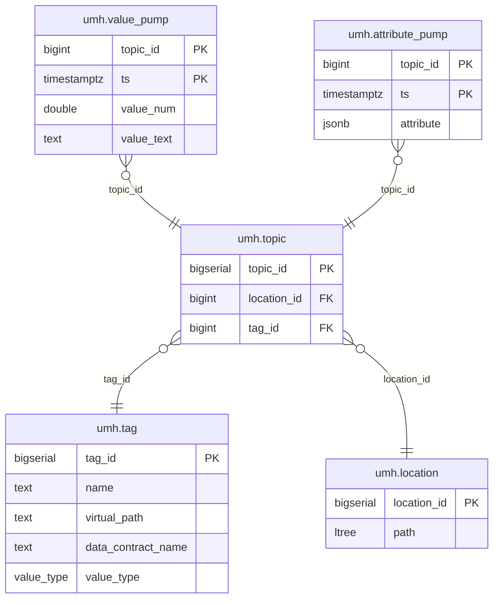

# Database schema

The tables the Historian writes, and the queries the Topic Browser generates. More example queries are
in the output reference under
[Reading the data](https://docs.umh.app/benthos-umh/output/historian#reading-the-data).

## Tables



| Table | Per data contract | Contents |
|---|---|---|
| `umh.value_<contract>` | yes | One row per tag and timestamp. `ts` is a `timestamptz`. Numbers and booleans in `value_num`, strings and JSON in `value_text`. |
| `umh.attribute_<contract>` | yes | The message metadata as a JSON object in `attribute`, queryable with `attribute->>'key'` and `attribute @> '{...}'`. |
| `umh.topic` | no | One row per tag at one location. |
| `umh.tag` | no | Tag name, virtual path, data contract and `value_type`. `data_contract_name` holds the UNS form with a leading underscore, such as `_pump`. |
| `umh.location` | no | The location path as an `ltree`. |

`<contract>` is the data contract without underscore and version, such as `pump`. In location paths,
characters outside `[A-Za-z0-9_-]` become `_`, so `line-1` and `line_1` are different locations.

### Contract version

All versions of a data contract write to the same tables. The version is in the metadata, read as
`attribute->>'data_contract_version'`.

## umh.get_topic_id

`umh.get_topic_id(location_path, virtual_path, data_contract, tag_name)` returns the `topic_id` of one
tag:

```sql
SELECT ts, value_num
FROM   umh.value_pump
WHERE  topic_id = umh.get_topic_id('enterprise.site.area.line', '', 'pump', 'temperature')
  AND  ts BETWEEN now() - INTERVAL '1 hour' AND now()
ORDER  BY ts;
```

For a tag without a virtual path, pass `''`, not `NULL`. `data_contract` accepts `pump`, `_pump` and
`_pump_v1`.

## Queries in the SQL query tab

The **SQL query** tab shows queries for every time-series tag. They return rows once the Historian
stores the tag's data contract; see
[SQL Query Returns No Rows](troubleshooting/sql-query-returns-no-rows.md).

| Control | Effect |
|---|---|
| **Grafana** / **TimescaleDB** | The Grafana query takes the dashboard's time range. The TimescaleDB query covers a fixed window ending now, about 60 intervals long (1 hour for raw rows). |
| **Aggregate** | On: average, minimum and maximum per interval. Off, and always for text tags: every stored row. |
| **Interval** | **Automatic** (Grafana only), `1 second`, `10 seconds`, `1 minute` or `1 hour`. |

The aggregated query for a numeric tag:

```sql
SELECT time_bucket_gapfill('1 minute', ts) AS time,
       avg(value_num) AS "temperature_avg",
       min(value_num) AS min,
       max(value_num) AS max
FROM   umh.value_pump
WHERE  topic_id = umh.get_topic_id('enterprise.site.area.line', '', 'pump', 'temperature')
  AND  ts >= $__timeFrom() AND ts <= $__timeTo()
GROUP  BY 1
ORDER  BY 1;
```

An interval without a stored value stays empty and shows as a gap in Grafana. The
[downsampler](https://docs.umh.app/benthos-umh/processing/downsampler) drops values that change less
than its threshold before they reach the Unified Namespace, so the Historian never receives them. A
downsampled tag therefore shows gaps while its value stays within the threshold. `avg` weights every
row equally, so it is a time average only at a fixed sample rate.

## Database Schema page

Opens from **Database schema** on the overview page or **Schema** in the Historian card's menu. It
lists the tables of the `umh` schema with their columns. **LLM Context** gives the schema, its rules
and example queries as Markdown for an AI assistant.
