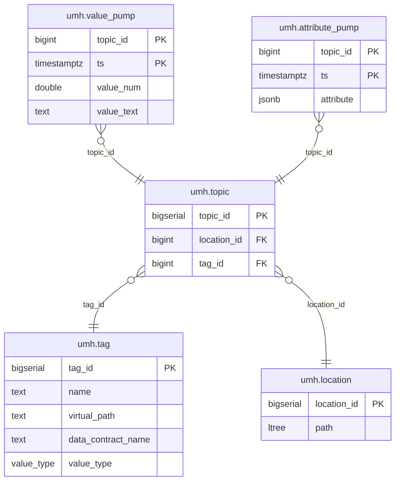

# Database schema

This page describes the tables the Historian writes in TimescaleDB, the queries the Topic Browser
generates, and the Database Schema page in the Management Console. It is for readers who write their
own SQL or check a generated query. The output reference's
[Reading the data](https://docs.umh.app/benthos-umh/output/historian#reading-the-data) section has
more example queries and the pitfalls of hand-written queries.

## Tables

Values are stored per data contract. Tag identity is shared across data contracts.



| Table | Per data contract | Contents |
|---|---|---|
| `umh.value_<contract>` | yes | One row per tag and timestamp. `ts` is a `timestamptz`. Numbers and booleans in `value_num`, strings and JSON in `value_text`. |
| `umh.attribute_<contract>` | yes | The message metadata as a JSON object in `attribute`, queryable with `attribute->>'key'` and `attribute @> '{...}'`. |
| `umh.topic` | no | One row per tag at one location. |
| `umh.tag` | no | Tag name, virtual path, data contract and `value_type`. `data_contract_name` holds the UNS form with a leading underscore, such as `_pump`. |
| `umh.location` | no | The location path as an `ltree`. |

`<contract>` is the bridge's `data_contract_name`, such as `pump`. `value_type` records whether a tag
is numeric or text; see [Precision and datatypes](precision-and-datatypes.md).

Location paths are canonicalized: characters outside `[A-Za-z0-9_-]` become `_`, so `line-1` and
`line_1` are different locations. See
[Location identity](https://docs.umh.app/benthos-umh/output/historian#location-identity).

### Contract version

All versions of a data contract write to the same tables and share one `umh.tag` row. No column holds
the version. The version is stored in the metadata, read as `attribute->>'data_contract_version'`.
An unversioned data contract such as `_historian` has no version key. See
[Contracts, versions and tables](contracts-versions-and-tables.md).

## umh.get_topic_id

`umh.get_topic_id(location_path, virtual_path, data_contract, tag_name)` returns the `topic_id` of one
tag. The generated queries use it instead of joining the identity tables:

```sql
SELECT ts, value_num
FROM   umh.value_pump
WHERE  topic_id = umh.get_topic_id('enterprise.site.area.line', '', 'pump', 'temperature')
  AND  ts BETWEEN now() - INTERVAL '1 hour' AND now()
ORDER  BY ts;
```

- A tag without a virtual path has `virtual_path` as the empty string `''`. `NULL` matches nothing and
  returns an empty result without an error.
- `data_contract` accepts `pump`, `_pump` and `_pump_v1` for the same tag.

## Queries in the SQL query tab

The Topic Browser's **SQL query** tab generates the queries for one tag. It shows them only when the
Historian stores the tag's data contract; see
[Troubleshoot a Historian bridge](troubleshoot-a-bridge.md#the-sql-query-tab-has-no-query). The
Management Console runs none of these queries.

| Control | Effect |
|---|---|
| **Grafana** / **TimescaleDB** | Grafana's query limits the time range with `$__timeFrom()` and `$__timeTo()`, which the dashboard fills in. The TimescaleDB query uses a fixed window ending at `now()`, sized to return about 60 intervals. |
| **Aggregate** | On: one row per interval with the average, minimum and maximum of `value_num`. Off: every stored row in the range. Text tags cannot be aggregated, so their query always returns the stored rows. |
| **Interval** | The width of each interval: **Automatic** (Grafana's `$__interval`, Grafana tab only), `1 second`, `10 seconds`, `1 minute` or `1 hour`. Grafana starts at **Automatic**, TimescaleDB at `1 minute`. |

The fixed window of the TimescaleDB query per interval:

| Interval | Window |
|---|---|
| `1 second` | 1 minute |
| `10 seconds` | 10 minutes |
| `1 minute` | 1 hour |
| `1 hour` | 60 hours |
| raw rows | 1 hour |

The aggregated query for a numeric tag:

```sql
SELECT time_bucket_gapfill('1 minute', ts) AS time,
       avg(value_num) AS "temperature_avg",
       min(value_num) AS min,
       max(value_num) AS max
FROM   umh.value_pump
WHERE  topic_id = umh.get_topic_id('enterprise.site.area.line', '', 'pump', 'temperature')
  AND  ts >= $__timeFrom() AND ts <= $__timeTo()
GROUP  BY 1
ORDER  BY 1;
```

The queries return only stored values. `time_bucket_gapfill` returns a row for every interval in the
range, and an interval without a stored value has empty columns. Grafana shows it as a gap. A tag
that stores a value only when it changes, for example behind the
[downsampler](https://docs.umh.app/benthos-umh/processing/downsampler), shows empty intervals while
its value stays constant.

`avg` weights every stored row equally. It matches the average over time only for a tag that stores
values at a fixed rate.

## Database Schema page

The Database Schema page opens from **Database schema** on the **Database status** card of the
Historian overview page, or from **Schema** in the menu of the Historian card in the **Plugins** tab.
It lists the tables of the `umh` schema with their columns and contents, and the data contracts the
database stores.

**LLM Context** opens the schema, its rules and example queries as Markdown, to copy or download. An
AI assistant that gets this text writes queries against your actual tables. The text describes empty
intervals the same way as the generated queries.
