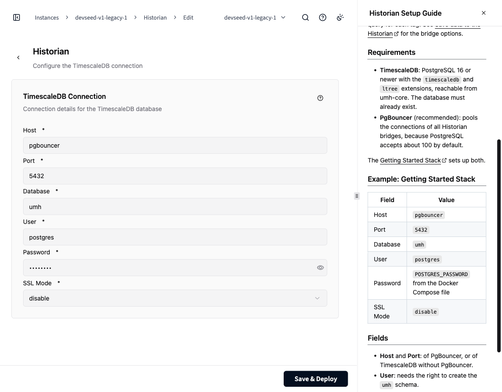
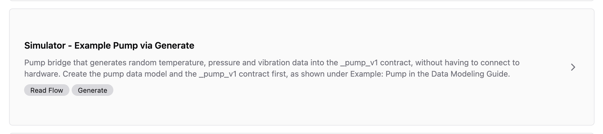
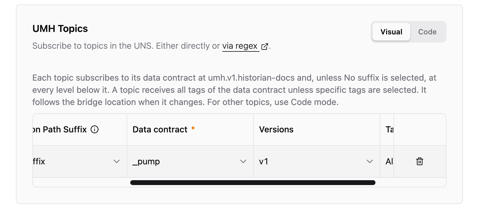
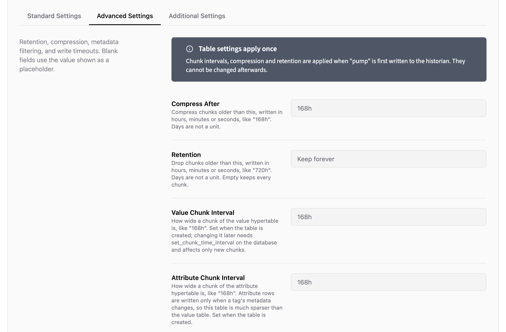
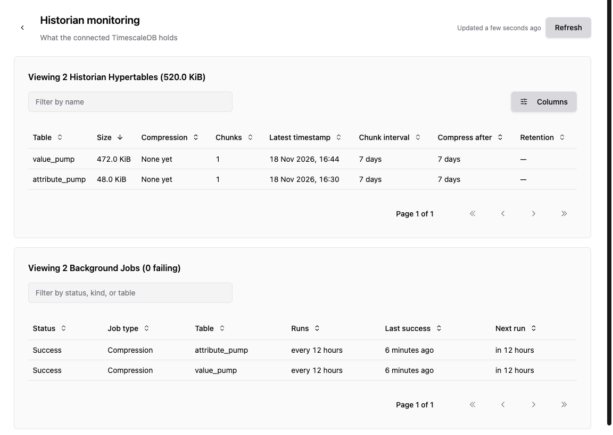

# Use the Historian

This guide connects an instance to a TimescaleDB database, stores one of your data models in it, and
builds a Grafana dashboard on the stored data.

You need:

- A UMH Core instance connected to the Management Console.
- A TimescaleDB database the instance can reach. The
  [Recommended UMH Stack](../../production/deployment/docker-compose/additional-services/recommended-umh-stack.md),
  which the Management Console calls the Getting Started Stack, starts UMH Core, TimescaleDB,
  PgBouncer and Grafana together. For a database you run yourself, check the
  [requirements](connection.md#requirements).

## Step 1: Add the Historian plugin

Open your instance, go to the **Plugins** tab, click **Add plugin** and choose **Historian**.

Enter the host, port, database, user, password and SSL mode of your database. The **Setup Guide**
next to the form lists the values for the Getting Started Stack. The fields are described in
[Connection](connection.md#connection-fields).

Click **Save & Deploy**. The Plugins tab now shows the Historian card with the connection status.

## Step 2: Choose the data model to store

The Historian stores data models you choose. Pick a data model whose data already arrives in the
Unified Namespace. Its name must contain no dashes; see
[Historian bridge](bridge.md#data-models-with-a-dash-in-the-name).

### No data yet: the pump example

Skip this part if your data already arrives. Otherwise, go to **Data Models** → **Add Data Model**, name it `pump`, and
copy the structure from the **Example: Pump** section of the Data Modeling Guide next to the form.
It describes a pump with a temperature, a pressure and a vibration on two axes.

Then add a bridge from the **Simulator - Example Pump via Generate** template in the Add Bridge list.
It publishes random pump values for version 1 of the `pump` data model.

## Step 3: Save the data model to the Historian

On the **Data Models** page, click **add** in the **Historian** column of your data model. The row
menu has the same action as **Save to Historian**.

The Historian bridge opens with its fields filled in. The connection comes from the plugin, and the
bridge name follows the data model. Check the instance and the location.

In the write flow, check the selected topic. **Save to Historian** selects the latest version of
your data model. If your devices publish an older version, select that version instead. The pump
example publishes version 1.

Do not deploy yet. Step 4 sets the values that cannot be changed after the first deployment.

## Step 4: Decide how long to keep the data

1. Open **Destination** → **Advanced Settings**.
2. Set **Compress After**. Data older than this is compressed to save disk space and stays
   available for queries. The default is one week, `168h`.
3. Set **Retention** if you want old data deleted. Data older than the retention is deleted. Leave it
   empty to keep all data, which is the default.
4. Click **Save & Deploy** and wait until the deployment finishes.

Write each duration in hours, minutes or seconds, for example `168h` for one week. Days are not a
unit, so `7d` is rejected.

These values apply only when the Historian creates the tables for the data model, before the first
value is written. After that, the form shows them read-only. To find out why, see
[Settings applied once](settings-applied-once.md).

Back on the **Data Models** page, the **Historian** column shows that the data model is stored and
whether storing works. Hover over it for the details, including the versions the bridge stores.

## Step 5: Check that the data arrives

On the Historian card in the **Plugins** tab, click **Open plugin**. The overview page shows whether
the database is reachable, whether the login works, how much disk space is used, and how much
history is stored.

On the **Database status** card, click **Monitor database**. The Monitor page shows the size,
compression and time range of each table, and whether the database's background jobs succeed.

[Historian](README.md#overview-page) describes every field on both pages.

## Step 6: Get a query for a tag

1. Open the **Topic Browser** and select a tag of your data model, for example the pump
   `temperature`.
2. Open the **SQL query** tab. It has a query for **Grafana** and one for **TimescaleDB**, which
   works in any SQL client.
3. Leave **Aggregate** on for numbers. It groups the values into intervals and returns the average,
   minimum and maximum of each interval.
4. Copy the query.

The queries return only values the Historian stored. An interval without a stored value stays empty
and shows as a gap in Grafana.

The tab shows queries for every time-series tag, with the note **Historian database required**. A
query returns rows only for a tag whose data contract the Historian stores. If it returns none, see
[Troubleshoot a Historian bridge](troubleshoot-a-bridge.md#a-query-from-the-sql-query-tab-returns-no-rows).

## Step 7: Let an AI assistant write your queries

On the Historian overview page, click **Database schema** on the **Database status** card. The menu
of the Historian card in the **Plugins** tab has the same page as **Schema**. The page lists the
tables the Historian stores.

Click **LLM Context**, then copy or download the text. It describes your tables, their rules and
example queries for an AI assistant such as Claude or ChatGPT.

Give the text to the assistant together with your question, for example "show the average pump
temperature per hour for the last week".

Without this text, the assistant has to guess the names of your tables and columns. Check each
generated query in Grafana before you rely on it.

## Step 8: Build a Grafana dashboard

1. In Grafana, add the database as a PostgreSQL data source, if it is not added yet. The Getting
   Started Stack does not add it: use host `pgbouncer:5432`, database `umh` and the credentials from
   the Docker Compose file. See
   [Recommended UMH Stack](../../production/deployment/docker-compose/additional-services/recommended-umh-stack.md#whats-next)
   and Grafana's
   [PostgreSQL data source documentation](https://grafana.com/docs/grafana/latest/datasources/postgres/).
2. Create a panel and paste the Grafana query from Step 6, or a query from the assistant in Step 7.
   The dashboard's time range sets the time range of the query.

To store another data model, repeat Steps 3 and 4.
