# Use the Historian

This guide connects a database, stores a data model in it and builds a Grafana dashboard.

You need:

- A UMH Core instance connected to the Management Console.
- A TimescaleDB database the instance can reach, for example from the
  [Getting Started Stack](../../production/deployment/docker-compose/additional-services/recommended-umh-stack.md).
  For your own database, check the [requirements](setup.md#requirements).

## Step 1: Add the Historian plugin

Open your instance, go to the **Plugins** tab, click **Add plugin** and choose **Historian**.

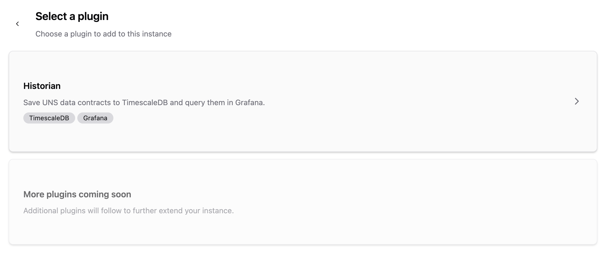

Enter the connection of your database. The **Setup Guide** next to the form lists the values for the
Getting Started Stack; the fields are described in [Setup](setup.md#connection-form).

Click **Save & Deploy**. The Plugins tab now shows the Historian card.

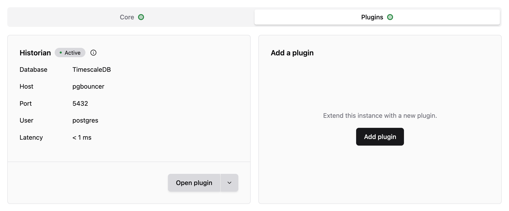

## Step 2: Choose the data model to store

Pick a data model whose data already arrives in the Unified Namespace. Its name must not contain a
dash; see [Historian bridge](bridge.md#data-models-with-a-dash-in-the-name).

### No data yet: the pump example

Go to **Data Models** → **Add Data Model**, name it `pump` and copy the structure from **Example:
Pump** in the Data Modeling Guide next to the form.

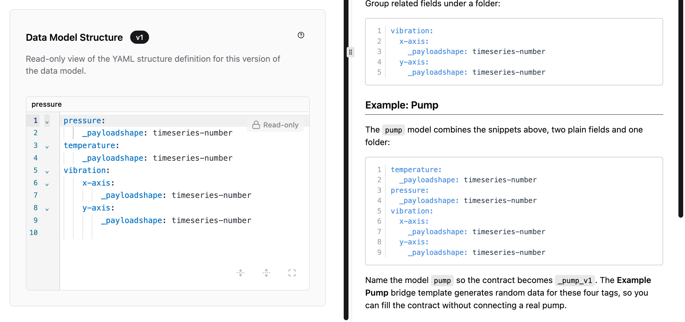

Then add a bridge from the **Simulator - Example Pump via Generate** template. It publishes random
values for version 1 of `pump`.

## Step 3: Save the data model to the Historian

On the **Data Models** page, click **add** in the **Historian** column of your data model, or **Save
to Historian** in its row menu.

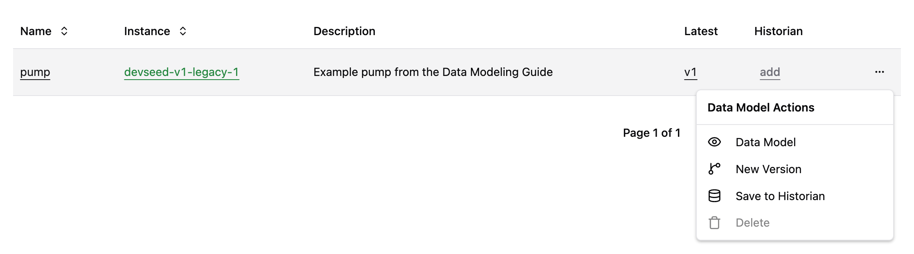

The Historian bridge opens filled in. Check the instance and the location.

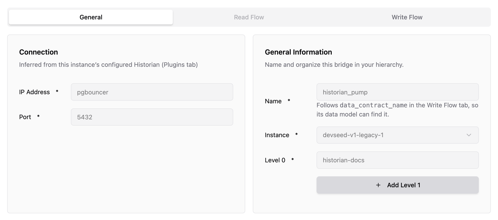

In the write flow, check the version: the latest is selected. If your devices publish an older
version, select that one; the pump example publishes v1.

Do not deploy yet.

## Step 4: Decide how long to keep the data

1. Open **Destination** → **Advanced Settings**.
2. Set **Compress After**: older data is compressed and stays queryable. The default is `168h`.
3. Set **Retention** to delete older data, or leave it empty to keep everything.
4. Click **Save & Deploy**.

Durations take hours, minutes or seconds, such as `168h`, not days. The values are fixed after the
first deployment; see [Historian parameters](how-the-historian-stores-data.md#historian-parameters).

<figure>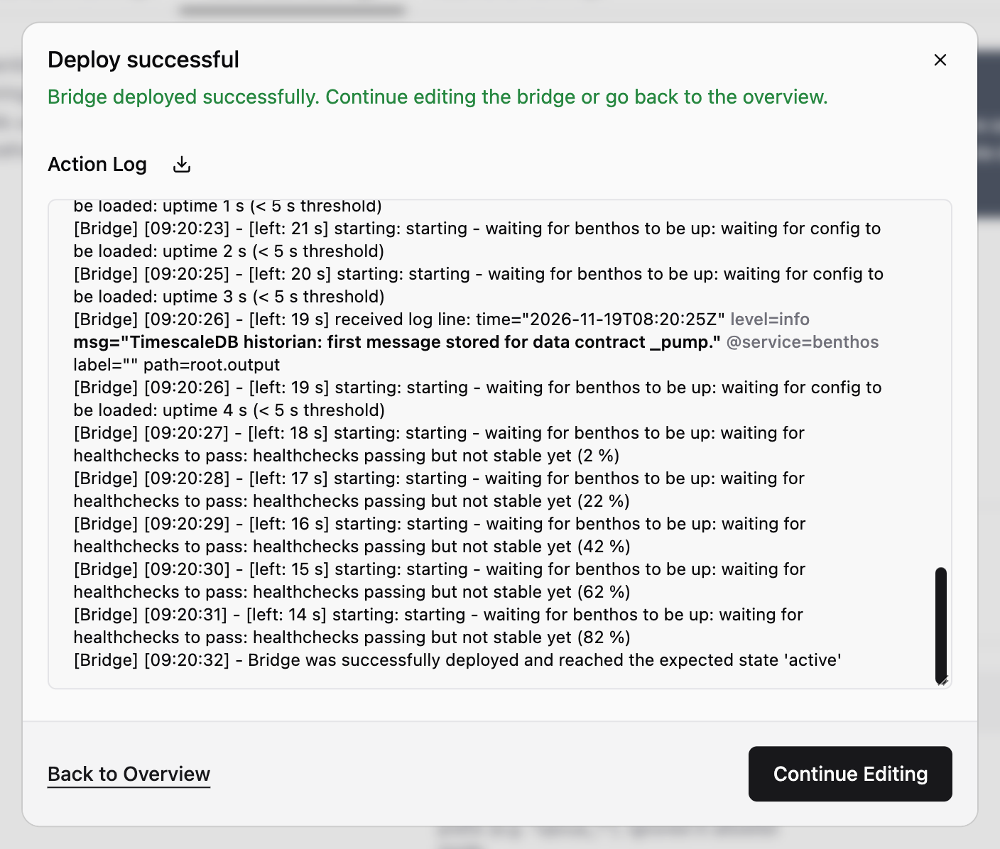<figcaption></figcaption></figure>

On the **Data Models** page, the **Historian** column now shows the bridge's health. Hover over it for
the stored versions.

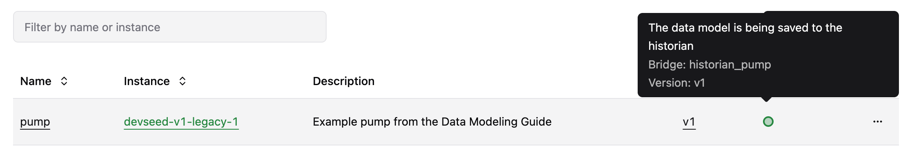

## Step 5: Check that the data arrives

On the Historian card in the **Plugins** tab, click **Open plugin**. The overview page shows the
connection, the disk use and how much history is stored.

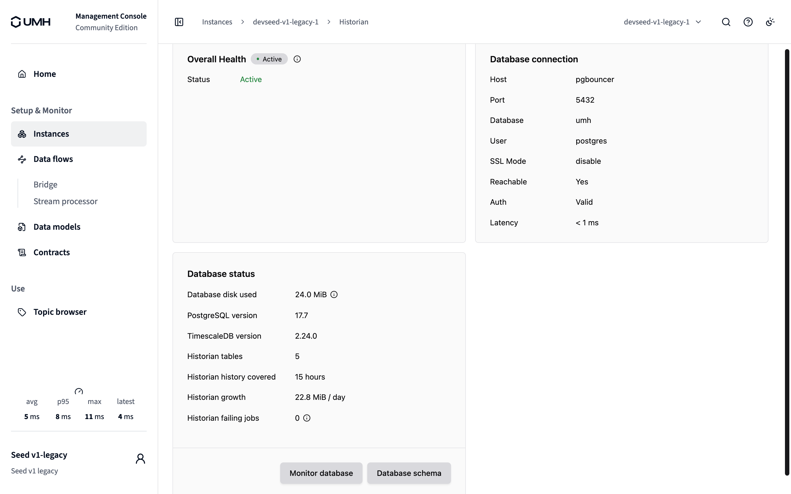

**Monitor database** shows each table's size and compression, and whether the background jobs
succeed.

The fields are described in [Historian](README.md#overview-page).

## Step 6: Get a query for a tag

1. Open the **Topic Browser** and select a tag of your data model, for example the pump
   `temperature`.
2. Open the **SQL query** tab and choose **Grafana**, or **TimescaleDB** for any other SQL client.
3. Leave **Aggregate** on to get the average, minimum and maximum per interval.
4. Copy the query.

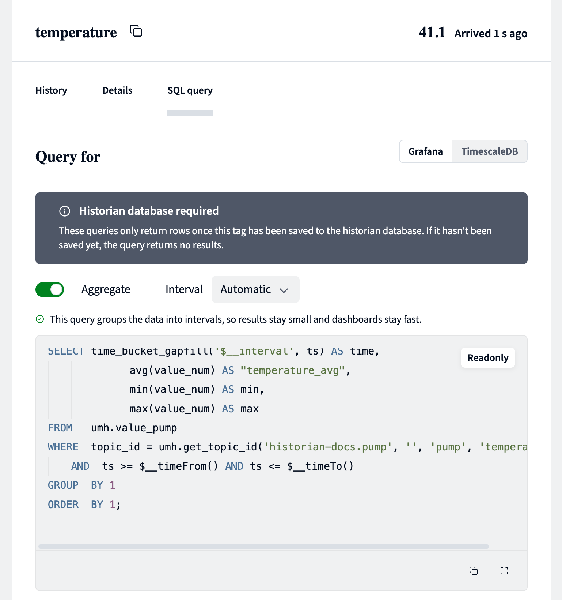

The tab shows queries for every tag, with the note **Historian database required**. They return rows
only for stored data contracts; see
[SQL Query Returns No Rows](troubleshooting/sql-query-returns-no-rows.md).

## Step 7: Let an AI assistant write your queries

On the Historian overview page, click **Database schema**.

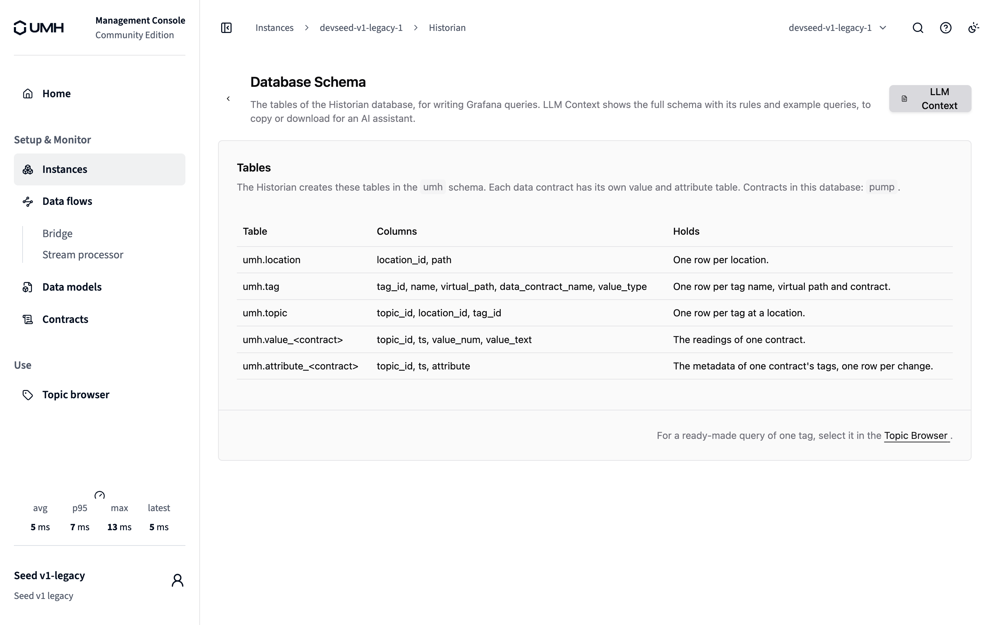

Click **LLM Context** and copy or download the text. It describes your tables for an AI assistant.

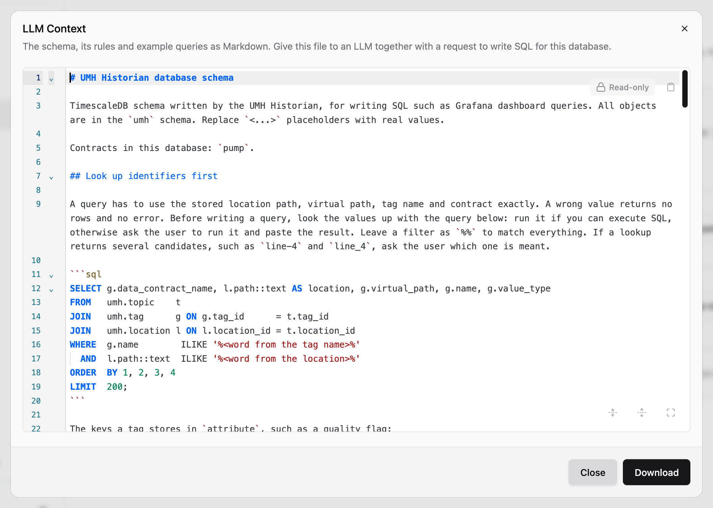

Give the text to the assistant with your question, for example "show the average pump temperature
per hour for the last week". Check each generated query in Grafana before you rely on it.

## Step 8: Build a Grafana dashboard

1. In Grafana, add the database as a
   [PostgreSQL data source](https://grafana.com/docs/grafana/latest/datasources/postgres/). For the
   Getting Started Stack, use host `pgbouncer:5432`, database `umh` and the credentials from its Docker
   Compose file.
2. Create a panel and paste the query from Step 6 or Step 7.

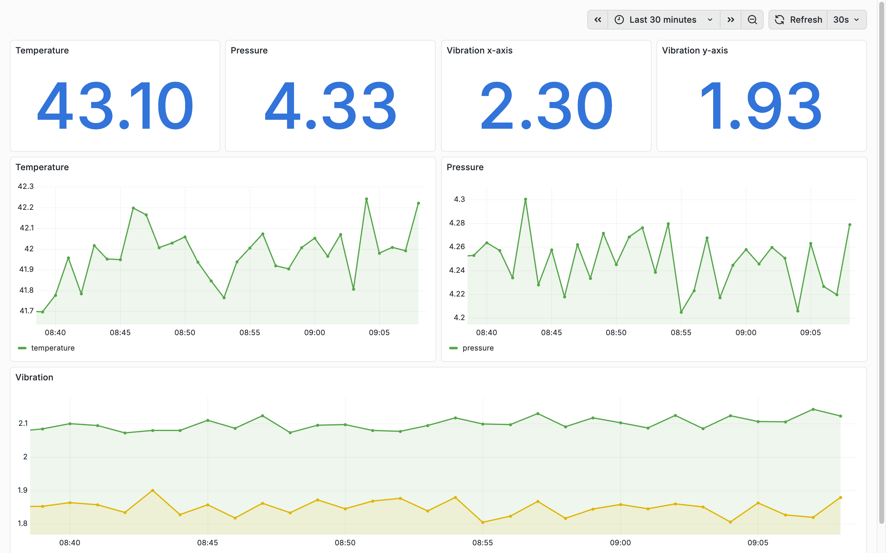

To store another data model, repeat Steps 3 and 4.
