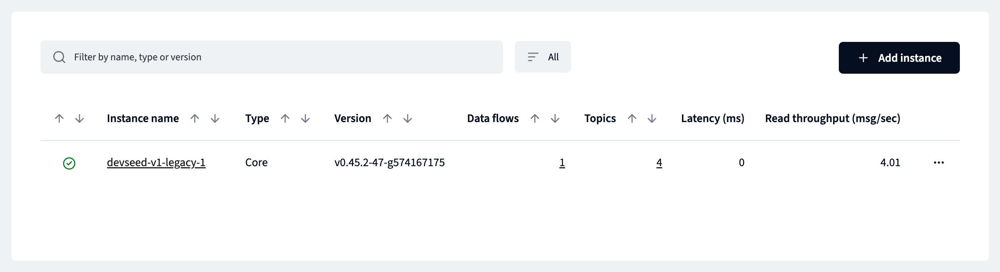

# Instances

An instance is a running UMH Core container: a single Docker container that hosts your Unified Namespace, your bridges and your flows. Each instance has a location path like `enterprise.site.area.line`, which decides where its data appears in the Unified Namespace. The Instance UUID identifies the instance.

## The instance list

**Instances** lists every instance you can access, one row each:

<figure><figcaption></figcaption></figure>

| Column | Shows |
|---|---|
| Status | **Active**, **Neutral**, **Degraded** or **Offline**. Hover over it to see why an instance is not active. An instance that the instance filter leaves out shows **Not in the filter** and no other values. |
| Instance name | The name of the instance. While the instance is online, click it to open the instance details page. |
| Type | **Core** for UMH Core, **Classic** for UMH Classic. `n/a` while the instance is offline. |
| Version | The UMH Core version, or for UMH Classic the version of the companion. A marker shows when a newer version is available, or that the version is no longer supported and needs an upgrade. |
| Data flows | The number of bridges, stand-alone flows and stream processors. It links to the Data Flows list, filtered to this instance. |
| Topics | The number of topics in the instance's Unified Namespace. It links to the Topic Browser. |
| Read throughput (msg/sec) | The messages per second of all data flows on the instance, input and output added together, as a one-minute average. |

The row menu has these entries:

- **Instance details**, disabled while the instance is offline.
- **Config file**, only for a UMH Core instance that is online.
- **Upgrade**, only for a UMH Classic instance whose companion is not up to date.
- **Audit logs**, only for a UMH Classic instance with companion 0.6.19 or later, and only with an active license and audit logs enabled for your organization.
- **Delete**.

<figure><figcaption></figcaption></figure>

## The instance details page

The **Core** tab shows one card per component. [Instance Details Page](instance-details-page.md) lists every field, status and reason on the cards.

| Card | Usage page |
|---|---|
| Agent | [Agent](agent/README.md) |
| Container | [Container](container/README.md) |
| Communicator | [Communicator](communicator/README.md) |
| Data Flows | [Data Flows](../data-flows/README.md) |
| Redpanda | [Redpanda](../unified-namespace/redpanda.md) |
| Topic Browser | [Topic Browser](../unified-namespace/topic-browser.md) |

The **Plugins** tab shows the plugins added to the instance. The [Historian](../historian/README.md) is the first plugin.

**View Instance Config** opens the instance's `config.yaml`. See [Edit the Config File](edit-the-config-file.md).

## Configuration

An instance authenticates with an `AUTH_TOKEN`, not with a user account. The Management Console generates the token while you create the instance and shows it once. Copy it then and pass it to the container as the `AUTH_TOKEN` environment variable on the first start. `AUTH_TOKEN` has no default. umh-core reads it once at startup and stores it in `config.yaml` as `agent.communicator.authToken`. Without a token in either place, the instance runs without a connection to the Management Console. To change the token, remove the container and start it again with the same `docker run` command and the new value. `docker restart` keeps the old environment.

The token does two things:

- It proves the instance's identity. The Management Console accepts the instance's status and hands it the configuration meant for it.
- It locks the instance's access to the Management Console. Only the instance can unlock it, because only the instance has the token. The Management Console cannot.

Keep the token somewhere you can find it again, such as your password manager. For storage and rotation on the instance, see [AUTH_TOKEN in Environment Variable](../../production/security/umh-core/deployment-security.md#auth_token-in-environment-variable).

Every other setting is a key in `config.yaml` or an environment variable of the container. See the [Configuration Reference](../../reference/configuration-reference.md) and [Environment Variables](../../reference/environment-variables.md).

## Metrics

Every instance serves Prometheus metrics on port 8080. [Collect Metrics with Prometheus](metrics/collect-with-prometheus.md) explains how to reach them. [Metrics](metrics/README.md) explains the series, and [Read the metrics](metrics/README.md#read-the-metrics) explains why Prometheus renames the `instance` label.

## Troubleshooting

[Troubleshooting](troubleshooting/README.md) lists the pages for instance problems, each named after the symptom.
