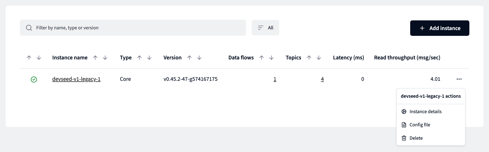
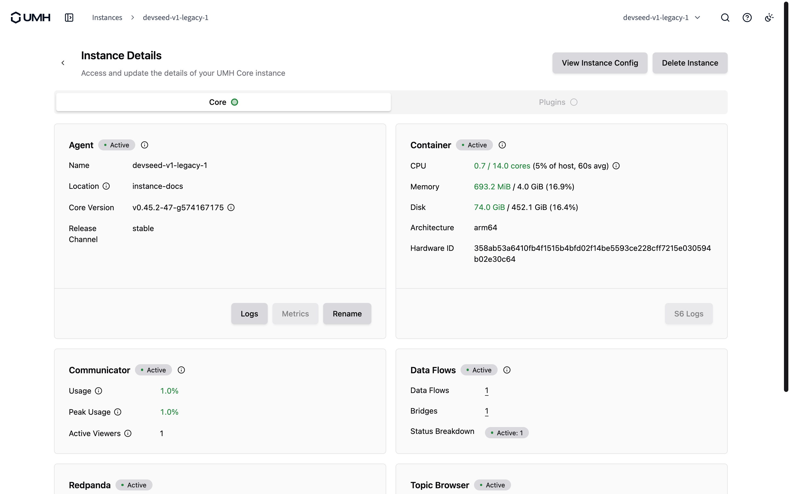

# Instances

An instance is a running UMH Core container: a single Docker container that hosts your Unified Namespace, your bridges and your flows. Each instance has a location path like `enterprise.site.area.line`, which decides where its data appears in the Unified Namespace. The Instance UUID identifies the instance.

## The instance list

**Instances** lists every instance you can access, one row each:

| Column | Shows |
|---|---|
| Status | **Active**, **Neutral**, **Degraded** or **Offline**. Hover over it to see why an instance is not active. An instance that the instance filter leaves out shows **Not in the filter** and no other values. |
| Instance name | The name of the instance. Click it to open the instance details page. For an instance in the instance filter, this works only while it is online. |
| Type | **Core** for UMH Core, **Classic** for UMH Classic. `n/a` while the instance is offline. |
| Version | The UMH Core version, or for UMH Classic the version of the companion. A marker shows when a newer version is available, or that the version is no longer supported and needs an upgrade. |
| Data flows | The number of bridges, stand-alone flows and stream processors. It links to the Data Flows list, filtered to this instance. |
| Topics | The number of topics in the instance's Unified Namespace. It links to the Topic Browser, or to the Tag Browser for UMH Classic, and adds the instance to the instance filter. |
| Read throughput (msg/sec) | The messages per second of all data flows on the instance, input and output added together, as a one-minute average. |

The row menu has these entries:

- **Instance details**, disabled while the instance is offline.
- **Config file**, only for a UMH Core instance that is online and whose UMH Core version supports it.
- **Upgrade**, only for a UMH Classic instance whose companion is not up to date.
- **Audit logs**, only for a UMH Classic instance with companion 0.6.19 or later, and only with an active license and audit logs enabled for your organization.
- **Delete**.

## The instance details page

The instance details page has two tabs. **Core** shows one card per component of UMH Core. **Plugins** shows the plugins added to the instance. See [Plugins](plugins.md).

Each card has a status badge: **Active**, **Neutral**, **Degraded**, or **Stopped** for a component that is meant to be stopped. When the instance sent a reason, an info button next to the badge shows it. The cards show the status that the instance sent last. After 15 seconds without a message from the instance, the Management Console shows a red alert, "Instance Offline", above the tabs, and the cards keep showing the last status.

Each card is explained on the page of its component:

| Card | Page |
|---|---|
| Agent | [Agent](agent/README.md#the-agent-card) |
| Container | [Container](container/README.md#the-container-card) |
| Communicator | [Communicator](communicator/README.md#the-communicator-card) |
| Data Flows | [Data Flows](../data-flows/README.md#the-data-flows-card) |
| Redpanda | [Redpanda](../unified-namespace/redpanda.md#redpanda-card) |
| Topic Browser | [Topic Browser](../unified-namespace/topic-browser.md#topic-browser-card) |

**View Instance Config** opens the instance's `config.yaml`. It appears when the instance's UMH Core version supports it. See [Edit the Config File](edit-the-config-file.md).

## Reference

### Configuration

`AUTH_TOKEN` and `API_URL`, which connect the instance to the Management Console, are explained in [Communicator: Configuration](communicator/README.md#configuration). Every other setting is a key in `config.yaml` or an environment variable of the container. See the [Configuration Reference](../../reference/configuration-reference.md) and [Environment Variables](../../reference/environment-variables.md).

### Metrics

Every instance serves Prometheus metrics on port 8080. [Read the metrics](agent/metrics.md#read-the-metrics) explains how to reach them, and each component page explains its own metrics.
