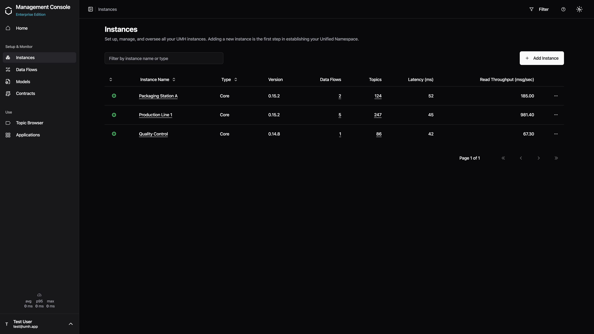
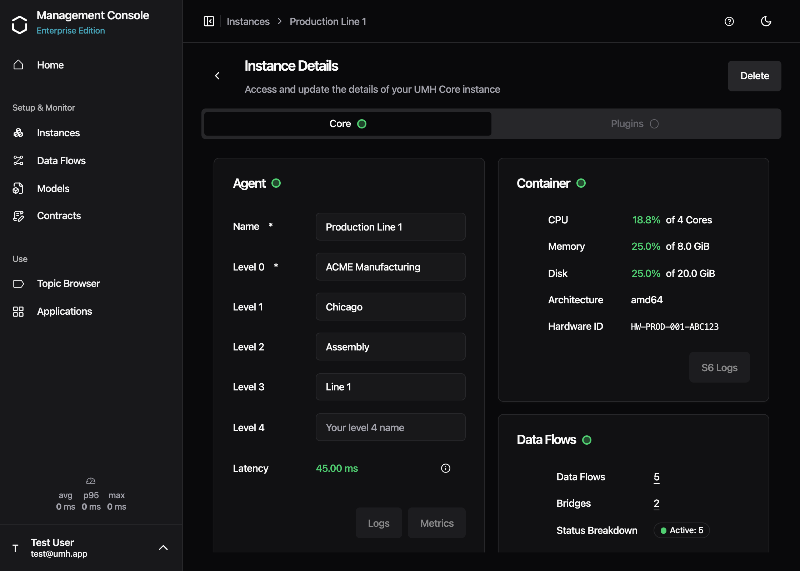

# Instances

## What is an Instance?

An instance is a running UMH Core container - a single Docker container that hosts your entire Unified Namespace. Each instance has a location path like `enterprise.site.area.line`. The location path determines where data is organized in your industrial data infrastructure. An instance is also uniquely identified by its Instance UUID.

## How an instance connects

An instance authenticates with an `AUTH_TOKEN`, not with a user account. The Management Console generates the token while you create the instance and shows it once. Copy it then and pass it to the container as the `AUTH_TOKEN` environment variable on the first start.

The token does two things:

- It proves the instance's identity. The Management Console accepts the instance's status and hands it the configuration meant for it.
- It locks the instance's access to the Management Console. Only the instance can unlock it, because only the instance has the token. The Management Console cannot.

Keep the token somewhere you can find it again, such as your password manager. For storage and rotation on the instance, see [AUTH_TOKEN in Environment Variable](../../production/security/umh-core/deployment-security.md#auth_token-in-environment-variable).

## Instance Overview Page
<!-- TODO: Needs Instance Filtering explanation -->

<!-- TODO: Needs new screenshot, UI outdated -->

The instance overview shows all your UMH instances at a glance:

- **Instance Name**: Your chosen identifier for the instance
- **Type**: 
  - **Core**: Single container deployment (UMH Core)
  - **Classic**: Kubernetes-based deployment (legacy)
- **Version**: Container version identifier (e.g., `9e22396`)
- **Data Flows**: Number of configured bridges and stand-alone flows
- **Topics**: Total data points in your Unified Namespace
- **Latency**: Network response time in milliseconds
- **Throughput**: Messages per second flowing through the system

**Status indicators:**
- Green dot: Instance is online and reachable
- Gray dot: Instance is offline or unreachable

**Quick actions:** Click the context menu (⋮) on any instance for:
- Instance Details
- Config File
- Delete

## Instance Details Page
<!-- TODO: Needs new screenshot, UI outdated -->

The instance details page provides comprehensive monitoring and management:

### Agent Card
The Agent card shows the identity and the version of the instance: its name, location path, UMH Core version and release channel. See [Agent](agent/README.md).

### Container Card
The Container card shows the CPU, memory and disk of the container, its architecture and its Hardware ID. See [Container](container/README.md).

### Communicator Card
The Communicator card shows the connection to the Management Console: its health, how full the outbound queue is, and how many Management Console sessions watch the instance. See [Communicator](communicator/README.md).

### Data Flows Card
The Data Flows card groups bridges and stand-alone flows by their state. The states come from the [state machines](../../reference/state-machines.md) reference:
- **Active**: Currently processing data (messages flowing)
- **Neutral**: Includes:
  - `idle`: Healthy but no data for 30+ seconds
  - `stopped`: Intentionally disabled
  - `starting`: Initialization in progress
  - Various transition states

Example states:
- `starting_dfc (port is open)`: Connection verified, waiting for Benthos, the stream processor that runs the flow, to start
- `starting: stopping: stopping`: Complex state transition in progress

**Bridges count**: Total configured with active/neutral breakdown

### Redpanda Card
The Redpanda card shows the message broker that stores your [Unified Namespace](../unified-namespace/README.md):
- **Incoming Throughput**: Data rate into the broker, per second, in B, KiB, MiB or a larger binary unit, depending on the value
- **Outgoing Throughput**: Data rate from the broker, per second, in B, KiB, MiB or a larger binary unit, depending on the value
- **Logs/Metrics buttons**: Direct access to Redpanda diagnostics

### Topic Browser Card
The Topic Browser card summarizes the data in the instance's Unified Namespace:
- **Topics count**: Total number of data topics
- Quick access to the [Topic Browser](../unified-namespace/topic-browser.md) for data exploration

## Next Steps

- **Configure your instance**: [Edit the config file](config-file.md)
- **Connect devices**: [Create bridges](../data-flows/bridges.md)
- **View your data**: [Topic Browser](../unified-namespace/topic-browser.md)
- **Understand states**: [State Machines reference](../../reference/state-machines.md)