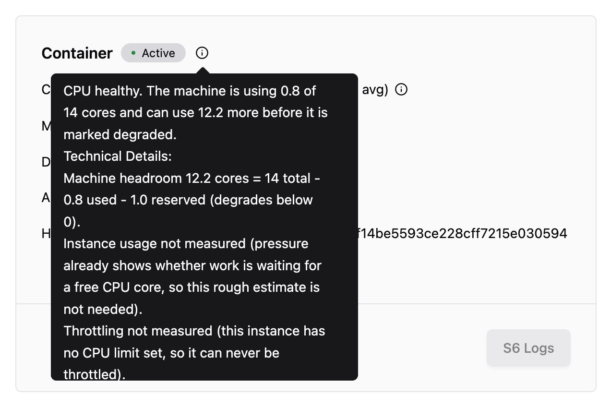
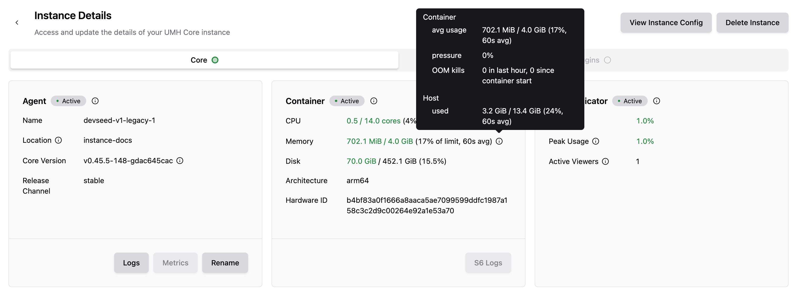
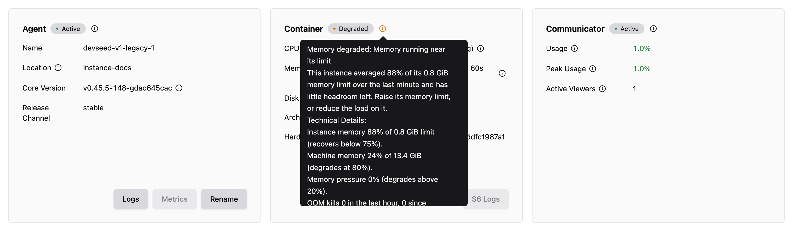

# Container

The container is the Docker container that UMH Core runs in. Its CPU, memory and disk are shared by every bridge, flow and Redpanda. When one of them crosses its threshold, the Container card shows Degraded, and new bridges wait to start.

The container is a [product feature](../../../product-features-and-supported-paths.md).

## The Container card

The Container card on the instance details page shows the CPU, memory and disk of the container, its CPU architecture and the Hardware ID of the installation.

| Field | Shows |
|---|---|
| Status badge | The health of the container. See [Container status](#container-status). |
| CPU | The CPU usage. See [The CPU row](#the-cpu-row). |
| Memory | The memory usage. See [The Memory row](#the-memory-row). |
| Disk | The used and total space of the `/data` volume, and the percentage. |
| Architecture | The CPU architecture UMH Core runs on, `amd64` or `arm64`. |
| Hardware ID | The ID of this installation. UMH Core creates it on the first start and stores it in `/data/hwid`. It stays the same as long as the `/data` volume is kept. See [Container Layout](../../../reference/container-layout.md#hwid). |

The CPU, Memory and Disk rows turn red when that resource is degraded. The **S6 Logs** button is not available yet.

### The CPU row

From v0.44.46, the CPU row shows 60-second mean CPU usage. With a CPU limit, it shows the container's own usage against the limit, for example `0.2 / 0.3 cores (67% of limit, 60s avg)`. Without a limit, it shows the busy cores of the whole machine, including software outside UMH Core, against the machine's cores, for example `2.1 / 14.0 cores (15% of host, 60s avg)`. In this label, host means the machine. When the machine's busy cores cannot be measured, it falls back to the container's own usage. [CPU Health: With and without a CPU limit](cpu-health.md#with-and-without-a-cpu-limit) explains the difference. The info button next to it shows the readings of the container and the machine, which [CPU thresholds](#cpu-thresholds) describes. The row turns red while the [CPU status](#cpu-status) is degraded, and reads `N/A` when umh-core cannot measure the CPU.


The [CPU status](#cpu-status) and its [Technical Details](#cpu-technical-details) appear in the badge reason of the Container card. While the CPU is degraded, the reason line starts with `CPU degraded:`, for example `CPU degraded: CPU limited`. While the whole container is Active, the reason is the CPU status itself, for example `CPU healthy. …`.



### The Memory row

The Memory row shows the memory the container uses, the memory it may use, and the percentage. The total is the memory limit of the container. Without a limit, it is the memory of the machine.

With the [memory monitor](memory-health.md) on, the row shows 60-second means. With a memory limit, it shows the container's memory against the limit, for example `670.6 MiB / 680.0 MiB (99% of limit, 60s avg)`. Without a limit, it shows the used memory of the whole machine against the machine's memory, for example `9.8 GiB / 15.6 GiB (63% of host, 60s avg)`. The row reads `N/A` during the first minute after a start, and while the total cannot be read.

With the memory monitor on, the info button next to the row shows the readings of the container and the machine, which [Memory thresholds](#memory-thresholds) describes. A reading turns red while it degrades the memory. It reads `not yet measured` while its window fills after a start, and `n/a` or `unavailable` when it cannot be measured.



While the memory is degraded, the [Memory status](#memory-status) and its [Technical Details](#memory-technical-details) appear in the badge reason of the Container card, after `Memory degraded:`. While the memory is healthy, the badge reason does not show the memory.



## Container states

### Container status

The container shows Degraded when the CPU, the memory or the disk is degraded. The badge reason then lists one line per degraded resource. [Container thresholds](#container-thresholds) gives the values.

| Badge | Reason | What it means |
|---|---|---|
| Active | The [CPU status](#cpu-status), for example `CPU healthy. …` | CPU, memory and disk are healthy. Without a CPU status, the reason is `Container operating normally`. |
| Degraded | `CPU degraded: …`, followed by the [CPU status](#cpu-status) | CPU health is degraded. |
| Degraded | `Memory degraded: Memory utilization critical` | The memory is above its threshold. With the memory monitor, the line gives the [Memory status](#memory-status) instead. |
| Degraded | `Disk degraded: Disk utilization critical` | The `/data` volume is above its threshold. |
| Degraded | `Container degraded` | A resource is degraded but gave no reason. |
| Neutral | `Container status unknown` | umh-core has no reading of the container yet, for example in the first seconds after a start. |

### CPU status

| Status | What it means |
|---|---|
| **CPU healthy** | The container has the CPU it needs. Usage is shown for context, for example "1.2 of 4 cores". |
| **CPU: starting up.** | umh-core has not measured the CPU yet. This shows in the first seconds after a start. |
| **CPU limited** | The container hit its CPU limit and was paused until the next scheduling period, for example in 12% of periods over the last minute. Work is being delayed. |
| **CPU contention** | Tasks inside the container spent time waiting for a free CPU core, for example 23% of the last minute. |
| **CPU taken by the server** | Other virtual machines on the same physical server took CPU this container needed. |
| **CPU running near full** | There is no room left for the next burst of work, because either the machine is full or the container is at its CPU limit. The status message says which. |

Every status except **CPU healthy** means CPU health is degraded.

When no CPU limit is set and the operating system does not report CPU pressure stats, **CPU healthy** adds a line that starts with `Limited visibility:`. umh-core then cannot fully tell when work waits for a free core. [Enable CPU pressure stats](enable-cpu-pressure-stats.md) turns on full monitoring.

If umh-core cannot read a file it needs to measure the CPU, the CPU health is degraded and the message names the file, for example `poll error: CPU not measured: open /sys/fs/cgroup/cpu.stat: no such file or directory`.

### CPU Technical Details

Below the status, in the same badge reason, a Technical Details section lists every signal umh-core can measure on that machine. Both the status and Technical Details show the thresholds. A healthy container states its remaining headroom. Each Technical Details line gives the reading next to the threshold that would change the status:

```text
CPU healthy. This instance is using 0.3 of 2 cores (15% of its limit) and can use 1.5 more before it is marked degraded.

Technical Details:
Instance headroom 1.5 cores = 2 total - 0.3 used - 0.2 reserved (degrades below 0).
Instance usage not measured (throttling already shows whether this instance is hitting its CPU limit, so this rough estimate is not needed).
Throttling 2% (degrades above 5%).
Pressure 4% (degrades above 20%).
Steal not measured (this instance is not running in a virtual machine, so no other virtual machine can take its CPU).
```

The headroom lines depend on the machine. A machine whose core count is readable also gets a Machine headroom line, which this example leaves out. A container with no CPU limit gets no Instance headroom line. Every other signal always has a line, even when this machine cannot measure it.

A signal that is already past its threshold shows what would clear it instead, for example `Throttling 12% (recovers below 3%)`. A signal this machine cannot measure reads `not measured` with its reason, as the Steal line above does.

### Memory status

With the [memory monitor](memory-health.md) on, the badge reason names why the memory is degraded, for example `Memory degraded: Memory running near its limit`. Each status belongs to one reading in [Memory thresholds](#memory-thresholds).

| Status | Reading | What it means |
|---|---|---|
| **Memory running near its limit** | Instance memory | The container is close to its own memory limit. |
| **Machine memory running near full** | Machine memory | The whole machine is close to full, including the memory that software outside UMH Core uses. |
| **Memory contention** | Memory pressure | Processes in the container are waiting for memory. |
| **Memory ran out** | OOM kills | The kernel stopped a process in the container because memory ran out. |

When several readings degrade the memory, the status names the most urgent one: **Memory ran out** first, then **Memory contention**, then the other two. Below the status, one paragraph per reading gives its value. When the container and the machine are both close to full, one paragraph covers both.

Any other text after `Memory degraded:` means umh-core has had no memory reading for three seconds. New bridges wait until it has one.

### Memory Technical Details

Below the paragraphs, a Technical Details section lists the four readings, each next to the threshold that would change it:

```text
Memory degraded: Memory running near its limit
This instance averaged 86% of its 2.0 GiB memory limit over the last minute and has little headroom left. Raise its memory limit, or reduce the load on it.
Technical Details:
Instance memory 86% of 2.0 GiB limit (recovers below 75%).
Machine memory 41% of 16.0 GiB (degrades at 80%).
Memory pressure 3% (degrades above 20%).
OOM kills 0 in the last hour, 0 since container start (degrades at 1).
```

A reading that degrades the memory shows what would clear it, as the Instance memory line above does. Any other reading shows the value at which it would degrade the memory. A line can also read:

| Line ends in | Means |
|---|---|
| `not measured (…)` | This machine cannot measure the reading. The parentheses give the reason, for example `Instance memory not measured (this instance has no memory limit set, so the machine's memory is its limit).` |
| `not available (measuring).` | The reading's window is still filling, for example in the first minute after a start. |
| `not available (held).` | The reading degraded the memory and is now missing. It keeps degrading the memory until it is back, for at most one minute. |

## Container thresholds

### CPU thresholds

Each CPU signal degrades at one value and recovers at another. The two are held apart so the status does not flicker. Throttling, pressure, steal and usage are worse the higher they read, headroom the lower. All readings are 60-second figures. [CPU Health](cpu-health.md) explains how the signals combine into the CPU status.

| Signal | Measures | Degrades | Recovers | Measured only when |
|---|---|---|---|---|
| **Throttling** | The share of scheduling periods, about 100 ms each, in which the kernel paused the container because it used up its CPU limit. A workload whose average looks fine can still be paused during bursts. | above 5% | below 3% | a CPU limit is set |
| **Pressure** | The share of time in which tasks of the container waited for a CPU core, from Linux Pressure Stall Information (PSI, `some avg60`). See [CPU Contention While Cores Are Free](cpu-contention-while-cores-are-free.md). | above 20% | below 12% | the container can read `cpu.pressure` (see [Enable CPU pressure stats](enable-cpu-pressure-stats.md)) |
| **Steal** | Time the hypervisor gave this machine's CPU to other virtual machines. A burstable cloud instance whose CPU credits ran out also reports its capped time as steal. | above 10% | below 6% | the machine is a virtual machine |
| **Machine headroom** | The cores free on the whole machine, including the CPU that software outside UMH Core uses. | less than 1 core free | more than 1.5 cores free | the machine's core count is readable |
| **Instance headroom** | The CPU the container can still use under its CPU limit. | usage past 90% of the limit | below 85% of the limit | a CPU limit is set |
| **Instance usage** | The CPU the container uses. | at 70% | below 60% | no CPU limit is set, the kernel publishes no PSI, and the machine's free cores cannot be measured |

Steal uses the 95th percentile once 20 samples are in, and the mean before that, so a newly started container gets a steal reading within seconds. Bare metal reports no steal, so on a physical machine the Steal line reads `not measured` with its reason.

### Memory thresholds

Without the [memory monitor](memory-health.md), the memory degrades above 80% of the total and recovers at or below 80%.

With the [memory monitor](memory-health.md) on, each reading degrades at one value and recovers at a lower one. The first column is the reading's name in Technical Details, the second its row in the info button of the Memory row. [Memory Health](memory-health.md) explains how the readings combine into the memory status.

| Reading | Info button row | Measures | Degrades | Recovers | Measured only when |
|---|---|---|---|---|---|
| **Instance memory** | Container: avg usage | The memory the container uses, as a share of its own memory limit, as a 60-second mean. | at 80% | below 75% | a memory limit is set |
| **Machine memory** | Host: used | The used memory of the whole machine, including software outside UMH Core, as a 60-second mean. | at 80% | below 75% | the machine's memory is readable |
| **Memory pressure** | Container: pressure | The share of the last minute in which processes in the container waited for memory, from Linux Pressure Stall Information (PSI, `some avg60`). | above 20% | below 12% | the container runs with cgroup v2 and PSI, the same as for CPU pressure (see [Enable CPU pressure stats](enable-cpu-pressure-stats.md)) |
| **OOM kills** | Container: OOM kills | The processes in the container that the kernel stopped in the last hour because memory ran out (out of memory, OOM). Only the kills after umh-core started count, so a kill that restarted umh-core itself does not. The count since the container started is shown for context and includes those kills. | at 1 | at 0 for a whole hour | the kernel's OOM kill counter is readable |

### Disk thresholds

The disk degrades above 85% of the `/data` volume and recovers at or below 85%.

## While the container is degraded

A new bridge waits to start while CPU, memory or disk is degraded. Bridges that already run keep running. The reason of the waiting bridge starts with the same line as the reason on the Container card. See [Bridges do not start](../../data-flows/bridges-do-not-start.md).

[Container Shows Degraded](container-shows-degraded.md) lists what to do for each resource, each memory status and each CPU status.

## Reference

### Configuration

The environment variable `USE_FSMV2_MEMORY_MONITOR` changes how umh-core judges the memory. umh-core reads it once at startup. To change it, remove the container and start it again with the same `docker run` command and the new value. `docker restart` keeps the old environment.

| Variable | Default | Effect |
|---|---|---|
| `USE_FSMV2_CPU` | none | Ignored from v0.45.4. The CPU status always comes from the CPU health check. On v0.44.46 to v0.45.3, `USE_FSMV2_CPU=false` turns the check off and applies the 70% CPU usage rule instead. Remove the variable from your `docker run` command. |
| `USE_FSMV2_MEMORY_MONITOR` | `false` | `true` turns on the early access memory monitor, which [Memory Health](memory-health.md) explains. |

The CPU health check also runs on an instance started without `AUTH_TOKEN` and `API_URL`.

### Metrics

The container reports these series on port 8080. [Read the metrics](../agent/metrics.md#read-the-metrics) explains how to reach the endpoint and the labels.

#### Container gauges

These gauges carry the label `instance`. They report the figures on the Container card, except the CPU gauges: these always report the container's own usage. Without a CPU limit, the CPU row shows the whole machine instead, which `umh_fsmv2_worker_cpu_avg_host_busy_cores` reports.

| Name | Type | Reports |
|---|---|---|
| `umh_container_cpu_usage_mcores` | gauge | CPU usage in millicores (1000 = 1 core), as a 60-second mean. |
| `umh_container_cpu_core_count` | gauge | CPU cores available to the container. |
| `umh_container_cpu_load_percent` | gauge | CPU usage as a percentage of the container's cores, as a 60-second mean. |
| `umh_container_memory_used_bytes` | gauge | Memory in use, in bytes. |
| `umh_container_memory_total_bytes` | gauge | The memory total the usage is measured against, in bytes. |
| `umh_container_memory_usage_percent` | gauge | Memory in use as a percentage of the total. |
| `umh_container_disk_used_bytes` | gauge | Used space of the `/data` volume, in bytes. |
| `umh_container_disk_total_bytes` | gauge | Size of the `/data` volume, in bytes. |
| `umh_container_disk_usage_percent` | gauge | Used space of the `/data` volume as a percentage. |
| `umh_container_health_status` | gauge | The health per resource: 0 = Neutral, 1 = Active, 2 = Degraded. The label `component` is `overall`, `cpu`, `memory` or `disk`. |

#### CPU health gauges

The CPU health check reports the readings behind the [CPU status](#cpu-status). These are FSMv2 component series whose `hierarchy_path` ends in `(cpu)`, see [FSMv2 metrics](../agent/metrics.md#fsmv2-metrics). Each gauge keeps its last value until the next successful measurement.

| Name | Type | Reports |
|---|---|---|
| `umh_fsmv2_worker_cpu_avg_usage_cores` | gauge | The container's own CPU usage, in cores, as a 60-second mean. |
| `umh_fsmv2_worker_cpu_avg_usage_fraction` | gauge | The container's own CPU usage as a fraction (0 to 1) of the cores it may run on. |
| `umh_fsmv2_worker_cpu_throttle_ratio` | gauge | Throttling: the fraction (0 to 1) of scheduling periods in the last 60 seconds in which the kernel paused the container. |
| `umh_fsmv2_worker_cpu_pressure_avg60_ratio` | gauge | Pressure: the `some avg60` value of the container's `cpu.pressure`, as a fraction (0 to 1). |
| `umh_fsmv2_worker_cpu_avg_host_busy_cores` | gauge | The busy cores of the whole machine, as a 60-second mean. |
| `umh_fsmv2_worker_cpu_host_headroom_cores` | gauge | Machine headroom: the cores free on the machine after the reserve. It is negative when the machine is full. |
| `umh_fsmv2_worker_cpu_capacity_cores` | gauge | The cores the CPU status is judged against: the CPU limit when one is set, otherwise the core count. |
| `umh_fsmv2_worker_cpu_reserve_cores` | gauge | The cores held back from the capacity as a reserve. |
| `umh_fsmv2_worker_cpu_host_cpus` | gauge | The core count of the machine. It is higher than the container's when the container is pinned to some cores. |
| `umh_fsmv2_worker_cpu_last_sample_unix` | gauge | The time of the last successful measurement, in Unix seconds. |
| `umh_fsmv2_worker_cpu_usage_ring_active` | gauge | 1 once `cpu_avg_usage_cores` has at least two samples in its 60-second window, otherwise 0. |
| `umh_fsmv2_worker_cpu_host_busy_ring_active` | gauge | 1 once `cpu_avg_host_busy_cores` has at least two samples in its 60-second window, otherwise 0. |
| `umh_fsmv2_worker_cpu_throttle_signal_ready` | gauge | 1 while `cpu_throttle_ratio` has a reading. It stays 0 on a machine that reports no throttling, for example without a CPU limit. |
| `umh_fsmv2_worker_cpu_pressure_signal_ready` | gauge | 1 while `cpu_pressure_avg60_ratio` has a reading. It stays 0 when the container cannot read `cpu.pressure`. |
| `umh_fsmv2_worker_cpu_host_headroom_available` | gauge | 1 when machine headroom can be measured. It is 0 when the container is pinned to some cores or the machine's core count cannot be read. |
| `umh_fsmv2_worker_cpu_host_busy_cores_available` | gauge | 1 when the last measurement could read the machine's busy cores. |

A gauge whose flag reads 0 is not worth acting on. `cpu_host_headroom_cores` is worth acting on only while `cpu_host_headroom_available`, `cpu_host_busy_cores_available` and `cpu_host_busy_ring_active` all read 1. Steal has no gauge. The badge reason shows it.

#### Memory monitor gauges

With the [memory monitor](memory-health.md) on, it reports these series, with a `hierarchy_path` that ends in `(memory)`. Without it, they do not exist. Each gauge keeps its last value until the next successful measurement.

| Name | Type | Reports |
|---|---|---|
| `umh_fsmv2_worker_memory_avg_used_bytes` | gauge | Memory in use, in bytes, as a 60-second mean. |
| `umh_fsmv2_worker_memory_total_bytes` | gauge | The memory total the usage is judged against, in bytes. |
| `umh_fsmv2_worker_memory_avg_used_fraction` | gauge | Memory in use as a fraction (0 to 1) of the total, as a 60-second mean. |
| `umh_fsmv2_worker_memory_avg_host_used_bytes` | gauge | The memory in use on the whole machine, in bytes, as a 60-second mean. |
| `umh_fsmv2_worker_memory_host_total_bytes` | gauge | The memory of the machine, in bytes. |
| `umh_fsmv2_worker_memory_pressure_avg60_ratio` | gauge | The `some avg60` value of the container's `memory.pressure`, as a fraction (0 to 1). |
| `umh_fsmv2_worker_memory_oom_kills_last_hour` | gauge | Processes in the container that the kernel stopped in the last hour because memory ran out. |
| `umh_fsmv2_worker_memory_last_sample_unix` | gauge | The time of the last successful measurement, in Unix seconds. |
| `umh_fsmv2_worker_memory_used_ring_active` | gauge | 1 once `memory_avg_used_bytes` and `memory_avg_used_fraction` cover a full 60-second window, otherwise 0. |
| `umh_fsmv2_worker_memory_host_ring_active` | gauge | 1 once `memory_avg_host_used_bytes` covers a full 60-second window, otherwise 0. |
| `umh_fsmv2_worker_memory_pressure_signal_ready` | gauge | 1 while `memory_pressure_avg60_ratio` has a reading. It stays 0 on cgroup v1 or without pressure stall information. |
| `umh_fsmv2_worker_memory_oom_signal_ready` | gauge | 1 while `memory_oom_kills_last_hour` has a reading. |
| `umh_fsmv2_worker_memory_used_from_cgroup` | gauge | 1 when `memory_avg_used_bytes` is the container's own usage. |
| `umh_fsmv2_worker_memory_total_is_cgroup_limit` | gauge | 1 when `memory_total_bytes` is the container's memory limit. |

#### Alert queries

To alert when the container degrades:

```promql
umh_container_health_status{component="overall"} == 2
```

When umh-core cannot read a file it needs for the CPU, the CPU gauges keep their previous value. Before the first successful measurement, `umh_fsmv2_worker_cpu_last_sample_unix` does not exist. To alert when an instance's CPU health check has not measured for a minute, including when it never measured, compare it with the `up` series of the scrape job. Replace `umh-core` with the name of your scrape job, and use a `for:` duration of a few minutes so that the first seconds after a start do not fire:

```promql
time() - umh_fsmv2_worker_cpu_last_sample_unix{job="umh-core"} > 60
or
(
  up{job="umh-core"} == 1
  unless on (job, instance)
  umh_fsmv2_worker_cpu_last_sample_unix{job="umh-core"}
)
```

The second part fires for each reachable instance without the gauge. An instance that cannot be scraped needs its own alert on `up == 0`.

The `umh_container_*` gauges are defined in [`pkg/service/container_monitor/metrics.go`](https://github.com/united-manufacturing-hub/united-manufacturing-hub/blob/staging/umh-core/pkg/service/container_monitor/metrics.go), and the CPU and memory gauges in [`fsmv2/deps/metrics.go`](https://github.com/united-manufacturing-hub/united-manufacturing-hub/blob/staging/umh-core/fsmv2/deps/metrics.go).
