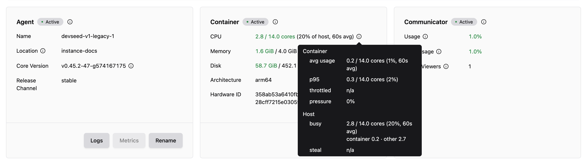

# Container

The container is the Docker container that UMH Core runs in. Its CPU, memory and disk are shared by every bridge, flow and Redpanda. When one of them crosses its threshold, the Container card shows Degraded, and new bridges wait to start.

## The Container card

The Container card on the instance details page shows the CPU, memory and disk of the container, its CPU architecture and the Hardware ID of the installation.

| Field | Shows |
|---|---|
| Status badge | The health of the container. See [Container status](#container-status). |
| CPU | The CPU usage. See [The CPU row](#the-cpu-row). |
| Memory | The memory the container uses, the memory it may use, and the percentage. The total is the memory limit of the container. Without a limit, it is the memory of the host. With the [memory monitor preview](#memory-with-the-memory-monitor-preview), the row shows 60-second means. With a memory limit, it shows the container's memory against the limit, for example `670.6 MiB / 680.0 MiB (99% of limit, 60s avg)`. Without a limit, it shows the used memory of the whole machine against the machine's memory. |
| Disk | The used and total space of the `/data` volume, and the percentage. |
| Architecture | The CPU architecture UMH Core runs on, `amd64` or `arm64`. |
| Hardware ID | The ID of this installation. UMH Core creates it on the first start and stores it in `/data/hwid`. It stays the same as long as the `/data` volume is kept. See [Container Layout](../../../reference/container-layout.md#hwid). |

The CPU, Memory and Disk rows turn red when that resource is degraded. The **S6 Logs** button is not available yet.

### The CPU row

From v0.44.46, the CPU row shows 60-second mean CPU usage. With a CPU limit, it shows the instance's own usage against the limit, for example `0.2 / 0.3 cores (67% of limit, 60s avg)`. Without a limit, it shows the busy cores of the whole machine, including software outside UMH Core, against the machine's cores, for example `2.1 / 14.0 cores (15% of host, 60s avg)`. When the machine's busy cores cannot be measured, it falls back to the instance's own usage. [How CPU Health Is Judged: With and without a CPU limit](how-cpu-health-is-judged.md#with-and-without-a-cpu-limit) explains the difference. The info button next to it shows the readings of the container and the machine, which [CPU thresholds](#cpu-thresholds) describes. The row turns red while the [CPU status](#cpu-status) is degraded, and reads `N/A` when umh-core cannot measure the CPU.



The [CPU status](#cpu-status) and its [Technical Details](#cpu-technical-details) appear in the badge reason of the Container card. While the CPU is degraded, the reason line starts with `CPU degraded:`, for example `CPU degraded: CPU limited`. While the whole container is Active, the reason is the CPU status itself, for example `CPU healthy. …`.


## Container states

### Container status

The container shows Degraded when the CPU, the memory or the disk is degraded. The badge reason lists one line per degraded resource. [Container thresholds](#container-thresholds) gives the values.

| Resource | Reason line |
|---|---|
| Memory | `Memory degraded: Memory utilization critical`. With the memory monitor preview, the line names the cause, see [Memory with the memory monitor preview](#memory-with-the-memory-monitor-preview). |
| Disk | `Disk degraded: Disk utilization critical` |
| CPU | `CPU degraded: …`, followed by the [CPU status](#cpu-status) |

### CPU status

| Status | What it means |
|---|---|
| **CPU healthy** | The instance has the CPU it needs. Usage is shown for context, for example "1.2 of 4 cores". |
| **CPU: starting up.** | UMH Core has not measured the CPU yet. This shows in the first seconds after a start. |
| **CPU limited** | The instance hit its CPU limit and was paused until the next scheduling period, for example in 12% of periods over the last minute. Work is being delayed. |
| **CPU contention** | Tasks inside the instance spent time waiting for a free CPU core, for example 23% of the last minute. |
| **CPU taken by the server** | Other virtual machines on the same physical server took CPU this instance needed. |
| **CPU running near full** | There is no room left for the next burst of work, because either the machine is full or the instance is at its CPU limit. The status message says which. |

Every status except **CPU healthy** means CPU health is degraded, and new bridges wait while it lasts.

When no CPU limit is set and the operating system does not report CPU pressure stats, **CPU healthy** adds a line that starts with `Limited visibility:`. UMH Core then cannot fully tell when work waits for a free core. [Enable CPU pressure stats](enable-cpu-pressure-stats.md) turns on full monitoring.

If UMH Core cannot read a file it needs to measure the CPU, the CPU health is degraded and the message names the file, for example `poll error: CPU not measured: open /sys/fs/cgroup/cpu.stat: no such file or directory`.

### CPU Technical Details

Below the status, in the same badge reason, a Technical Details section lists every signal UMH Core can measure on that machine. Both the status and Technical Details show the thresholds. A healthy instance states its remaining headroom. Each Technical Details line gives the reading next to the threshold that would change the status:

```text
CPU healthy. This instance is using 0.3 of 2 cores (15% of its limit) and can use 1.5 more before it is marked degraded.

Technical Details:
Instance headroom 1.5 cores = 2 total - 0.3 used - 0.2 reserved (degrades below 0).
Instance usage not measured (throttling already shows whether this instance is hitting its CPU limit, so this rough estimate is not needed).
Throttling 2% (degrades above 5%).
Pressure 4% (degrades above 20%).
Steal not measured (this instance is not running in a virtual machine, so no other virtual machine can take its CPU).
```

The headroom lines depend on the machine. A machine whose core count is readable also gets a Machine headroom line, which this example leaves out. An instance with no CPU limit gets no Instance headroom line. Every other signal always has a line, even when this machine cannot measure it.

A signal that is already past its threshold shows what would clear it instead, for example `Throttling 12% (recovers below 3%)`. A signal this machine cannot measure reads `not measured` with its reason, as the Steal line above does.

### Memory with the memory monitor preview

With the [memory monitor preview](how-memory-health-is-judged.md) on, memory degrades for one of four causes. The reason line on the Container card names the cause, for example `Memory degraded: Memory running near its limit` for `container-limit-full` or `Memory degraded: Memory ran out` for `oom-kill`. [How Memory Health Is Judged](how-memory-health-is-judged.md) explains the causes, and [Memory monitor preview thresholds](#memory-monitor-preview-thresholds) gives their values.

## Container thresholds

### Memory and disk

| Resource | Degraded from | Active again below | Warning from |
|---|---|---|---|
| Memory | 80% of the total | 80% | 70% |
| Disk | 85% of the `/data` volume | 85% | 75% |

Memory and disk recover at the same value they degrade at. A warning does not change the badge. The badge stays Active and does not show the warning. With the memory monitor preview, [Memory monitor preview thresholds](#memory-monitor-preview-thresholds) replaces the memory row.

### CPU thresholds

Each CPU signal degrades at one value and recovers at another. The two are held apart so the status does not flicker. Throttling, pressure, steal and usage are worse the higher they read, headroom the lower. All readings are 60-second figures. A reading must exceed a threshold to count. Where the table says "at", reaching it is enough. [How CPU Health Is Judged](how-cpu-health-is-judged.md) explains why the signals are chosen.

| Signal | Measures | Degrades | Recovers | Measured only when |
|---|---|---|---|---|
| **Throttling** | The share of scheduling periods, about 100 ms each, in which the kernel paused the container because it used up its CPU limit. A workload whose average looks fine can still be paused during bursts. | above 5% | below 3% | a CPU limit is set |
| **Pressure** | The share of time in which tasks of the instance waited for a CPU core, from Linux Pressure Stall Information (PSI, `some avg60`). See [CPU Contention While Cores Are Free](cpu-contention-while-cores-are-free.md). | above 20% | below 12% | the container can read `cpu.pressure` (see [Enable CPU pressure stats](enable-cpu-pressure-stats.md)) |
| **Steal** | Time the hypervisor gave this machine's CPU to other virtual machines. A burstable cloud instance whose CPU credits ran out also reports its capped time as steal. | above 10% | below 6% | the machine is a virtual machine |
| **Machine headroom** | The cores free on the whole machine, including the CPU that software outside UMH Core uses. | less than 1 core free | more than 1.5 cores free | the machine's core count is readable |
| **Instance headroom** | The CPU the instance can still use under its CPU limit. | usage past 90% of the limit | below 85% of the limit | a CPU limit is set |
| **Instance usage** | The CPU the instance uses. | at 70% | below 60% | no CPU limit is set, the kernel publishes no PSI, and the machine's free cores cannot be measured |

Steal uses the 95th percentile once 20 samples are in, and the mean before that, so a newly started instance gets a steal reading within seconds. Bare metal reports no steal, so on a physical machine the Steal line reads `not measured` with its reason.

### Memory monitor preview thresholds

With the [memory monitor preview](how-memory-health-is-judged.md) on, each cause degrades at one value and recovers at a lower one.

| Cause | Degraded from | Healthy again below |
|---|---|---|
| `container-limit-full` | 80% of the container's own memory limit, as a 60-second mean. Judged only when the container has a limit. | 75% |
| `host-memory-full` | 80% of the machine's memory, as a 60-second mean | 75% |
| `memory-pressure` | Above 20%: processes in the container waited for memory for more than 20% of the last minute | 12% |
| `oom-kill` | 1 OOM kill in the container within the last hour | 0 for a whole hour |

## While the container is degraded

A new bridge waits to start while CPU, memory or disk is degraded. Bridges that already run keep running. The reason of the waiting bridge starts with the same line as the reason on the Container card. See [Bridges do not start](../../data-flows/bridges-do-not-start.md).

[Container Shows Degraded](container-shows-degraded.md) lists what to do for each resource and each CPU status.

## Reference

### Configuration

The environment variable `USE_FSMV2_MEMORY_MONITOR` changes how umh-core judges the memory. umh-core reads it once at startup. To change it, remove the container and start it again with the same `docker run` command and the new value. `docker restart` keeps the old environment.

| Variable | Default | Effect |
|---|---|---|
| `USE_FSMV2_MEMORY_MONITOR` | `false` | `true` turns on the memory monitor preview, which [How Memory Health Is Judged](how-memory-health-is-judged.md) explains. |
| `USE_FSMV2_CPU` | none | Ignored from v0.45.4. The CPU status always comes from the CPU health check. On v0.44.46 to v0.45.3, `USE_FSMV2_CPU=false` turns the check off and applies the 70% CPU usage rule instead. Remove the variable from your `docker run` command. |

The CPU health check also runs on an instance started without `AUTH_TOKEN` and `API_URL`.

### Metrics

The container reports its CPU, memory and disk on port 8080 as `umh_container_*` gauges. `umh_container_health_status` holds the health per resource: 0 = Neutral, 1 = Active, 2 = Degraded, with the label `component` set to `overall`, `cpu`, `memory` or `disk`. The CPU health check reports each signal in [CPU thresholds](#cpu-thresholds) as a `umh_fsmv2_worker_cpu_*` gauge, and the memory monitor preview reports its readings as `umh_fsmv2_worker_memory_*` gauges. Next to these gauges, flag gauges read 0 while a reading is not worth acting on yet, for example while its 60-second window fills. [Read the metrics](../agent/metrics.md#read-the-metrics) explains how to reach the endpoint and the labels.

To alert when the container degrades:

```promql
umh_container_health_status{component="overall"} == 2
```

When UMH Core cannot read a file it needs for the CPU, the CPU gauges keep their previous value. Before the first successful measurement, `umh_fsmv2_worker_cpu_last_sample_unix` does not exist. To alert when the CPU health check has not measured for a minute, including when it never measured, use a `for:` duration of a few minutes so that the first seconds after a start do not fire:

```promql
time() - umh_fsmv2_worker_cpu_last_sample_unix > 60
or
absent(umh_fsmv2_worker_cpu_last_sample_unix)
```

The definitions are in [`pkg/service/container_monitor/metrics.go`](https://github.com/united-manufacturing-hub/united-manufacturing-hub/blob/staging/umh-core/pkg/service/container_monitor/metrics.go) for the `umh_container_*` gauges, and in [`fsmv2/deps/metrics.go`](https://github.com/united-manufacturing-hub/united-manufacturing-hub/blob/staging/umh-core/fsmv2/deps/metrics.go) for the CPU and memory gauges.
