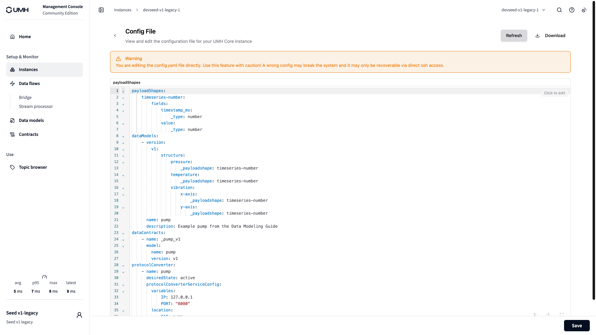

# Edit the Config File

This page explains how to edit an instance's `config.yaml` in the Management Console, and how to repair the file when umh-core cannot read it. The repair steps need access to the Docker host.

`config.yaml` holds everything you configure on an instance: bridges, stand-alone flows, data models and the agent settings. The UI writes to the same file, so a bridge you create in the UI appears in `config.yaml`, and a bridge you add to `config.yaml` appears in the UI. The [Configuration Reference](../../reference/configuration-reference.md) lists every key.

## Open the file

Open the instance's details page and click **View Instance Config**. The button appears when the instance's UMH Core version supports it. In the instance list, the row menu of an online UMH Core instance has the same page under **Config file**.

The page shows `/data/config.yaml` as umh-core read it last. **Refresh** reads it again. **Download** saves a copy named `config-<first 8 characters of the instance ID>.yaml`.



## Save a change

1. Edit the file in the editor.
2. Click **Save**.

The Management Console first checks that the text is valid YAML. umh-core then checks the file and writes it. It rejects the save if the file changed on the instance since you opened it, for example because someone created a bridge in the meantime. Click **Refresh** and make your change again.

After **Configuration saved successfully**, umh-core applies the change without a restart. Settings that umh-core reads only at startup, such as `agent.graphql.enabled`, take effect when the container restarts.


umh-core saves a `config.yaml` with a key it does not know, for example a misspelled one, and ignores the key. It rejects the file the next time it reads it strictly: when the container restarts, or after the file is edited outside the Management Console. Check every key against the [Configuration Reference](../../reference/configuration-reference.md) before you save.


## Repair the file on the Docker host

When the Config File page cannot load a usable file, edit `/data/config.yaml` inside the container, the way your [deployment](../../production/deployment/README.md) runs a command in a container. With Docker:

```bash
docker exec -it <container name> vi /data/config.yaml
```

Fix the file and save it. umh-core reads the file again while it runs, so a fix takes effect without a restart.
