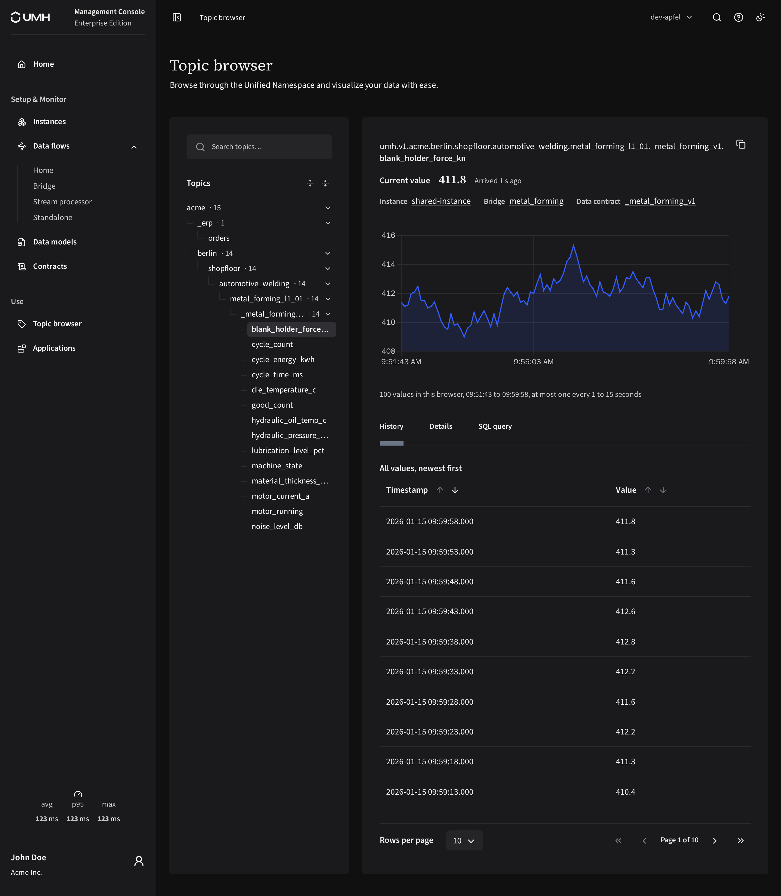
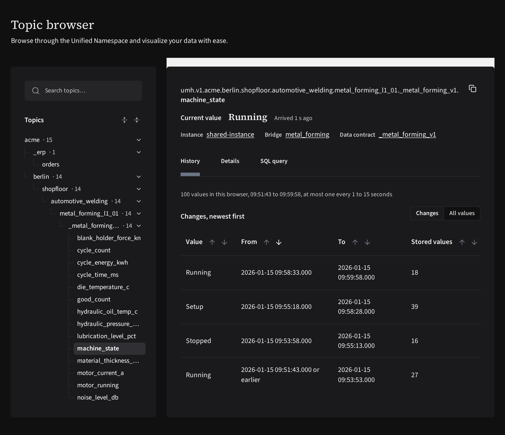
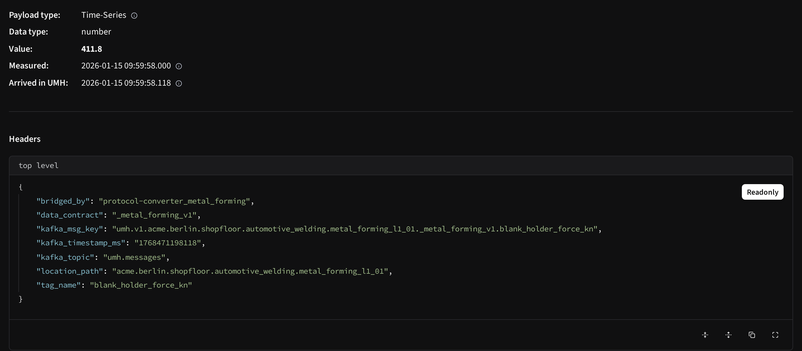
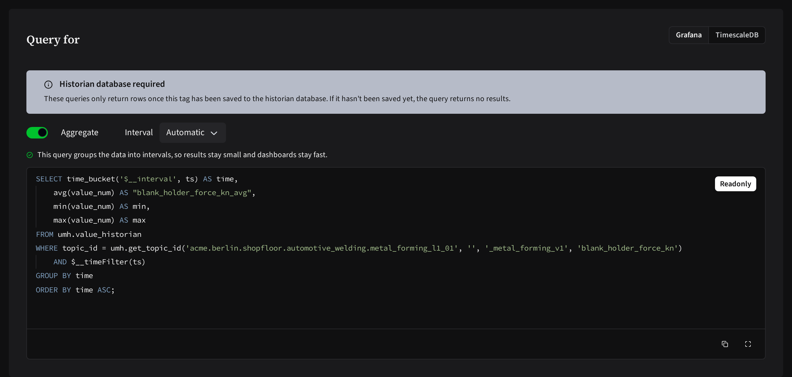
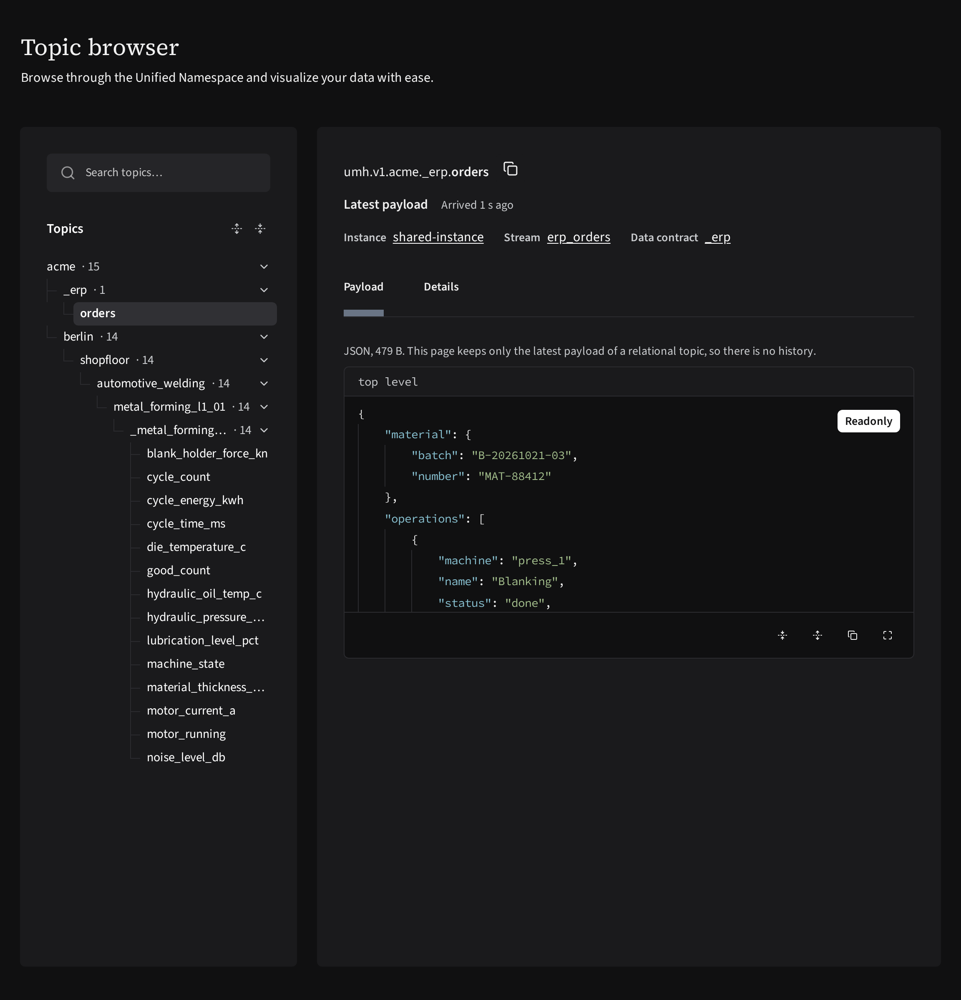
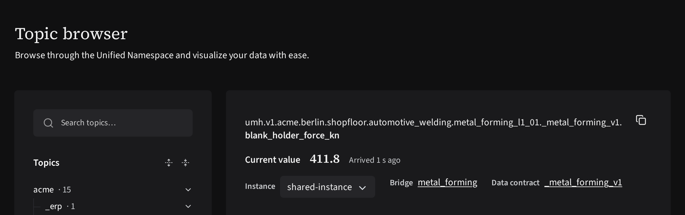

# Topic Browser

The Topic Browser shows every topic in your Unified Namespace as a tree, with the current value and the recent history of the topic you select. Use it to find a data point, to see where it sits in your hierarchy, and to check what it last reported. It runs in the Management Console under **Use** → **Topic browser**; this page is not about the Topic Browser of UMH Classic. To read topics from a program, use the [GraphQL API](#graphql-api).

If the tree stays empty while your instance is producing data, or a topic you expect never appears, see [Topic does not appear in the Topic Browser](topic-does-not-appear-in-the-topic-browser.md).

## The main view

The screen splits into two panels. The left panel searches and shows your topics as a tree. The right panel shows the topic you select. Both update on their own, without a reload.



The instance selector at the top right chooses which instance you are looking at.

## The topic tree

The tree follows your topic structure, which [Topic Convention](topic-convention.md) explains: the location path comes first — enterprise, site, area, line, machine — then the data contract, then the tag. A virtual path shows up as further folders between the contract and the tag. Each level carries the number of tags beneath it, so you can see where your data is before opening anything.

The search box narrows the tree. It matches parts of topic names and of metadata, so `temp` finds every topic with "temp" in its name or metadata.

A namespace with more than 10,000 topics loads progressively instead of all at once.

## The selected topic

The right panel opens with the full topic string and a button that copies it. Below it:

| Field | Shows |
|---|---|
| **Current value** | The latest value, with how long ago it arrived. |
| **Instance** | The instance that reported the topic. |
| **Bridge** | The bridge or stream processor that sends it. |
| **Data contract** | The contract applied to the data, for example `_raw` or a device model such as `_metal_forming_v1`. |

A numeric topic also draws a chart of its recent values. Under it, three tabs hold the rest.

### History

The History tab lists the values the browser is holding — the last 100 of that topic, newest first, with a note of the window they cover and how often they arrive. When values arrive faster than the display can draw them, they are batched.

A text or boolean topic has no chart. Its History tab offers two views instead: **Changes**, which collapses runs of the same value into one row with the time it held and how many values it stored, and **All values**.



### Details

The Details tab describes the last message rather than the series.

| Field | Shows |
|---|---|
| **Virtual path** | The folders between the data contract and the tag, if the topic has any. |
| **Payload type** | `Time-Series` for a single value, or `Relational` for a JSON object. [Payload Formats](payload-formats.md) explains both. |
| **Data type** | `number`, `string` or `boolean`. |
| **Value** | The value itself. |
| **Measured** | When the device recorded it. |
| **Arrived in UMH** | When UMH received it. The gap between the two is your pipeline's latency. |
| **Headers** | The Kafka headers of the message, including the bridge that sent it, the data contract, the location path and the original tag name. [Metadata and Tracing](metadata-and-tracing.md) explains each field. |



### SQL query

The SQL query tab writes the query that reads this tag out of the historian database, for **Grafana** or for **TimescaleDB** directly. Choose an aggregate and an interval and the query groups the data into buckets, so a dashboard stays fast over a long window.



The query returns rows only once the tag has been saved to the historian database. Until then it returns nothing, however much data the Topic Browser itself is showing.

## Relational topics

A relational topic, for example `_erp.orders`, carries a document rather than a measurement. It shows **Latest payload** in place of a current value, and names the **Stream** that produced it instead of a bridge. The browser keeps only the most recent payload, so there is no history and no chart.



## Topics from several instances

Each instance runs its own Topic Browser service and reports its own topics, and the Management Console merges them into one tree. When more than one instance reports the same topic, the **Instance** row lists all of them, and marks any that is currently offline.



## The Topic Browser card

The **Topic Browser** card on the instance's detail page shows one value. **Topics** counts the different topics the instance has seen since umh-core started. Once a topic stops receiving messages it stays in the count, and when umh-core restarts the count starts from zero again. The **Metrics** button on the card opens the counters of the Benthos process that consumes the Kafka topic `umh.messages` from [Redpanda](redpanda.md).

While that process runs, the card's badge reads **Active**. Hover the badge to see the reason for a failure: `benthos degraded` when the Benthos process fails, `redpanda degraded` when Redpanda is degraded. The Redpanda card shows the cause of a Redpanda failure; see [When Redpanda is degraded](redpanda.md#when-redpanda-is-degraded).

## Configuration

| Key | Default | Effect |
|---|---|---|
| `internal.topicbrowser.desiredState` | `active` | `stopped` turns off the Topic Browser on this instance: it collects no topics, and both the tree and the [GraphQL API](#graphql-api) stop updating. The change takes effect without a restart. |

[Configuration reference](../../reference/configuration-reference.md) lists the setting with the rest of `internal`.

## Metrics

The Topic Browser reports on port 8080 and runs on FSMv1, so it uses the standard [FSMv1 metrics](../instances/agent/metrics.md#fsmv1-metrics). [Read the metrics](../instances/agent/metrics.md#read-the-metrics) explains how to reach the endpoint. Its series carry these labels:

| Part of the Topic Browser | `component` | `instance` |
|---|---|---|
| The Topic Browser | `topic_browser_instance` | `topic-browser` |
| Its Benthos process | `benthos_instance` | `topicbrowser-topic-browser` |

To raise an alert while the Benthos process of the Topic Browser is degraded, use:

```promql
umh_core_service_current_state{component="benthos_instance", exported_instance="topicbrowser-topic-browser"} == 5
```

## GraphQL API

The GraphQL API is documented on its own reference page. For the endpoint, the schema, example queries and every configuration option, see [Topic Browser GraphQL API](../../reference/http-api/topic-browser-graphql.md). Old links to `#graphql-api` land here.
