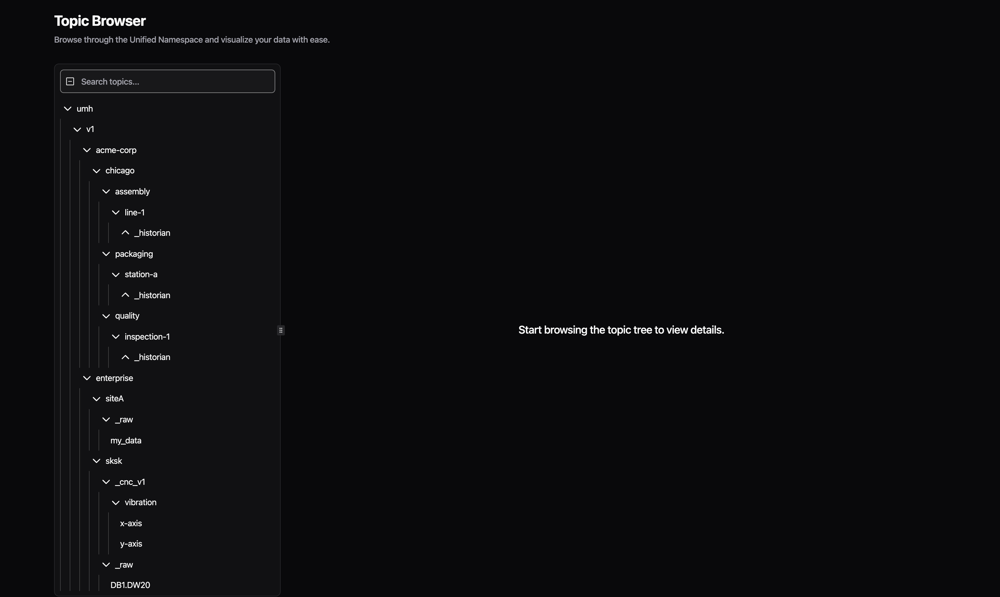

# Topic Browser

The Topic Browser shows every topic in your Unified Namespace as a tree, with the current value and the recent history of the topic you select. Use it to find a data point, to see where it sits in your hierarchy, and to check what it last reported. It runs in the Management Console at `management.umh.app`, under **Topic Browser**; this page is not about the Topic Browser of UMH Classic. To read topics from a program, use the [GraphQL API](#graphql-api).

If the tree shows `No topics found. Ensure your UMH instance is connected and generating topics.` while your instance is producing data, or a topic you expect never appears, see [Topic does not appear in the Topic Browser](topic-does-not-appear-in-the-topic-browser.md).

## The main view

The screen splits into two panels. The left panel shows your topics as a tree. The right panel shows the topic you select: its metadata, its current value and its history. Both panels update on their own, without a reload.



The selected topic in the example is a number, so its history is a line chart.

## The topic tree

The tree follows your topic structure, which [Topic Convention](topic-convention.md) explains: the location path comes first — enterprise, site, area, line, machine — then the data contract, then the tag. A virtual path shows up as further folders between the contract and the tag. Open each level to drill down from the enterprise to a single tag.

The tree combines the topics of all your instances: each instance runs its own Topic Browser service and reports its own topics, and the Management Console merges them into one tree.

The search bar narrows the tree: it matches parts of topic names and of metadata, so `temp` finds every topic with "temp" in its name or metadata.

A namespace with more than 10,000 topics can load progressively instead of all at once.

## The details panel

Selecting a topic shows its details on the right, in three sections. **Topic Details** says where the topic comes from:

| Field | Shows |
|---|---|
| **Physical Path** | The location part of the topic, from the enterprise down to the machine. |
| **Data Contract** | The contract applied to the data, for example `_raw` or a device model such as `_pump_v1`. |
| **Virtual Path** | The folders between the data contract and the tag, if the topic has any. |
| **Tag Name** | The last part of the topic. |
| **Instance** | The instance that reported the topic. |
| **Bridge** | The bridge or stream processor that sends the topic. |

**Last Message** shows the latest message of the topic:

| Field | Shows |
|---|---|
| **Payload Type** | Time-Series for a single value, or Relational for a JSON object. [Payload Formats](payload-formats.md) explains both. |
| **Timestamp** | When the value was measured. |
| **Data Type** | The type of the value, for example number. |
| **Value** | The value itself. |
| **Produced At** | When the message reached UMH. |
| **Metadata** | The headers of the message, including the original device tag and the bridge that sent it. [Metadata and Tracing](metadata-and-tracing.md) explains each field. |

**History** shows the last 100 values of a time-series topic, as a line chart for numbers and as a table for booleans and strings.

When values arrive faster than the display can draw them, they are batched. A relational topic, for example `_erp.orders`, shows the payload of its last message and no history.

## The Topic Browser card

The **Topic Browser** card on the instance's detail page shows one value. **Topics** counts the different topics the instance has seen since umh-core started. Once a topic stops receiving messages it stays in the count, and when umh-core restarts the count starts from zero again. The **Metrics** button on the card opens the counters of the Benthos process that consumes the Kafka topic `umh.messages` from [Redpanda](redpanda.md).

While that process runs, the card's badge reads **Active**. Hover the badge to see the reason for a failure: `benthos degraded` when the Benthos process fails, `redpanda degraded` when Redpanda is degraded. The Redpanda card shows the cause of a Redpanda failure; see [When Redpanda is degraded](redpanda.md#when-redpanda-is-degraded).

## Configuration

| Key | Default | Effect |
|---|---|---|
| `internal.topicbrowser.desiredState` | `active` | `stopped` turns off the Topic Browser on this instance: it collects no topics, and both the tree and the [GraphQL API](#graphql-api) stop updating. The change takes effect without a restart. |

[Configuration reference](../../reference/configuration-reference.md) lists the setting with the rest of `internal`.

## Metrics

The Topic Browser reports on port 8080 and runs on FSMv1, so it uses the standard [FSMv1 metrics](../instances/agent/metrics.md#fsmv1-metrics). [Read the metrics](../instances/agent/metrics.md#read-the-metrics) explains how to reach the endpoint. Its series carry these labels:

| Part of the Topic Browser | `component` | `instance` |
|---|---|---|
| The Topic Browser | `topic_browser_instance` | `topic-browser` |
| Its Benthos process | `benthos_instance` | `topicbrowser-topic-browser` |

To raise an alert while the Benthos process of the Topic Browser is degraded, use this query. It writes `exported_instance` for `instance`, as [Read the metrics](../instances/agent/metrics.md#read-the-metrics) explains:

```promql
umh_core_service_current_state{component="benthos_instance", exported_instance="topicbrowser-topic-browser"} == 5
```

The state definitions live in [`pkg/metrics/metrics.go`](https://github.com/united-manufacturing-hub/united-manufacturing-hub/blob/staging/umh-core/pkg/metrics/metrics.go).

## GraphQL API

The GraphQL API is documented on its own reference page. For the endpoint, the schema, example queries and every configuration option, see [Topic Browser GraphQL API](../../reference/http-api/topic-browser-graphql.md).
