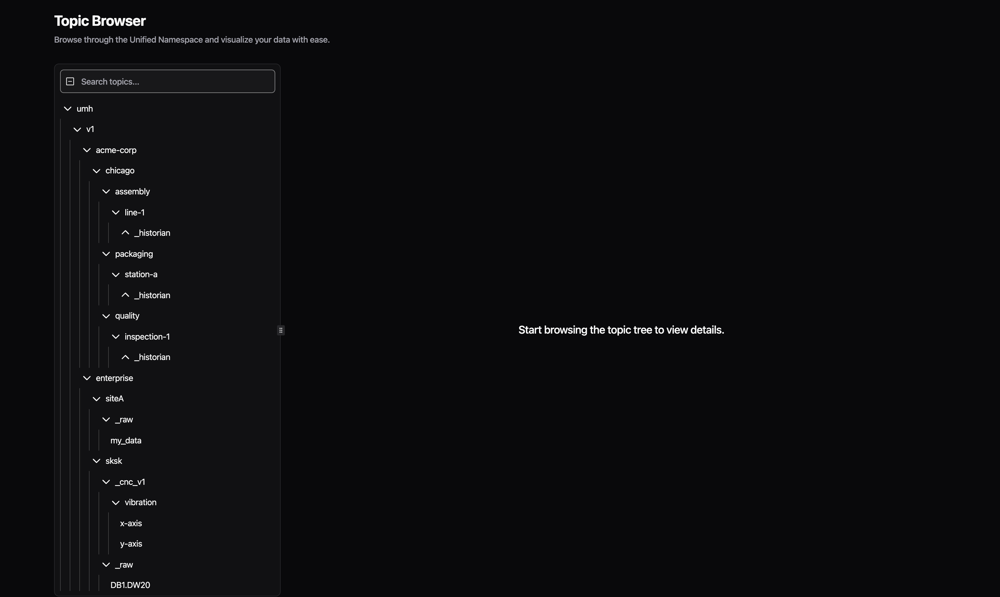

# Topic Browser

Real-time exploration of your Unified Namespace data via Management Console or GraphQL API.

## Management Console

Access via `management.umh.app` → **Topic Browser** (not the Classic version).

### Interface Overview
- **Left panel**: Hierarchical topic tree following ISA-95 structure
- **Right panel**: Details for selected topic (metadata, values, history)
- **Auto-aggregation**: Combines data from all your UMH instances
- **Live updates**: Real-time data without manual refresh

### Key Features

**Topic Tree Navigation:**
- Expand/collapse hierarchy levels (Enterprise → Site → Area → Line → Equipment)
- See data contracts (`_raw`, `_pump_v1`) and virtual paths
- Search bar for filtering by topic name or metadata

**Topic Details Panel:**
When selecting a topic, view:
- **Location**: Physical hierarchy path
- **Data Contract**: Applied schema (`_raw`, `_pump_v1`, etc.)
- **Current Value**: Latest data with timestamp
- **Metadata**: Including original device tags (see [Metadata and Tracing](metadata-and-tracing.md))
- **History**: Last 100 values as chart (time-series) or table (boolean/string)



## GraphQL API

Programmatic access at `http://localhost:8090/graphql` (per instance).


**Early Access.** We built the GraphQL API for developers who want to query the Unified Namespace programmatically. It's experimental, so it's off by default. See the instructions below and give it a try. Tell us what you think.


### Configuration

```yaml
internal:
  topicbrowser:
    desiredState: "active"  # Enable/disable

agent:
  graphql:
    enabled: true           # Enable GraphQL API (required!)
    port: 8090             # API port
    debug: false           # Set true for GraphiQL UI
```

### Basic Query
```graphql
{
  topics(filter: {
    text: "temperature",
    meta: [{ key: "data_contract", eq: "_pump_v1" }]
  }) {
    topic
    metadata {
      key
      value
    }
    lastEvent {
      ... on TimeSeriesEvent {
        producedAt
        numericValue
        scalarType
      }
    }
  }
}
```

### cURL Example
```bash
curl -X POST http://localhost:8090/graphql \
  -H "Content-Type: application/json" \
  -d '{"query": "{ topics(limit: 10) { topic } }"}'
```

## Common Use Cases

### Finding Specific Data
1. Use search bar for partial matches (e.g., "temp" finds all temperature topics)
2. Filter by metadata like data contract or location
3. Check metadata section for original device tags

### Verifying Data Flow
1. Select topic to see current value
2. Check "Produced At" timestamp for freshness
3. Review history chart for patterns
4. Inspect metadata for source bridge

### Debugging Issues
1. Verify topic exists in tree
2. Check metadata for `bridged_by` to identify source
3. Look for original tag names (e.g., `opcua_tag_name`, `s7_address`)
4. Compare timestamps to detect delays

## Performance Notes

- Topic Browser stores last 100 values per topic
- Extremely rapid updates are batched for display
- Large namespaces (>10,000 topics) may load progressively
- Each UMH instance has its own Topic Browser service

## Metrics

The Topic Browser runs one Benthos process inside the container. Benthos is the engine that moves data in UMH Core. This process reads the messages in the Kafka topic `umh.messages` from [Redpanda](redpanda.md) and passes the Unified Namespace topics on to umh-core. The [Metrics](../instances/agent/metrics.md) page explains how to read the series below.

The **Topic Browser** card on the instance details page shows one value. **Topics** is the number of different topics the instance has seen since umh-core started. A topic stays in the count after it stops receiving messages. The count starts again from zero when umh-core restarts. The **Metrics** button on the card opens the counters of the Benthos process.

The badge on the card shows Active while the Benthos process runs. When the Benthos process or Redpanda fails, the badge does not show Degraded:

- When the Benthos process fails, the badge shows Neutral. The tooltip shows `benthos degraded`.
- When Redpanda is degraded, the badge stays Active. The tooltip shows `redpanda degraded`.

Check the tooltip to find these failures. For a Redpanda failure, the Redpanda card shows the cause. See [When Redpanda is degraded](redpanda.md#when-redpanda-is-degraded).

umh-core reports the Topic Browser in the FSMv1 series. FSMv1 is the older of umh-core's two frameworks, the parts of umh-core that start and watch components (see [Which framework runs a component](../instances/agent/metrics.md#which-framework-runs-a-component)). The series names are under [FSMv1 metrics](../instances/agent/metrics.md#fsmv1-metrics).

| `component` value | `instance` value ([how Prometheus labels it](../instances/agent/metrics.md#read-the-metrics)) | Series |
|---|---|---|
| `topic_browser_instance` | `topic-browser` | `umh_core_service_current_state`, `umh_core_service_desired_state`, `umh_core_errors_total`, `umh_core_reconcile_duration_milliseconds` |
| `benthos_instance` | `topicbrowser-topic-browser` | the same four series, for the Benthos process |

`umh_core_reconcile_duration_milliseconds` has further `instance` values of the form `topic-browser.<step>` and `topicbrowser-topic-browser.<step>`. Filter on the exact values in the table to get one series per component.

For `topic_browser_instance`, `umh_core_service_current_state` reads 3 for `active`, 4 for `idle` and 0 for `stopped`. The Topic Browser has two degraded states, `degraded_benthos` and `degraded_redpanda`, and the series reads -1 in both. -1 means the component is in a sub-state (starting, degraded or stopping steps). Check the state in the Management Console.

To see that the Benthos process is degraded, read the series with `component="benthos_instance"` and `instance="topicbrowser-topic-browser"`. It reads 5 while that process is degraded, although the badge shows Neutral and the `topic_browser_instance` series reads -1.

## Next Steps

- [**Metadata and Tracing**](metadata-and-tracing.md) - Understanding metadata fields