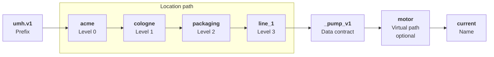

# Topic Convention

> **Prerequisite:** Understand the [UNS concept](README.md) and see it in action via [Getting Started](../../getting-started/).

Every message in the Unified Namespace has a topic: an address that says where the data comes from and what it is. This page explains the parts of a topic and how to write a topic pattern, a regular expression that matches topics. Pages of other features link here and add only their own rules.

## The parts of a topic

This topic carries the motor current of a pump on line 1 of the packaging area in Cologne:

```text
umh.v1.acme.cologne.packaging.line_1._pump_v1.motor.current
```

It has five parts:



| Part | Example | Rule |
|---|---|---|
| Prefix | `umh.v1` | Always `umh.v1`. |
| Location path | `acme.cologne.packaging.line_1` | One or more levels. The first level is required. |
| Data contract | `_pump_v1` | The first level that starts with `_`. |
| Virtual path | `motor` | Optional. Any number of levels between the data contract and the name. |
| Name | `current` | The last level. Required. |

Each part is one or more levels, separated by dots. A level is never empty, so a topic has no `..`.

## Location path

The location path says where the data comes from. It has one or more levels, numbered from level 0. Only level 0 is required.

You decide what each level stands for. ISA-95, KKS or any other naming standard works. With ISA-95, the levels are enterprise, site, area, line and machine, as in the topic above. A level of the location path does not start with `_`, because the first level that starts with `_` is the data contract.

The topics of a bridge start with its **bridge location**: the instance location plus the bridge's levels. The bridge's levels extend the instance location and never overwrite its levels. In a bridge, `{{ .location_path }}` holds the bridge location in dotted form, such as `acme.cologne.packaging`. [Bridges](../data-flows/bridges.md#configuration) explains where the levels are set.

## Data contract

The data contract says what the data is and which shape its payload has. It always starts with `_`.

- `_raw` and `_historian` are built in and have no version. `_raw` holds unvalidated device data, for exploring a device.
- Every other data contract belongs to one version of a data model and is written `_<model>_v<version>`, such as `_pump_v1`. The Management Console creates it when you create a version of a data model.

A data contract is an entry under `dataContracts:` in `config.yaml`. It names the data model and the one version of it that the contract enforces:

```yaml
dataContracts:
  - name: _pump_v1
    model:
      name: pump
      version: v1
```

Every message whose topic carries `_pump_v1` must match version `v1` of the data model `pump`. [Data Contracts](../data-modeling/data-contracts.md) explains how the contract is enforced.

## Virtual path and name

Everything after the data contract is defined by the data model, or by the bridge for `_raw`. The name is the last level. The levels between the data contract and the name are the virtual path, which groups related names like folders.

The name works for both kinds of data:

- **Time-series data**: the name is one measurement. In `_pump_v1.motor.current`, `motor` is the virtual path and `current` is the name.
- **Relational data**: the name is an action whose payload is a whole record. In `_maintenance_v1.work_order.create`, `work_order` is the virtual path and `create` is the name.

## Characters

A level may contain letters, digits, `_` and `-`. Any other character, a space included, is rejected.

Write levels in lowercase, with `_` between words, such as `line_1` and `inlet_temperature`. In `_raw`, a level taken from a device address, such as the S7 address `DB1.DW20`, keeps its original spelling.

## Topic patterns

A **topic** is one concrete address, such as the one above. A **topic pattern** is a regular expression that matches topics. The `uns` input of a stand-alone flow subscribes to topics with topic patterns.

A topic pattern matches a topic when it matches any part of it. These parts of the syntax matter most:

| Syntax | Meaning |
|---|---|
| `^` | The start of the topic. Without `^` at the start, the pattern also matches topics that only contain it. |
| `\.` | A literal dot. A plain `.` matches any character, so `umh.v1.acme` also matches `umhxv1xacme`. Write every dot as `\.`. |
| `(?:[^._][^.]*\.)*` | Any number of location levels, including none. `[^._]` keeps the data contract out of the match. |
| `_pump_v(?:1\|2)` | Versions 1 and 2 of the data model `pump`, each version listed by its number. |
| `$` | The end of the topic. Use it to match one name only. |

These patterns match topics at the location path `acme.cologne.packaging`:

| Matches | Topic pattern |
|---|---|
| All `_pump_v1` topics at `acme.cologne.packaging` itself | `^umh\.v1\.acme\.cologne\.packaging\._pump_v1\.` |
| All `_pump_v1` topics at `acme.cologne.packaging` and every level below it | `^umh\.v1\.acme\.cologne\.packaging\.(?:[^._][^.]*\.)*_pump_v1\.` |
| Only the name `pressure` | `^umh\.v1\.acme\.cologne\.packaging\._pump_v1\.pressure$` |
| Versions 1 and 2 of `pump` | `^umh\.v1\.acme\.cologne\.packaging\._pump_v(?:1\|2)\.` |

## Next Steps

- [Understand payload formats](payload-formats.md) for message structure
- [Connect external systems with bridges](../data-flows/bridges.md)
- [Explore with Topic Browser](topic-browser.md)
