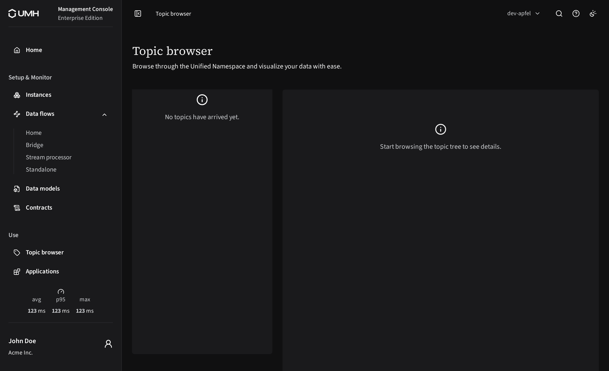

# Topic does not appear in the Topic Browser

The Topic Browser can show an empty tree, `No topics have arrived yet.`, while the instance is connected and producing data. A single topic can also stay missing while its bridge keeps sending it. The last step on this page needs access to the Docker host of the instance.

An empty tree does not mean your data stopped. The Topic Browser is a view the instance builds from the messages it receives (see [Topic Browser](topic-browser.md)); the messages themselves can keep flowing through your bridges and stream processors into [Redpanda](redpanda.md). [Check whether the data is still flowing](#check-whether-the-data-is-still-flowing) explains how to check. If the tree is empty on an instance whose `internal.topicbrowser.desiredState` is `stopped`, that is expected: see [Configuration](topic-browser.md#configuration).



## What to try first

Three checks, in order of how little they disturb:

1. Wait a minute. A new topic can take a moment to show.
2. Reload the page in your browser.
3. Open the [Topic Browser card](topic-browser.md#the-topic-browser-card) on the instance's detail page. If its badge does not read **Active**, the information icon beside the badge gives the reason.

## When the instance is offline

If the instance that reports the topic has gone offline, the browser says so above the value and keeps showing what arrived before it went. The age beside the value says how long ago that was.


## Check whether the data is still flowing

If the topic shows in the tree, select it and read the **Bridge** or **Stream** row to find out what produces it. If it does not show, find the bridge or stream processor that should produce it under **Data Flows**.

- For a bridge, open it and select **Metrics**, as [Bridges](../data-flows/bridges.md) describes.
- For a stream processor, open it and select **Metrics** on its Monitoring card, as [Stream Processors](../data-flows/stream-processor.md#metrics) describes.

While data flows, the counts of messages received and sent keep rising.

If the bridge or stream processor shows errors, or its count of messages sent stands still, the topic is missing upstream of the Topic Browser. See [Bridges Do Not Start](../data-flows/bridges-do-not-start.md) for a bridge that never starts, the [Bridges](../data-flows/bridges.md) page for one that starts and sends nothing, and [Stream Processors](../data-flows/stream-processor.md) for a stream processor. To follow a single message from its device tag to its topic, see [Metadata and Tracing](metadata-and-tracing.md).

The [Redpanda](redpanda.md) card on the instance's detail page shows the state of the broker the messages go to. If it does not read **Active**, see [When Redpanda is degraded](redpanda.md#when-redpanda-is-degraded).

## Restart the container


Restarting the container stops umh-core and every data flow in it. Nothing is read from your devices until it is back up, which takes about a minute. Plan it for a maintenance window.


If the data is flowing and the topic is still missing, restart the container of the instance. On the Docker host, run:

```bash
docker restart umh-core
```

Replace `umh-core` with the name of your container if you named it differently.

After the restart, a topic shows again only when a message for it arrives that the Topic Browser has not read yet. A topic that publishes rarely can stay absent until it next publishes.

## Getting help

If none of the steps above helps, tell us on [Discord](https://discord.gg/F9mqkZnm8U) or through your usual UMH contact: the instance, the time, and whether a reload or a restart brought the topic back.
