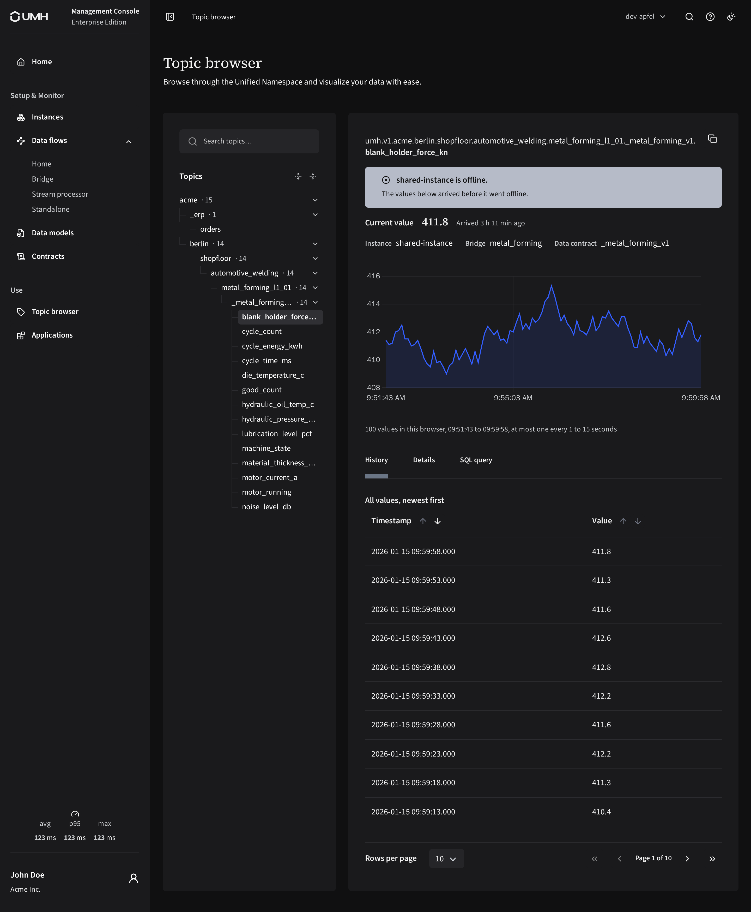

# Topic does not appear in the Topic Browser

The Topic Browser can show `No topics have arrived yet.`, or miss a single topic, while your bridges and stream processors publish data. The checks below follow the path a topic takes to the tree, as [How topics reach the Topic Browser](topic-browser.md#how-topics-reach-the-topic-browser) describes. Each check says what the result means and what to do, so work through them in order.


## Check the Topic Browser of the instance

Open the [Topic Browser card](topic-browser.md#the-topic-browser-card) on the detail page of the instance that should report the topic. Read the reason in the information icon beside its badge as well: the badge can read **Active** while one of the reasons below applies.

- **The reason starts with `starting`.** The Topic Browser is still starting, for example after a restart. Wait until the reason no longer starts with `starting`, then check again.
- **The reason is `redpanda degraded`.** The Topic Browser cannot read messages because Redpanda is degraded. See [When Redpanda is degraded](redpanda.md#when-redpanda-is-degraded). The Topic Browser recovers on its own once Redpanda does.
- **The reason is `benthos degraded`.** The process that reads the messages for the Topic Browser fails. Its log is `/data/logs/benthos-topicbrowser-topic-browser/current` inside the container. Reading it requires access to the instance’s Docker host; [Container layout](../../reference/container-layout.md) explains where the logs are and how to read them. If the log does not show a cause you can fix, continue with [Restart the container](#restart-the-container).
- **Otherwise** the Topic Browser runs. Continue with [Check what publishes the topic](#check-what-publishes-the-topic).

### When the Topic Browser is turned off

If `internal.topicbrowser.desiredState` is `stopped` in the `config.yaml` of the instance, the Topic Browser collects no topics on that instance and the tree stops updating. An empty tree or a missing topic is then expected. To turn it on, set the key to `active`, as [Configuration](topic-browser.md#configuration) describes. The change takes effect without a restart.

## Check what publishes the topic

If the topic shows in the tree, select it and read the **Bridge** or **Stream** row to find out what produces it. If it does not show, find the bridge or stream processor that should produce it under **Data Flows**.

- For a bridge, open it and select **Metrics**, as [Bridges](../data-flows/bridges.md) describes.
- For a stream processor, open it and select **Metrics** on its Monitoring card, as [Stream Processors](../data-flows/stream-processor.md#metrics) describes.

While data flows, the counts of messages received and sent keep rising.

If the count of messages sent stands still, the topic is missing before it reaches the Topic Browser. See [Bridges Do Not Start](../data-flows/bridges-do-not-start.md) for a bridge that never starts, the [Bridges](../data-flows/bridges.md) page for one that starts and sends nothing, and [Stream Processors](../data-flows/stream-processor.md) for a stream processor.

If the count keeps rising but errors show, they may concern other topics: one bridge or stream processor can send many. Open its **Logs** and check whether the errors concern the data behind your topic. If they do, fix what they report and check the counts again.

To follow a single message from its device tag to its topic, see [Metadata and Tracing](metadata-and-tracing.md).

If the count of messages sent keeps rising, select **Metrics** on the Topic Browser card. If its counts stand still too, the messages are published but the Topic Browser does not read them. Continue with [Restart the container](#restart-the-container).

## Check what the tree shows

If the topic is published and the Topic Browser reads it, the cause is in what the tree shows.

- **The instance is not in the header filter.** The tree shows only the instances selected in the header filter of the Management Console. Select the instance there.
- **The search box holds text.** The search narrows the tree to matching topics. Clear it.
- **The topic sits deeper than you expect.** The tree follows the [topic convention](topic-convention.md): location path, data contract, then any virtual path folders, then the tag. Search for the tag name to find it.
- **The topic has just published for the first time.** The instance sends an update every one to fifteen seconds while messages arrive. Check again after that time.
- **umh-core has just restarted.** Topics show again as new messages for them arrive, as [Restart the container](#restart-the-container) describes.

If none of these applies, the checks have ruled out the Topic Browser of the instance, what publishes the topic, and the view. No further step on the instance is known to bring the topic back. Collect the evidence that [Getting help](#getting-help) lists and contact us.

### When the instance is offline

If the instance that reports the topic has gone offline, the browser says so above the value and keeps showing what arrived before it went. The age beside the value says how long ago that was. New topics from that instance show once it is back online.



## Restart the container

This step requires access to the instance’s Docker host.

Restart the container only when the checks above point to the Topic Browser of the instance: the reason on its card is `benthos degraded` and the log shows no cause you can fix, or messages are published but the Topic Browser does not read them. The restart starts the Topic Browser afresh.


Restarting the container stops umh-core and every data flow in it. Nothing is read from your devices until it is back up, which takes about a minute. Plan it for a maintenance window.


The logs in `/data/logs` inside the container stay after the restart, so you can send them to us later. On the Docker host, run:

```bash
docker restart umh-core
```

Replace `umh-core` with the name of your container if you named it differently.

After the restart, wait until the reason on the Topic Browser card no longer starts with `starting`. Its **Topics** count starts from zero. Topics that send data infrequently may take longer to reappear in the Topic Browser after a UMH Core restart.

## Getting help

If the checks above do not bring the topic back, or it is still missing after a restart and after it has published again, tell us on [Discord](https://discord.gg/F9mqkZnm8U) or through your usual UMH contact. Include:

- the instance, the topic and the time you last expected it,
- which of the checks above you ran and what each showed, including the badge and the information icon of the Topic Browser card,
- the logs in `/data/logs/umh-core/` and `/data/logs/benthos-topicbrowser-topic-browser/` inside the container, which you can read from the Docker host.
